# CoopKitAI: editor tools

Step-by-step pictures of the editor tools of CoopKitAI. You do everything with the mouse; the only typing is a name for a new asset. Your editor may look slightly different from the pictures.

The pictures are in `Docs/Images`.

## Show the plugin's content

The plugin's own assets (examples, demo maps) live in the plugin folder. To see them in the Content Browser, click **Settings** in the Content Browser and turn on **Show Plugin Content**.

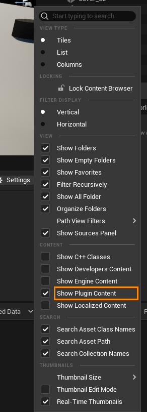

## Create an AI threat profile

1. In the Content Browser, open the folder for the new asset.
2. Click **Add**, point to **CoopKit**, then click **AI Threat Profile**.
3. Enter a name for the asset. The New Threat Profile wizard opens (see below).

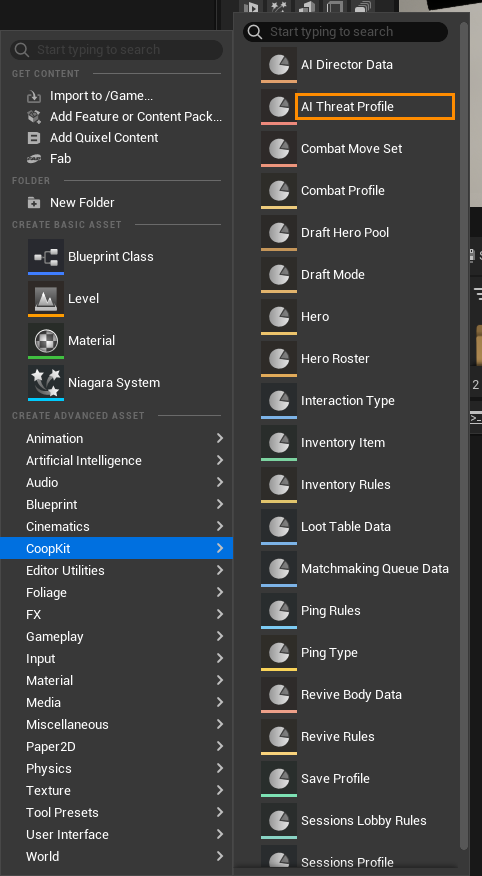

Director rules, pacing profiles and wave sets are created the same way: **Add > CoopKit > AI Director Data**, **AI Pacing Profile** or **AI Wave Set** opens the New Director Rules, New Pacing Profile or New Wave Set wizard.

## Open the CoopKit Hub

The hub shows the entities of every CoopKit plugin in your project in one window. CoopKitAI adds the categories **Threat Profile**, **Director Rules**, **Pacing Profile** and **Wave Set**.

1. On the main menu, click **Tools**, then click **CoopKit Hub**.

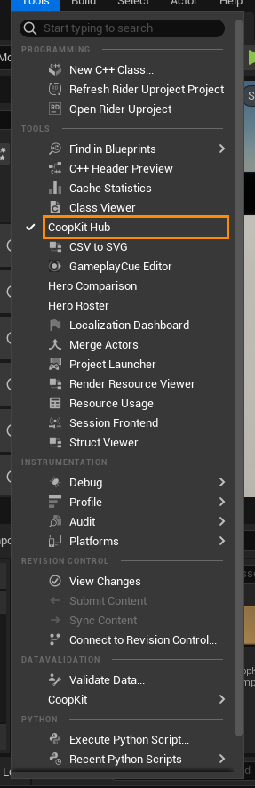

2. The hub opens on the categories. Each entity type has a button that shows the number of its entities and the name of the plugin that adds it.

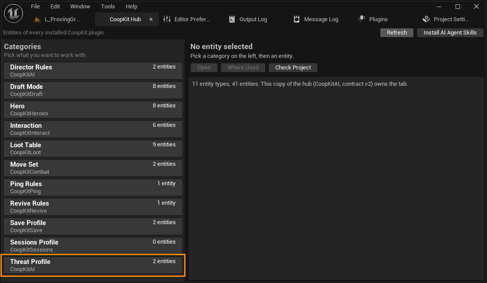

## Find a threat profile

1. Click the category **Threat Profile**. The left side now lists only this category. It also has a search box, the name box and **New Threat Profile**. Click **< Back** to return to the categories.

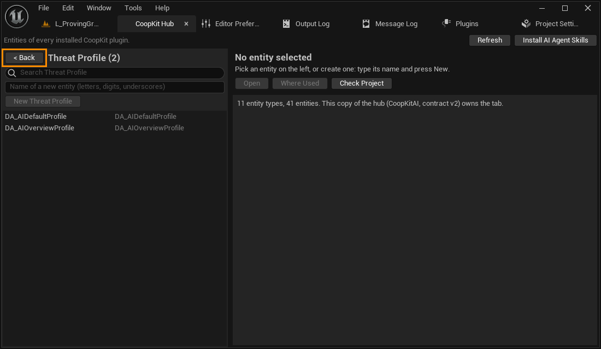

2. Click a threat profile in the list. A threat profile has no separate display name, so the list shows the asset's name. The right side shows its name, type and asset path. **Open** opens its card in a separate window (a double click in the list does the same).

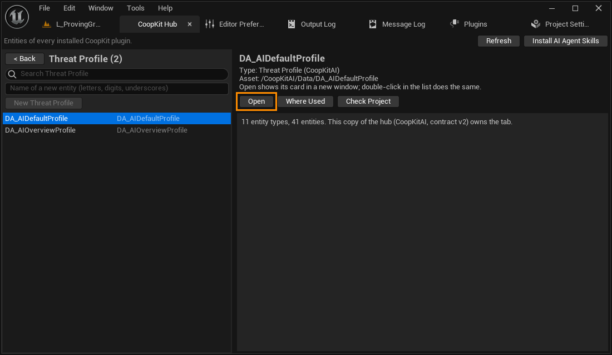

3. **Where Used** shows the assets that use the selected profile. Enemies without their own profile use the default from *Project Settings > Plugins > CoopKit AI*. That default is not an asset, so Where Used shows 0 assets for it.

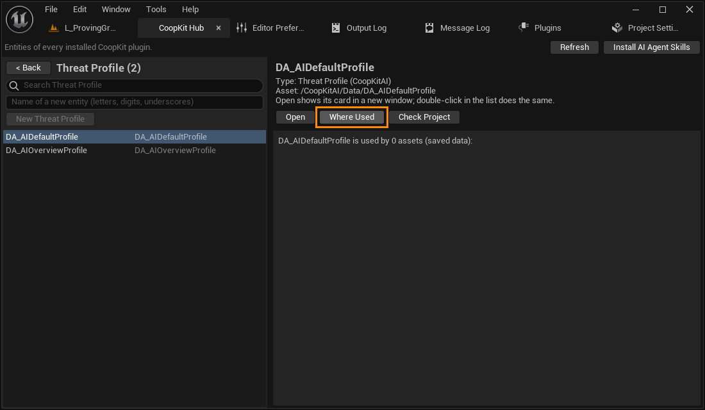

4. **Check Project** checks every entity of every type: data errors and duplicate ids. The result appears in the text box below the buttons.

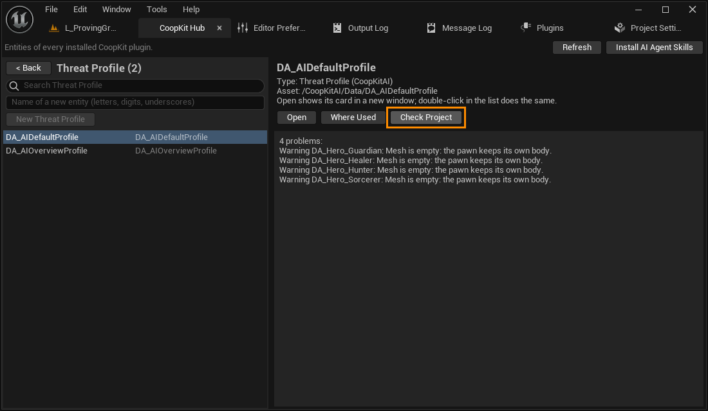

The category **Director Rules** works the same way.

## Make a new threat profile with the wizard

1. In the **Threat Profile** category, click the name box and enter a name (letters, digits, underscores). The button **New Threat Profile** turns on.

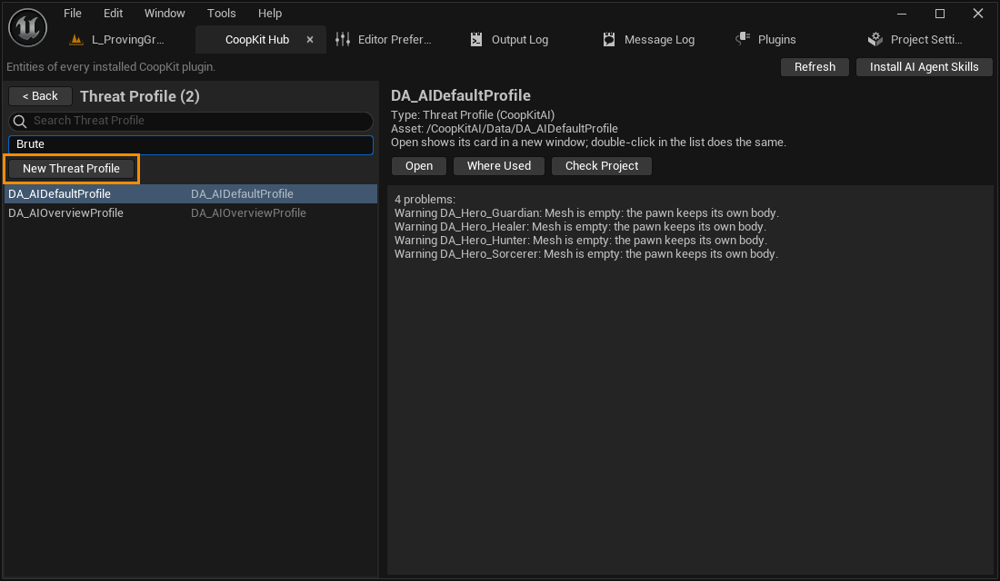

2. Click **New Threat Profile**. The wizard opens. In **Start From**, pick a profile to copy its values from, or leave it empty for the plugin's defaults. Click **Create**.

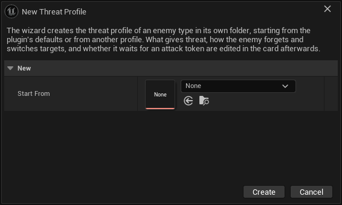

3. The new profile appears in the hub's list and is selected, and its card opens. The text box below the buttons says "Created" and shows the asset path. The new asset is not saved yet: click **Save All** to keep it.

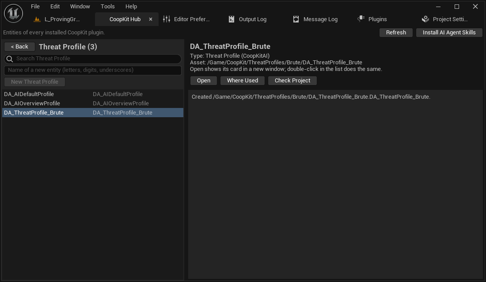

**New Director Rules**, **New Pacing Profile** and **New Wave Set** in their categories work the same way.

## Make waves with a pacing profile

1. In the **Wave Set** category, enter a name and click **New Wave Set**, then **Create**. The new set has one wave of the plugin's demo enemy.
2. In the wave set's card, open the **Parts** tab. Next to **Pacing**, click **Create**. A new pacing profile appears in the wave set's folder, and the wave set uses it.
3. In **Properties**, open **Waves**: set each wave's **Budget**, its enemies (**Enemy Class**, **Cost**, **Count**, **Fill Weight**) and its **Spawn Group**. The **Summary** tab shows which enemies come at one and at four players.
4. Open the pacing profile's card from the **Parts** tab to change what makes the players tense and how long the peak and the break last. **Validation** tells you about values that cannot work.
5. Drag **CK AI Spawn Point** actors from the *Place Actors* panel into your level and type the wave's **Spawn Group** in their **Group** field. Add **CKAI Horde Component** to your game state and pick the wave set as its **Wave Data**.

## The threat profile card

The card shows everything about one threat profile. Open it from the hub (**Open**) or double-click the asset in the Content Browser. Director rules have the same card.

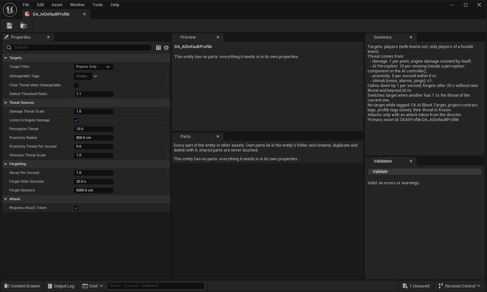

- **Properties**: the data of the profile.

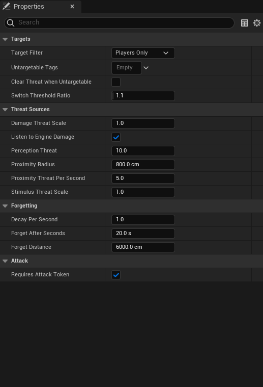

- **Preview**: the name of the profile. A threat profile has no picture to show.

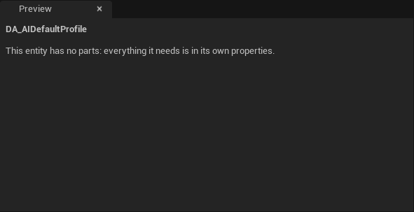

- **Parts**: the other assets the profile uses. A threat profile uses none, so the list is empty.

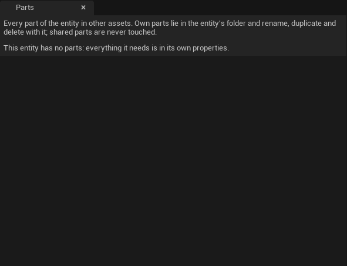

- **Summary**: what gives threat and how fast, how the enemy forgets and switches targets.

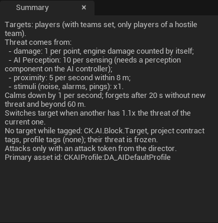

- **Validation**: problems of the data, refreshed on every change. **Validate** checks again.

When a value does not work, Validation shows the problem in red right away, for example **Switch Threshold Ratio** below 1.

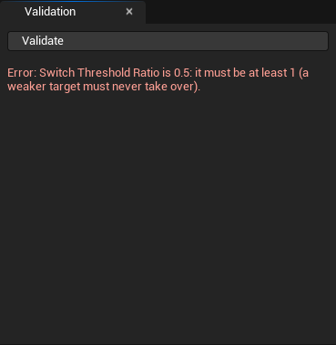

## Install the AI agent skills

The skills let an AI coding agent extend the plugin with you (see *AI agent skills* in the README).

1. On the main menu, click **Tools**, point to **CoopKit**, then click **Install AI Agent Skills**. The CoopKit Hub has the same button.

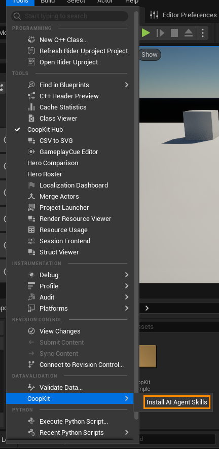

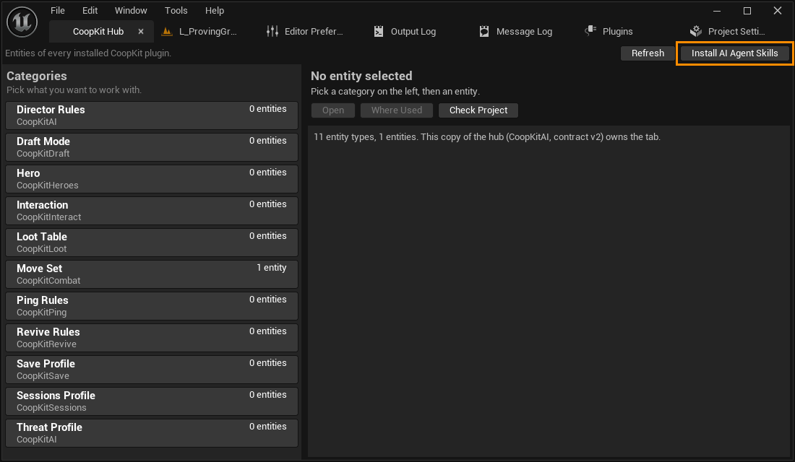

2. A message lists the skill folders that were copied into your project. Click **OK**. If some folders could not be copied, the message shows a warning icon and lists them.

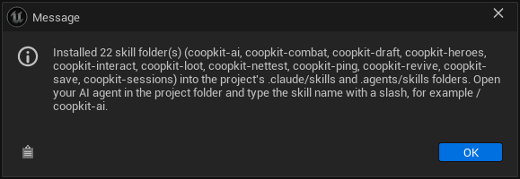

3. If the skills are already in the project, the plugin asks first. **Yes** replaces them and removes any change you made to their files; **No** keeps them.

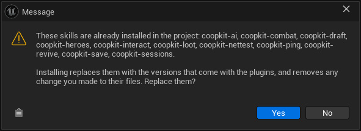

## Play the demo with the mouse

1. Show the plugin's content (see above), double-click `/CoopKitAI/Maps/L_AIDemo`, then click **Play** in the toolbar.

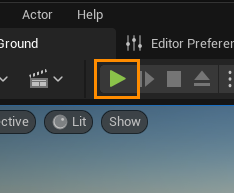

2. The panel in the top left corner lists every enemy and who it attacks, for example *Enemy 1: attacks Player 2*. Click **Play with 2 windows** to have a second player. Play restarts with two windows. Your Play settings stay as they were.

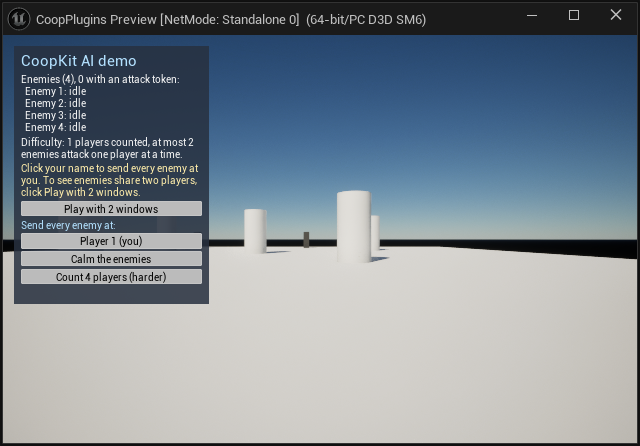

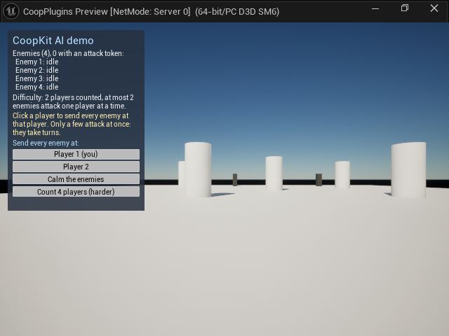

3. In window 1, click **Player 2** under *Send every enemy at*. Every enemy goes for Player 2, but only a few attack at once. Window 2 shows which enemies attack you.

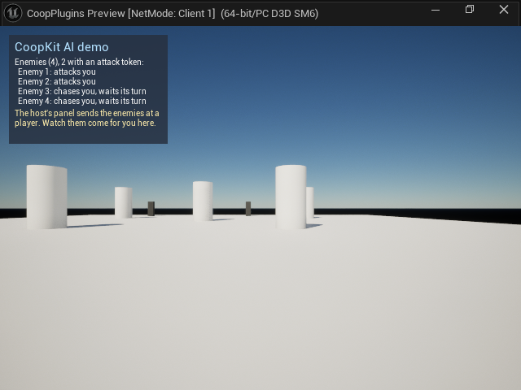

4. In window 1, click **Count 4 players (harder)**. More enemies attack at once. Click **Count the real players** to go back. **Calm the enemies** stops the attack.
5. Click **Start the waves**. Enemies come in waves, away from the places the players look at. Both windows show the wave and the pacing: build up, peak, a break. **Send a horde now** adds a horde, **Stop the waves** removes the horde's enemies.

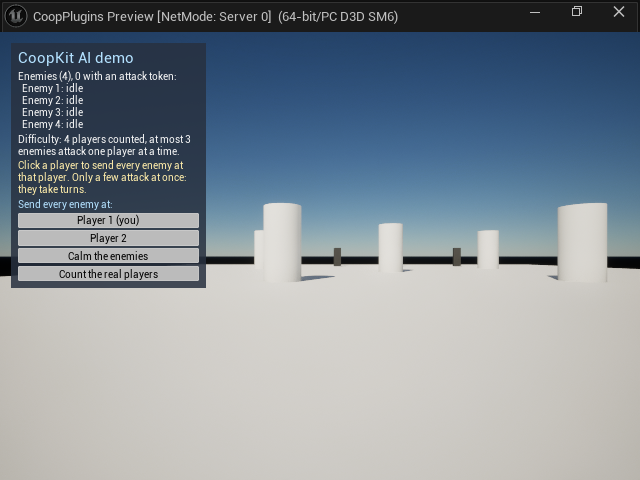
