# CoopKitCombat: editor tools

Step-by-step pictures of the editor tools of CoopKitCombat. You do everything with the mouse; the only typing is a name for a new asset. Your editor may look slightly different from the pictures.

The pictures are in `Docs/Images`.

## Show the plugin's content

The plugin's own assets (examples, demo maps) live in the plugin folder. To see them in the Content Browser, click **Settings** in the Content Browser and turn on **Show Plugin Content**.

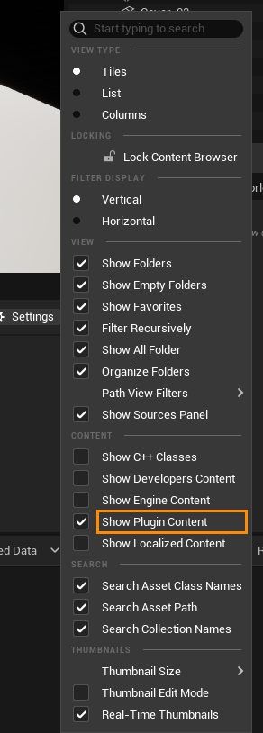

## Create a move set

1. In the Content Browser, open the folder for the new asset.
2. Click **Add**, point to **CoopKit**, then click **Combat Move Set**.
3. Enter a name for the asset.

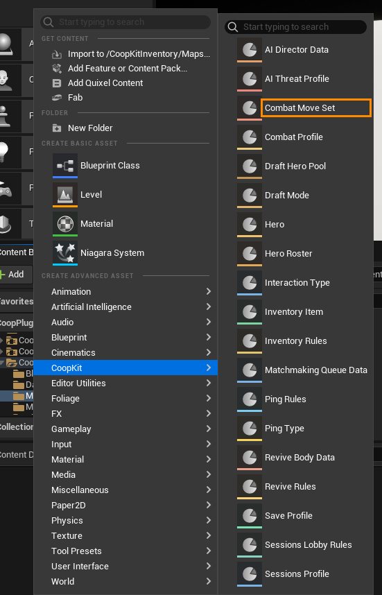

## Open the CoopKit Hub

The hub shows the entities of every CoopKit plugin in your project in one window. CoopKitCombat adds the category **Move Set**.

1. On the main menu, click **Tools**, then click **CoopKit Hub**.

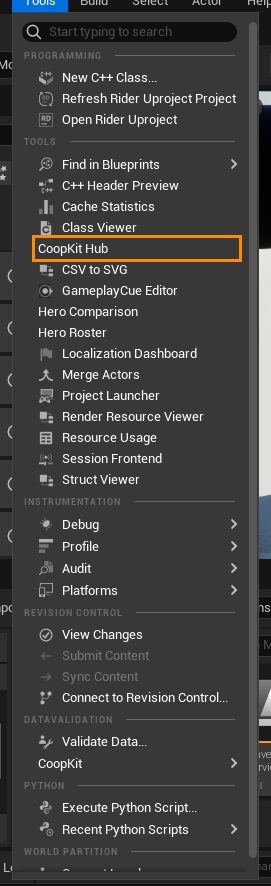

2. The hub opens on the categories. Each entity type has a button that shows the number of its entities and the name of the plugin that adds it.

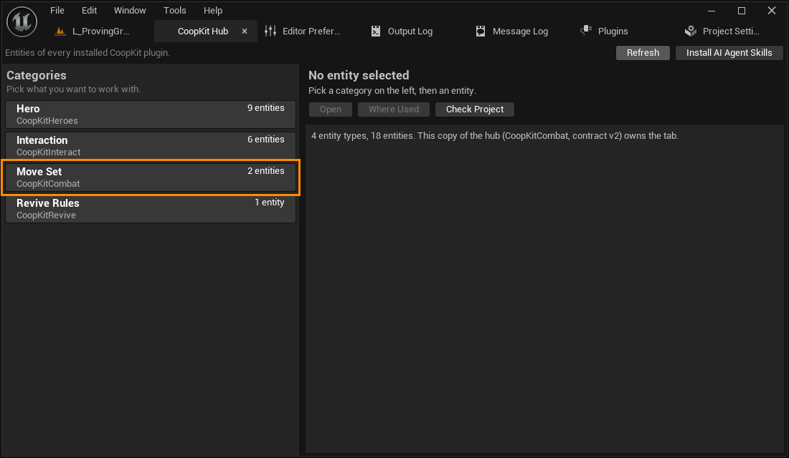

## Find a move set

1. Click the category **Move Set**. The left side now lists only this category. It also has a search box, the name box and **New Move Set**. Click **< Back** to return to the categories.

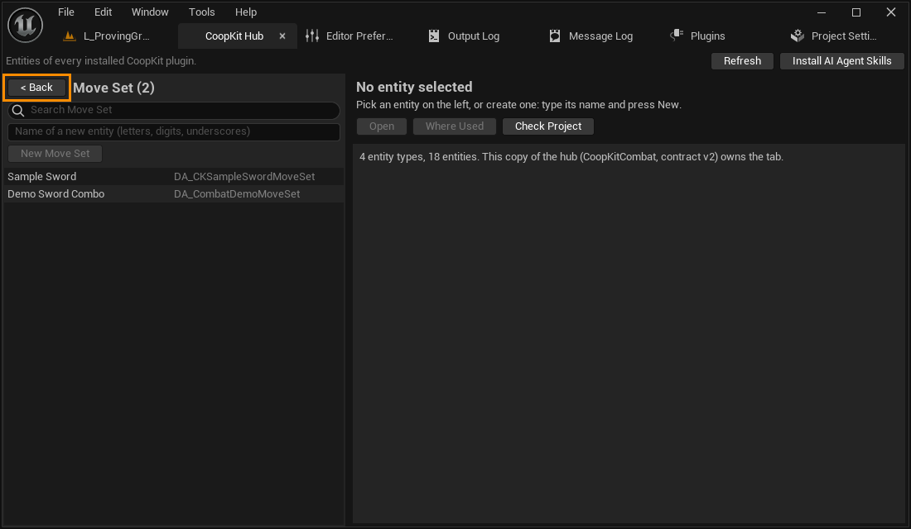

2. Click a move set in the list. The right side shows its name, type and asset path. **Open** opens its card in a separate window (a double click in the list does the same).

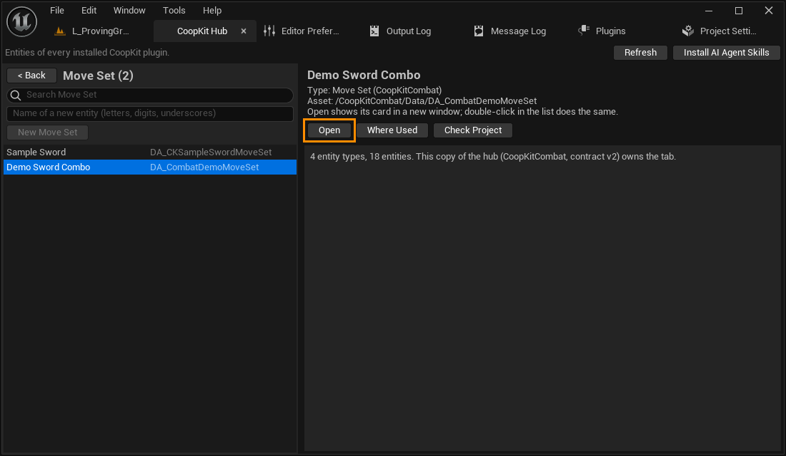

3. **Where Used** shows the assets that use the selected move set.

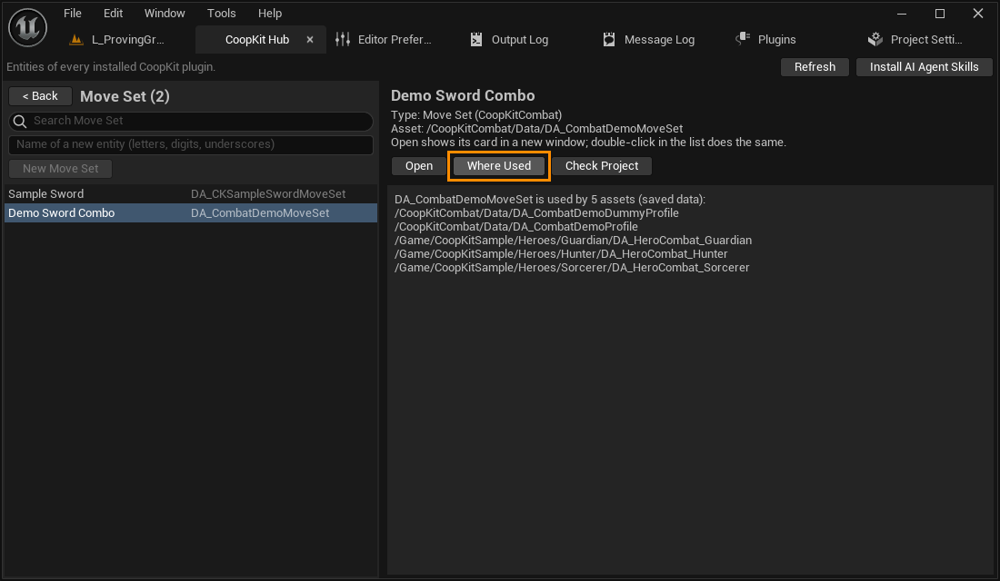

4. **Check Project** checks every entity of every type: data errors and duplicate ids. The result appears in the text box below the buttons.

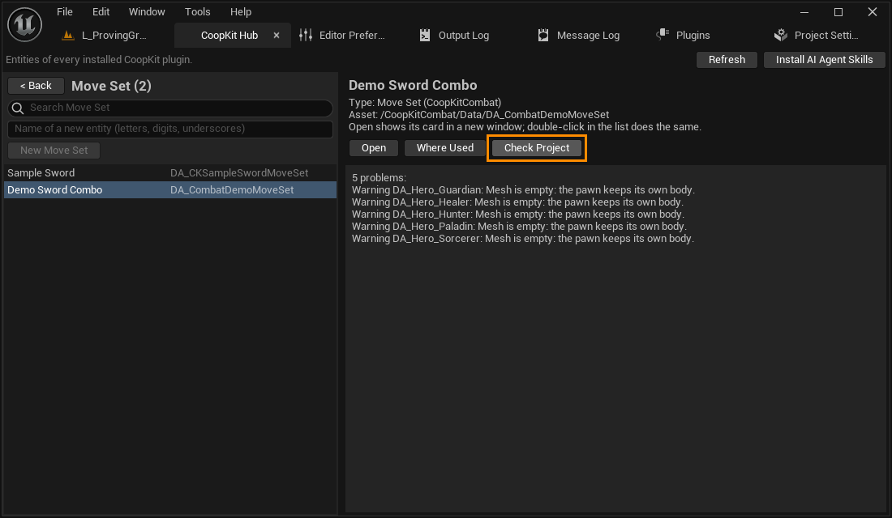

## Make a new move set with the wizard

1. In the **Move Set** category, click the name box and enter a name (letters, digits, underscores). The button **New Move Set** turns on.

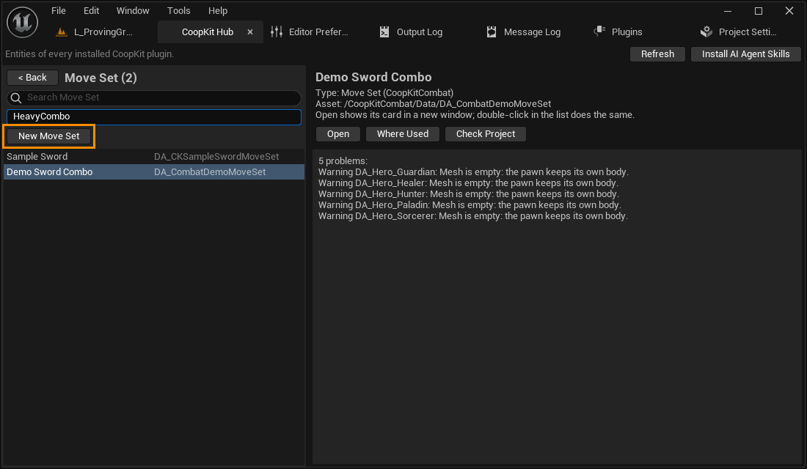

2. Click **New Move Set**. The wizard opens. Pick a display name, a move set to start from and one animation per attack; the wizard makes an own montage for each animation. Click **Create**.

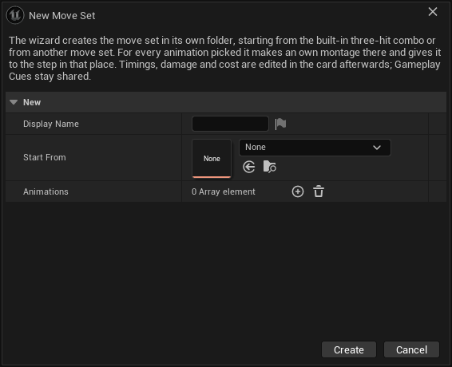

3. The card of the new move set opens. The new move set appears in the hub's list and is selected. The text box below the buttons says "Created" and shows the full asset path. The new assets are not saved yet: click **Save All** in the Content Browser to keep them.

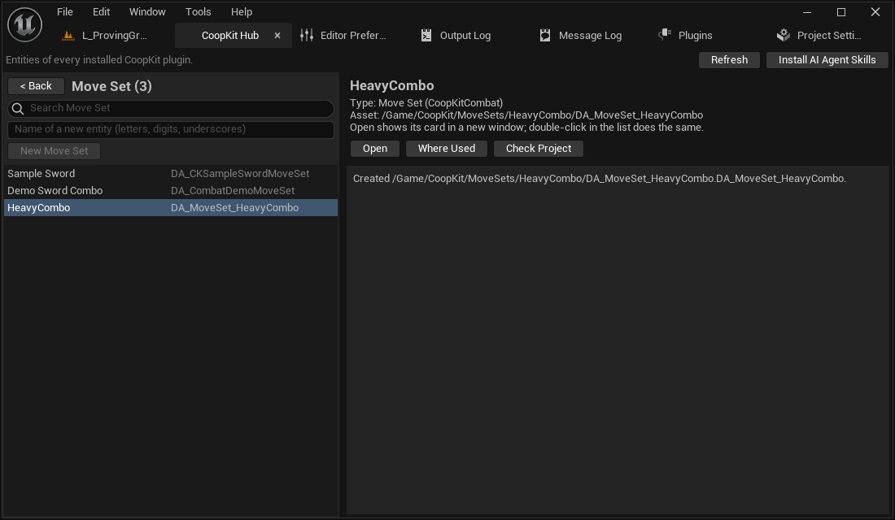

## The move set card

The card shows everything about one move set. Open it from the hub (**Open**) or double-click the asset in the Content Browser.

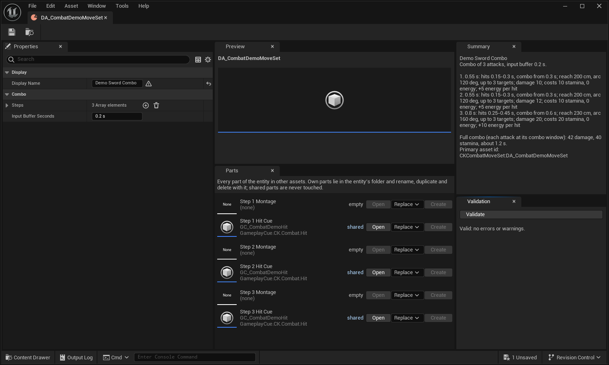

- **Properties**: the data of the move set.

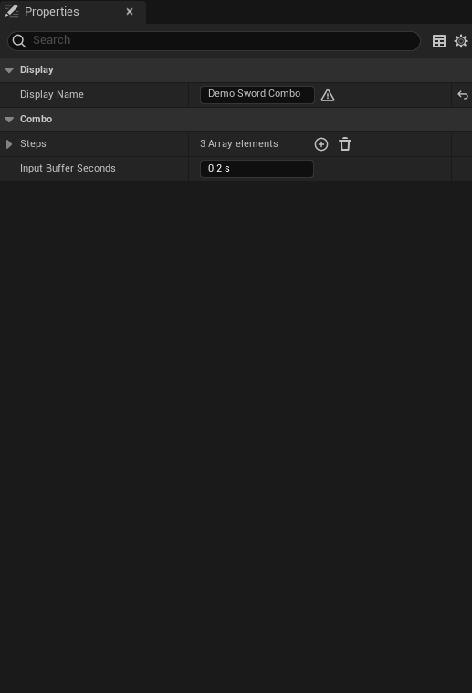

- **Preview**: a picture of the first part that is set.

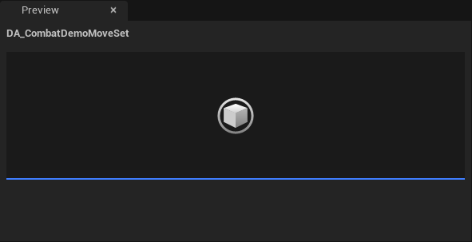

- **Parts**: every asset the move set uses. **own** parts lie in the move set's folder and are renamed, duplicated and deleted with it; **shared** parts are used by other assets too and are never touched. **Open** opens a part in its editor, **Create** makes a new own part.

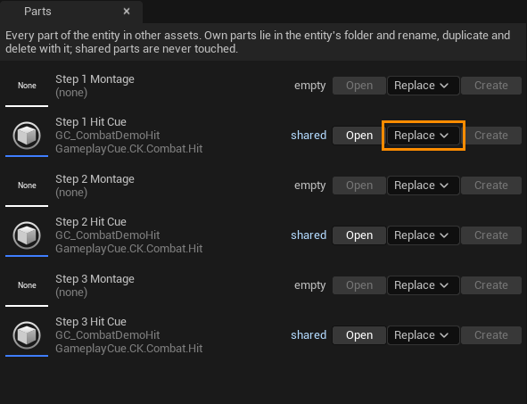

- To use another asset for a part, click **Replace** and click the asset in the list.

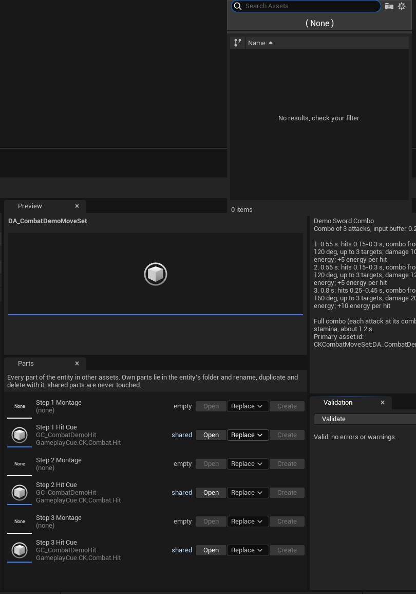

- **Summary**: what the data means in practice.

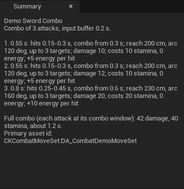

- **Validation**: problems of the data, refreshed on every change. **Validate** checks again.

When a value does not work, Validation shows the problem in red right away, for example a move set without attacks.

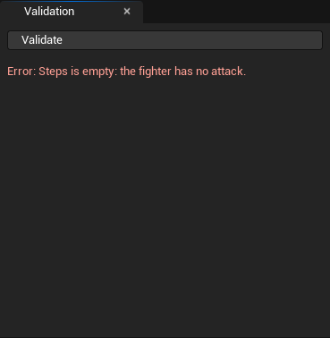

## Install the AI agent skills

The skills let an AI coding agent extend the plugin with you (see *AI agent skills* in the README).

1. On the main menu, click **Tools**, point to **CoopKit**, then click **Install AI Agent Skills**. The CoopKit Hub has the same button.

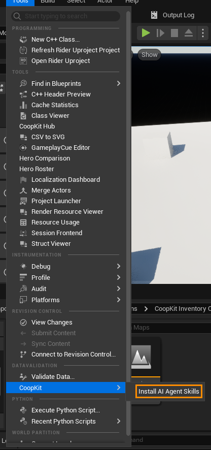

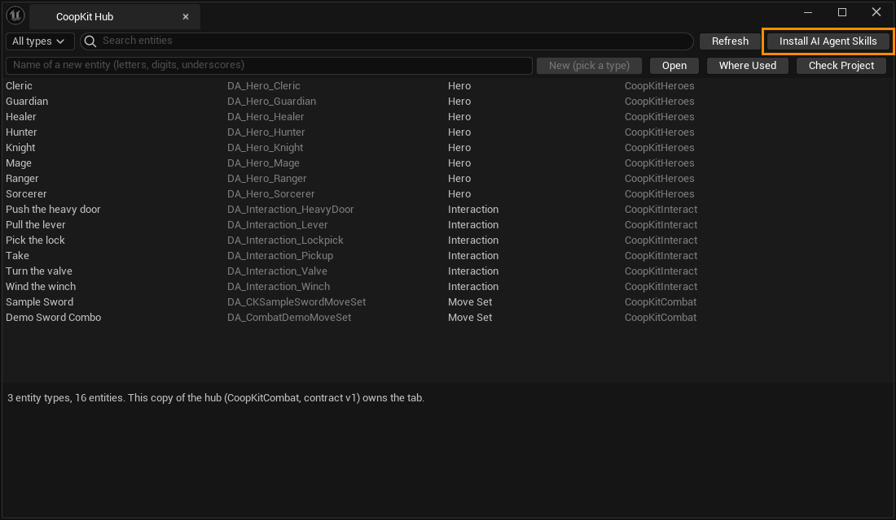

2. A message lists the skill folders that were copied into your project. Click **OK**. If some folders could not be copied, the message shows a warning icon and lists them.

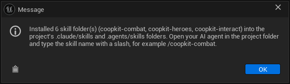

3. If the skills are already in the project, the plugin asks first. **Yes** replaces them and removes any change you made to their files; **No** keeps them.

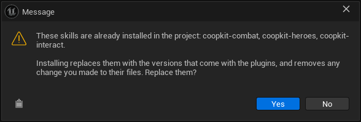

## Play the demo with the mouse

1. Show the plugin's content (see above), double-click `/CoopKitCombat/Maps/L_CombatDemo`, then click **Play** in the toolbar.

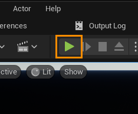

2. The panel in the top left corner shows your health, stamina and action, and the health of the four training dummies. To fight next to a second player, click **Play with 2 windows**: Play restarts with two windows. Your Play settings stay as they were.

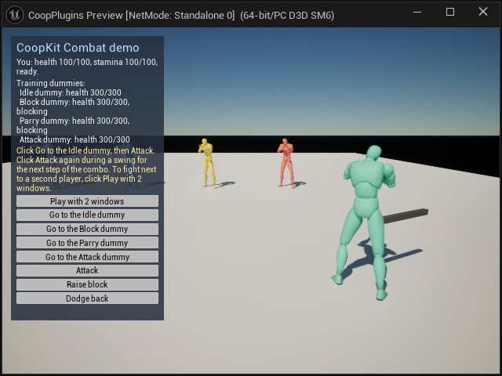

3. Click **Go to the Idle dummy**, then **Attack**. The dummy loses health, in every window.

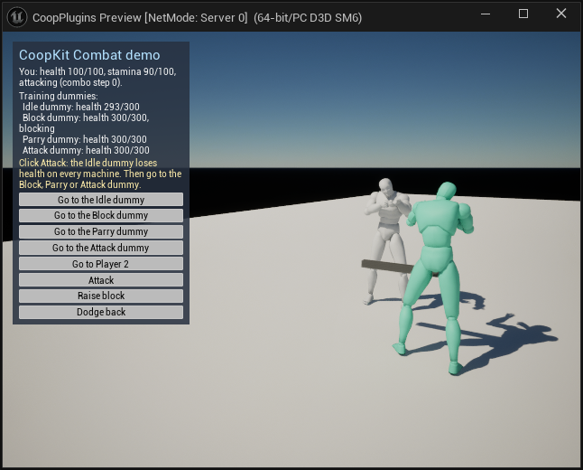

4. Click **Go to the Block dummy**, then **Attack**. The dummy blocks the hit and keeps its health.

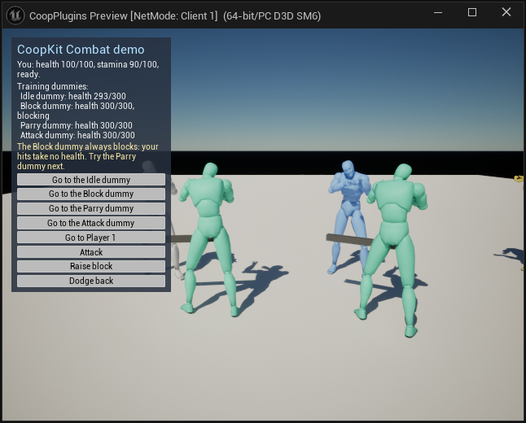

5. Click **Raise block** to block, **Lower block** to stop, and **Dodge back** to dodge.

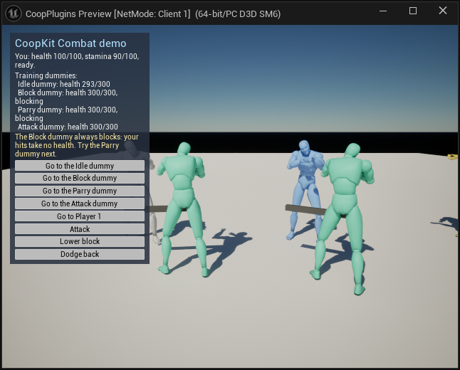
