# CoopKitCraft: editor tools

Step-by-step pictures of the editor tools of CoopKitCraft. You do everything with the mouse. You type only a name for a new asset and, in the Recipe Table, the values you edit in your own spreadsheet. Your editor may look slightly different from the pictures.

The pictures are in `Docs/Images`.

## Show the plugin's content

The plugin's own assets (examples, demo maps) live in the plugin folder. To see them in the Content Browser, click **Settings** in the Content Browser and turn on **Show Plugin Content**.

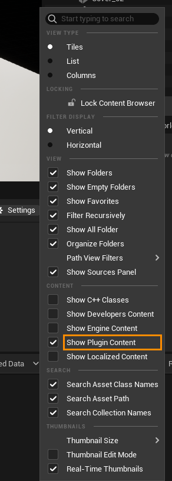

## Create a recipe

1. In the Content Browser, open the folder for the new asset.
2. Click **Add**, point to **CoopKit**, then click **Recipe**. Stations and buildings are in the same menu.
3. Enter a name for the asset. The New Recipe wizard opens (see below).

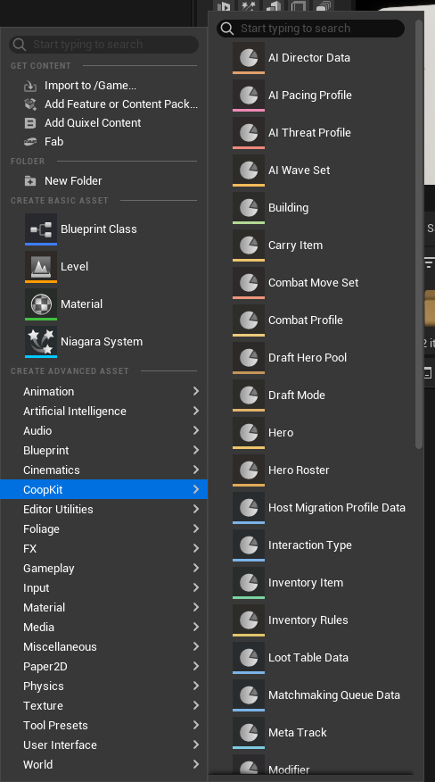

## Open the CoopKit Hub

The hub shows the entities of every CoopKit plugin in your project in one window. CoopKitCraft adds the categories **Recipe**, **Station** and **Building**.

1. On the main menu, click **Tools**, then click **CoopKit Hub**.

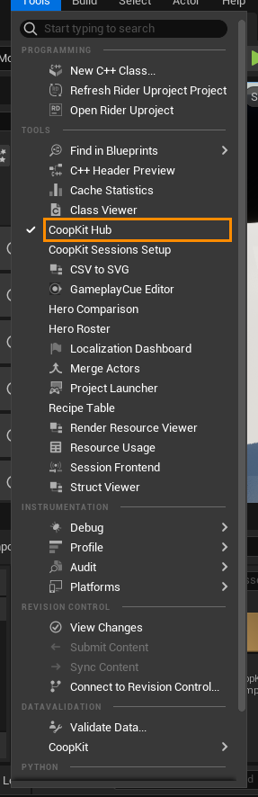

2. The hub opens on the categories. Each entity type has a button that shows the number of its entities and the name of the plugin that adds it.

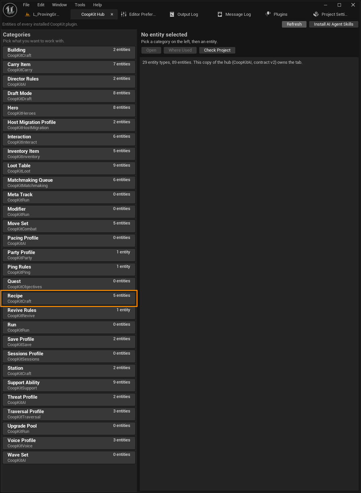

## Find a recipe

1. Click the category **Recipe**. The left side now lists only this category. It also has a search box, the name box and **New Recipe**. Click **< Back** to return to the categories.

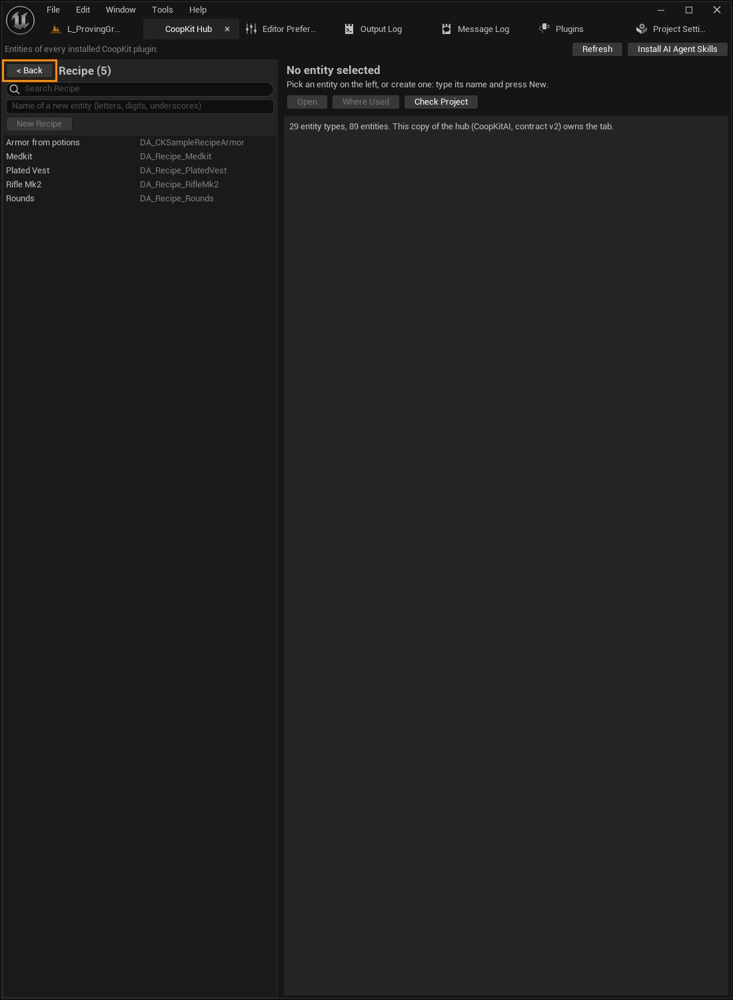

2. Click a recipe in the list. The right side shows its name, type, asset path and id. **Open** opens its card in a separate window (a double click in the list does the same).

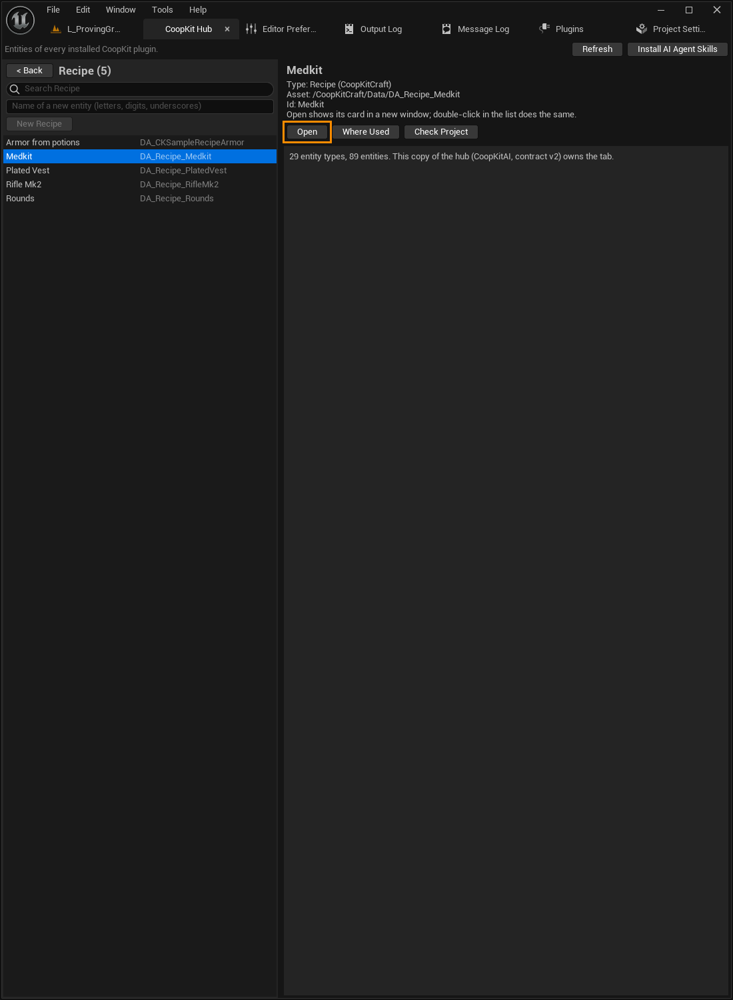

3. **Where Used** shows the assets that use the selected recipe, for example the station that offers it.

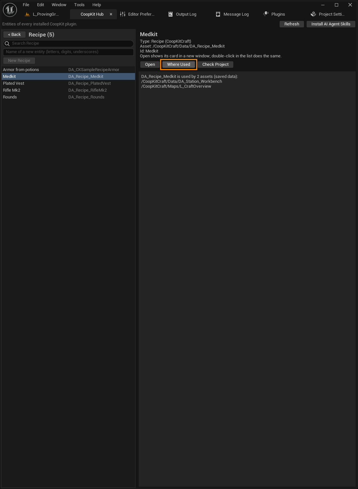

4. **Check Project** checks every entity of every type: data errors and duplicate ids. The result appears in the text box below the buttons.

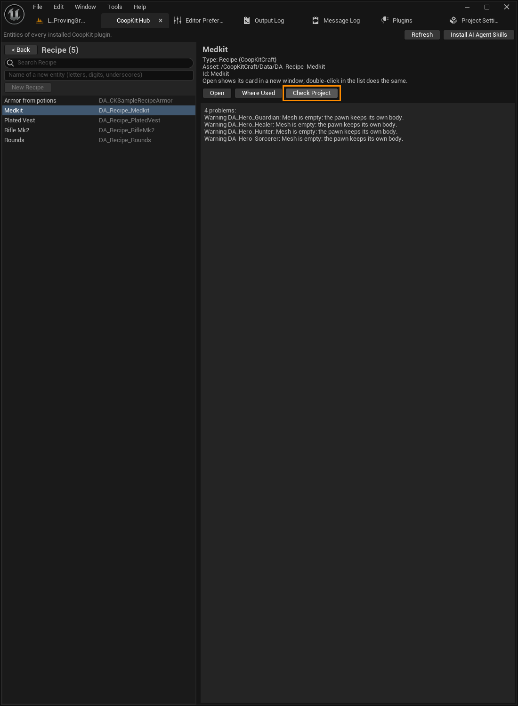

## Make a new recipe with the wizard

1. In the **Recipe** category, click the name box and enter a name (letters, digits, underscores). The button **New Recipe** turns on.

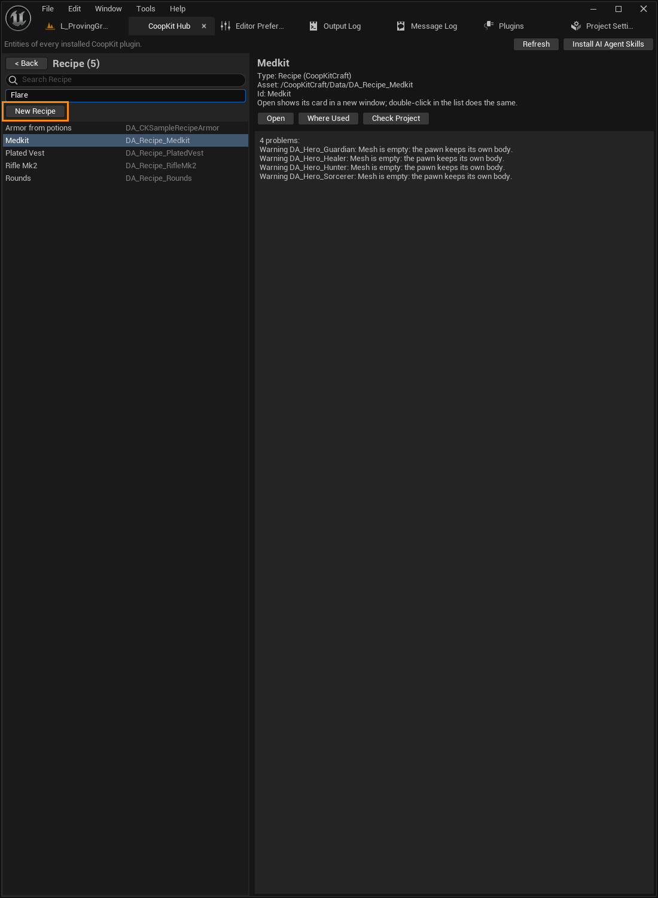

2. Click **New Recipe**. The wizard opens. Set the display name, the items that go in and come out, the craft time and the icon, and tick whether the recipe gets its own progress curve. Click **Create**.

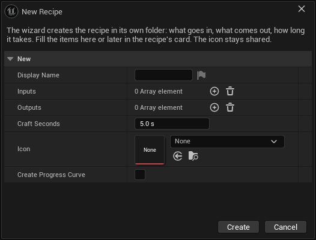

3. The new recipe appears in the hub's list and is selected, and its card opens. The text box below the buttons says "Created" and shows the asset path. The new asset is not saved yet: click **Save All** to keep it.

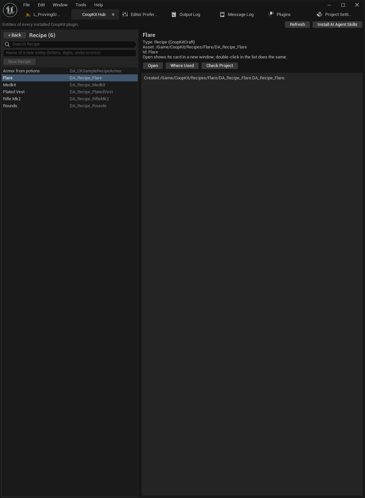

## The recipe card

The card shows everything about one recipe. Open it from the hub (**Open**) or double-click the asset in the Content Browser. Stations and buildings have the same card.

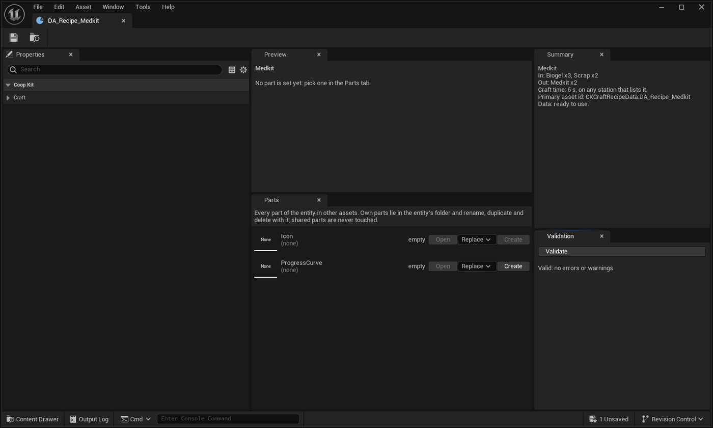

- **Properties**: the data of the recipe: id, name, inputs, outputs, craft time, station tags, icon and progress curve.

- **Preview**: the id of the recipe and the pictures of its parts. When no part is set, it says so.

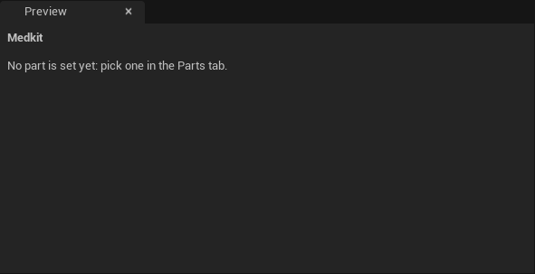

- **Parts**: the **Icon** and the **Progress Curve** of the recipe. An **own** part lies in the recipe's folder and is used by nothing else. A **shared** part is used by other assets too and is never moved or deleted. **Open** opens a part in its editor, **Replace** points the slot at another asset, and **Create** makes a new progress curve of the recipe's own.

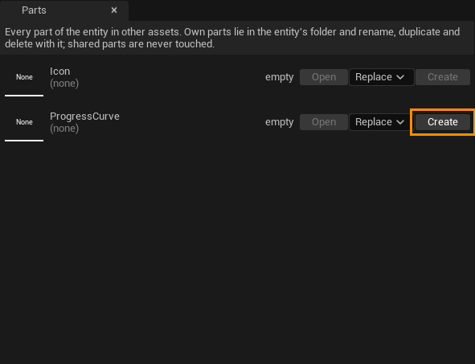

- **Summary**: what goes in and out, the craft time, the stations and the problems of the data.

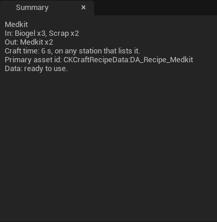

- **Validation**: problems of the data, refreshed on every change. **Validate** checks again.

When a value does not work, Validation shows the problem in red right away, for example **Craft Seconds** set to -1.

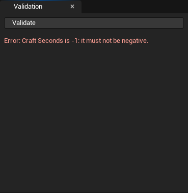

## Recipe Table: balance in a spreadsheet

**Tools > Recipe Table** lists every recipe of the project with its inputs, outputs, craft time and data check. Use it to balance many recipes at once in a spreadsheet.

1. Click **Export CSV** and pick a file. The window suggests the name `Recipes.csv` and writes one row per recipe.
2. Open the file in your spreadsheet. Change counts, times, names or tags. Leave the **Asset** column as it is. It names the recipe of each row. Write items as `ItemId:Count`, separated by `;`, for example `Scrap:6; Biogel:2`. Save the file as CSV.
3. Click **Import CSV** and pick the file. The text below the list says how many values of how many recipes changed. To take the whole import back, click **Edit > Undo** once. Click **Save All** to keep it.

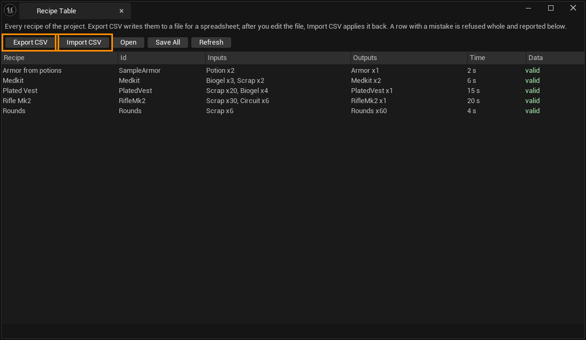

A row with a mistake is not applied at all, even its good cells. The text below the list names the row and the column, for example *Row 3, column Inputs: "Scrap" has no count; write ItemId:Count. The row is skipped.* The other rows are still applied. A row is refused for: a count that is not a whole number of at least 1, a time that is not a number or is negative, an unknown Gameplay Tag, a path that is not an object path, a recipe without inputs or outputs, an empty name or id, and an id that another recipe already has. A row whose Asset is not a recipe of the project, and a column the window does not know, are reported and skipped.

## Install the AI agent skills

The skills let an AI coding agent extend the plugin with you (see *AI agent skills* in the README).

1. On the main menu, click **Tools**, point to **CoopKit**, then click **Install AI Agent Skills**. The CoopKit Hub has the same button.

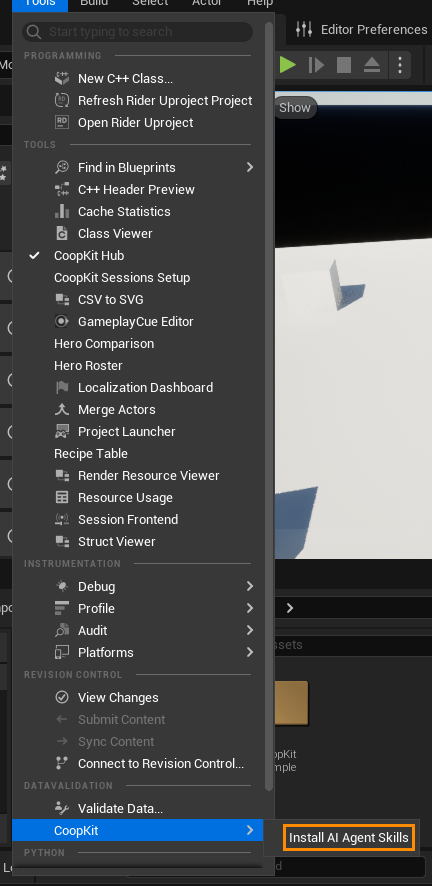

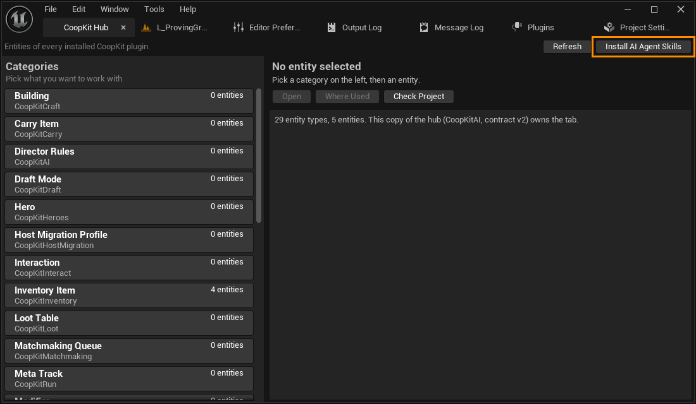

2. A message lists the skill folders that were copied into your project. Click **OK**. If some folders could not be copied, the message shows a warning icon and lists them.

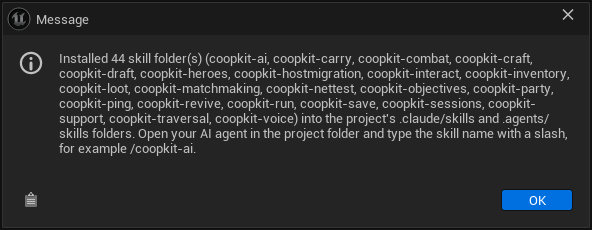

3. If the skills are already in the project, the plugin asks first. **Yes** replaces them and removes any change you made to their files; **No** keeps them.

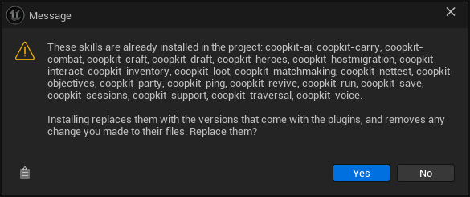

## Play the demo with the mouse

1. Show the plugin's content (see above), double-click `/CoopKitCraft/Maps/L_CraftDemo`, then click **Play** in the toolbar.

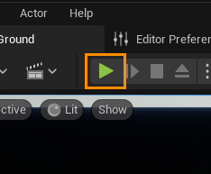

2. The panel in the top left corner shows your bag, the workbench's recipes and its queue, and tells you what to do next. Click **Take supplies** twice.

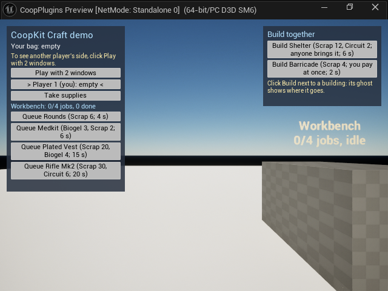

3. Click **Queue Medkit**, then **Contribute** on the job's row. The job has everything it needs and the workbench works on it.

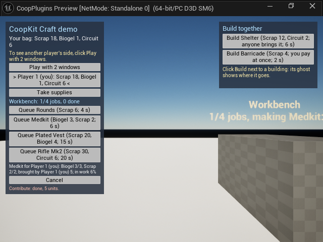

4. Click **Queue Rounds**, then **Cancel** on its row. The job leaves the queue and you get your items back.

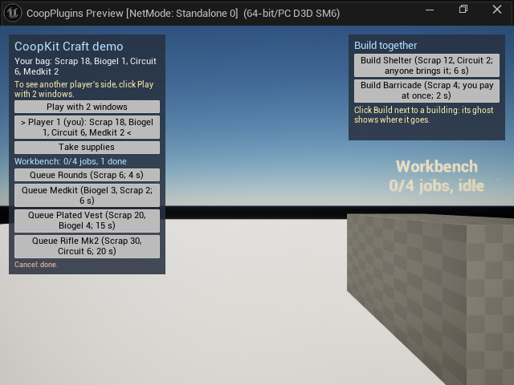

5. Click **Play with 2 windows**. Play restarts as a listen server with two windows. Your Play settings stay as they were.

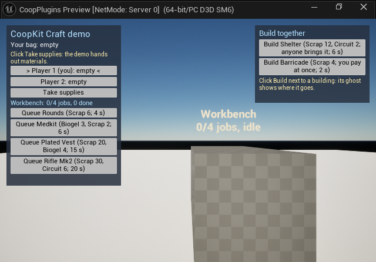

6. In both windows, click **Take supplies**. In window 1, click **Queue Medkit** and **Contribute**: the job still needs one biogel, and window 2 shows it. In window 2, click **Contribute**. Both windows show who brought what.

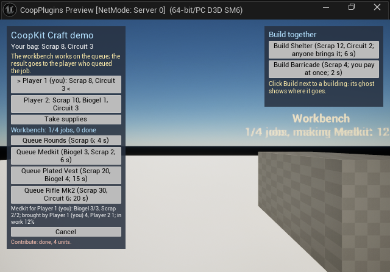

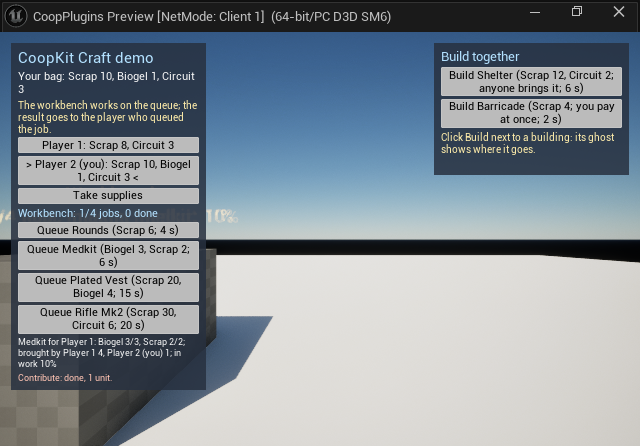

7. On the **Build together** panel in the top right corner, click **Build Shelter**. A ghost of the shelter appears: green where it may stand, red with the reason where it may not. Move it with the buttons.

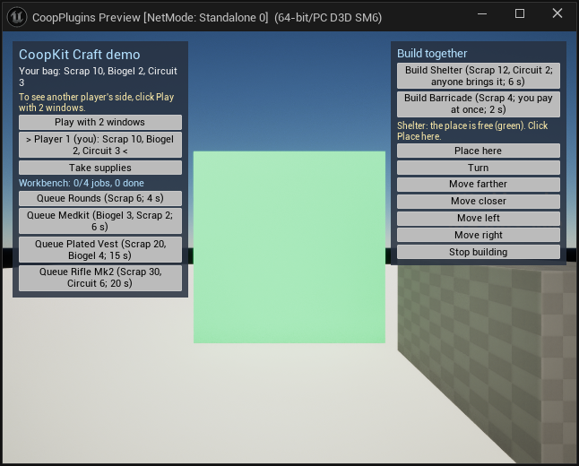

8. Click **Place here**. A construction site appears and takes what you have. Bring the rest with **Contribute to the site**.

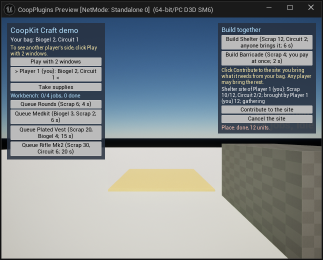

9. When the cost is in, the building rises, and after a few seconds the shelter stands.

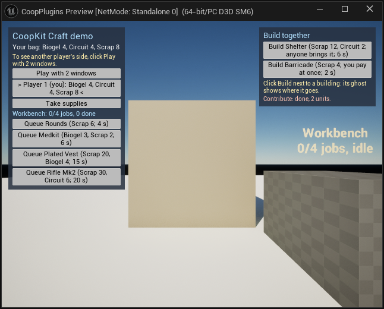

10. Click **Build Barricade**, move its ghost onto the shelter and click **Place here**. The server refuses and the panel says *CK.Craft.Reject.Blocked*. Move it away until it is green and click **Place here** again. The barricade stands, and the panel says *Barricade: done*.

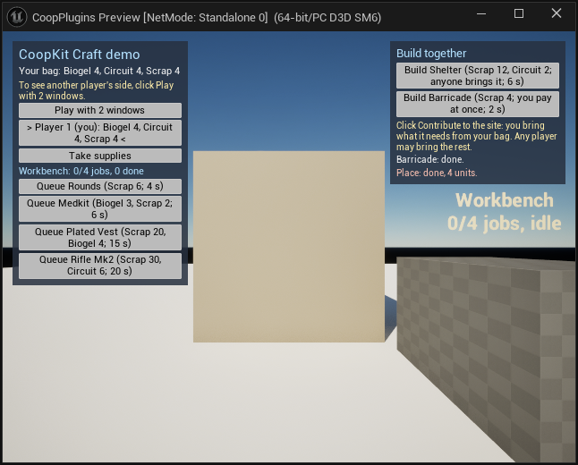
