# CoopKitDraft: editor tools

Step-by-step pictures of the editor tools of CoopKitDraft. You do everything with the mouse; the only typing is a name for a new asset. Your editor may look slightly different from the pictures.

The pictures are in `Docs/Images`.

## Show the plugin's content

The plugin's own assets (examples, demo maps) live in the plugin folder. To see them in the Content Browser, click **Settings** in the Content Browser and turn on **Show Plugin Content**.

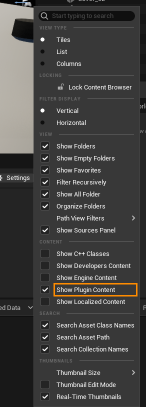

## Create a draft mode

1. In the Content Browser, open the folder for the new asset.
2. Click **Add**, point to **CoopKit**, then click **Draft Mode**. **Draft Hero Pool** in the same menu creates a hero pool alone.
3. Enter a name for the asset. The New Draft Mode wizard opens (see below).

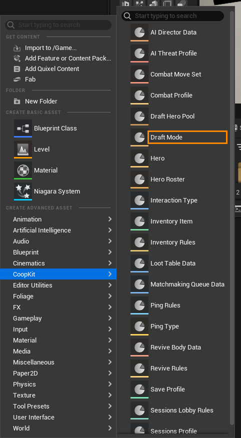

## Open the CoopKit Hub

The hub shows the entities of every CoopKit plugin in your project in one window. CoopKitDraft adds the category **Draft Mode**.

1. On the main menu, click **Tools**, then click **CoopKit Hub**.

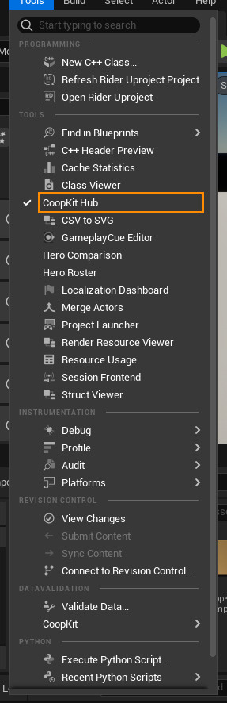

2. The hub opens on the categories. Each entity type has a button that shows the number of its entities and the name of the plugin that adds it.

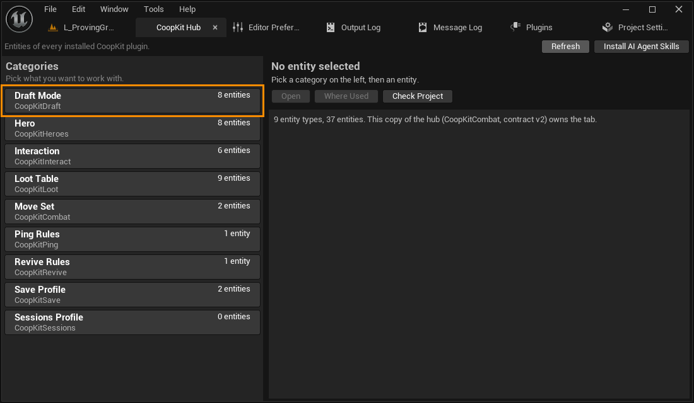

## Find a draft mode

1. Click the category **Draft Mode**. The left side now lists only this category. It also has a search box, the name box and **New Draft Mode**. Click **< Back** to return to the categories.

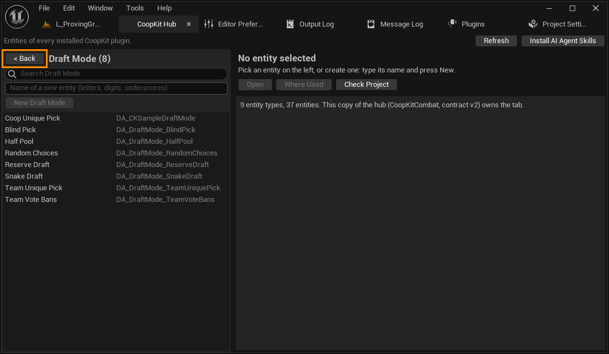

2. Click a draft mode in the list. The list shows the display name of each mode and its asset name; a mode without a display name (a new one from the wizard) shows its asset name. The right side shows its name, type and asset path. **Open** opens its card in a separate window (a double click in the list does the same).

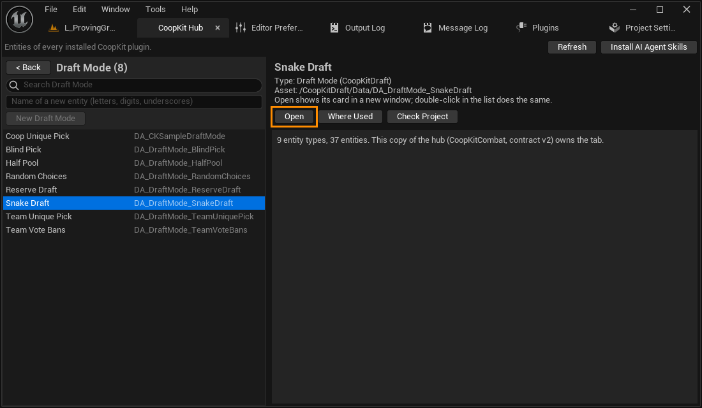

3. **Where Used** shows the assets that use the selected mode, for example the demo's game state.

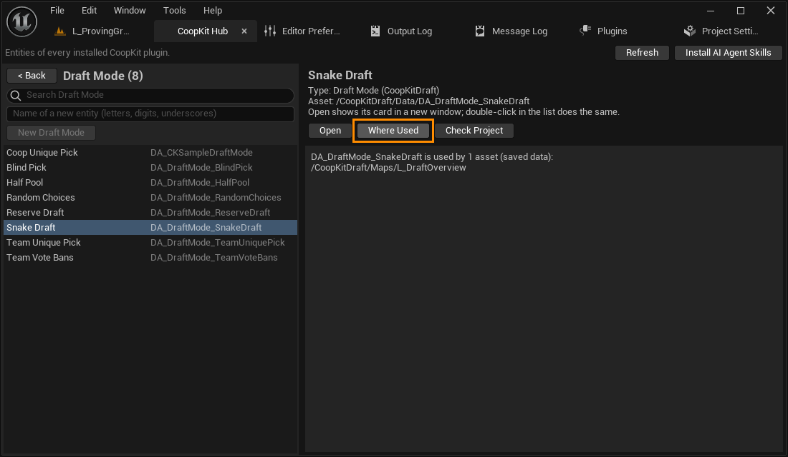

4. **Check Project** checks every entity of every type: data errors and duplicate ids. The result appears in the text box below the buttons.

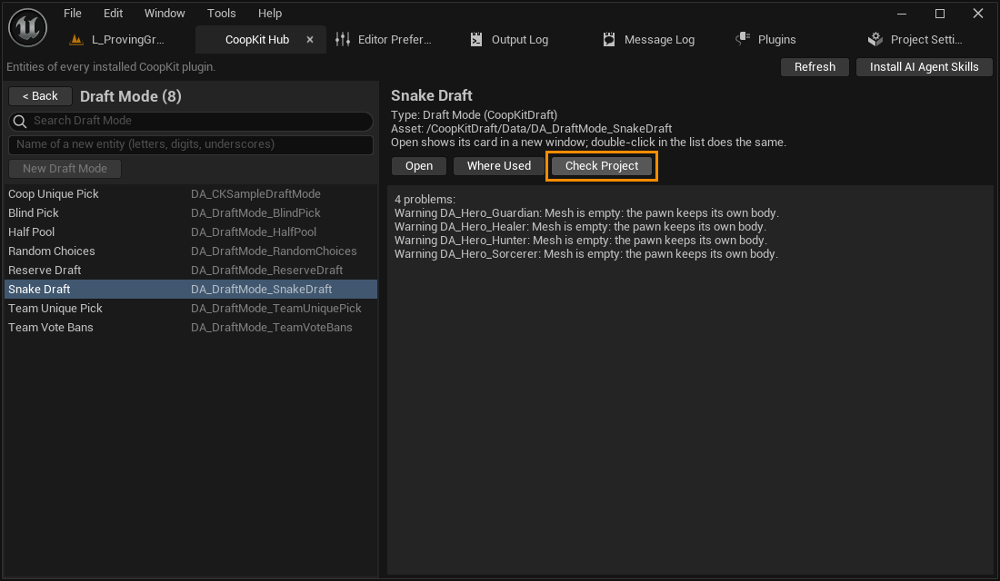

## Make a new draft mode with the wizard

1. In the **Draft Mode** category, click the name box and enter a name (letters, digits, underscores). The button **New Draft Mode** turns on.

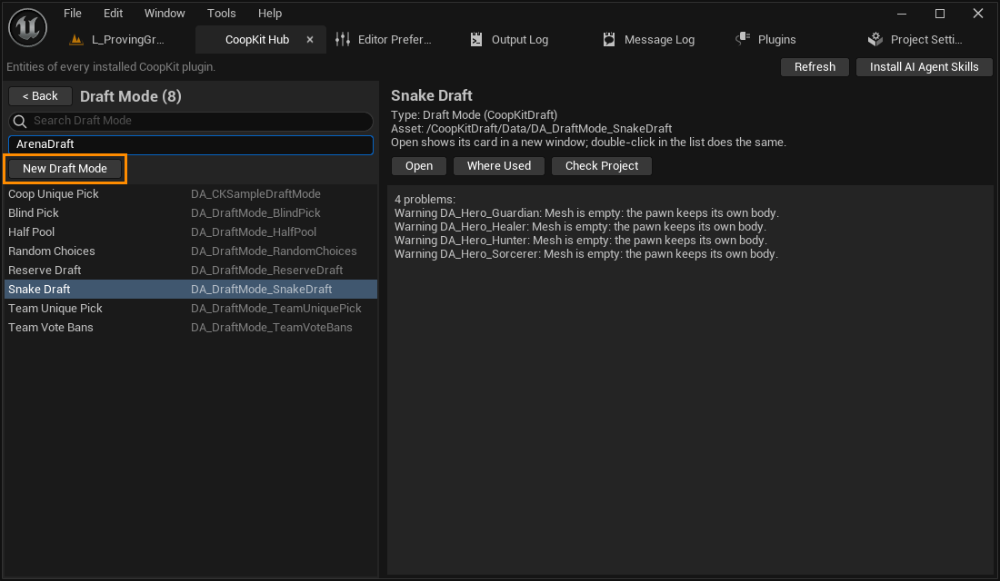

2. Click **New Draft Mode**. The wizard opens. Pick a draft mode to start from, if you like: its rules are copied. Leave **Create Hero Pool** on to get a hero pool of the mode's own, and pick a **Hero Pool** whose heroes it copies (without one it takes the heroes of the mode you start from, or the demo heroes). Click **Create**.

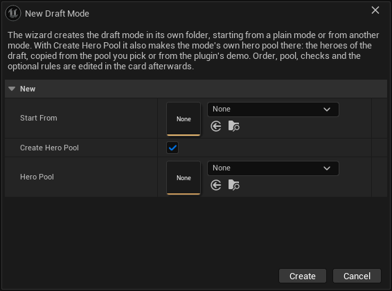

3. The new mode appears in the hub's list and is selected, and its card opens. The text box below the buttons says "Created" and shows the asset path. The new assets are not saved yet: click **Save All** to keep them.

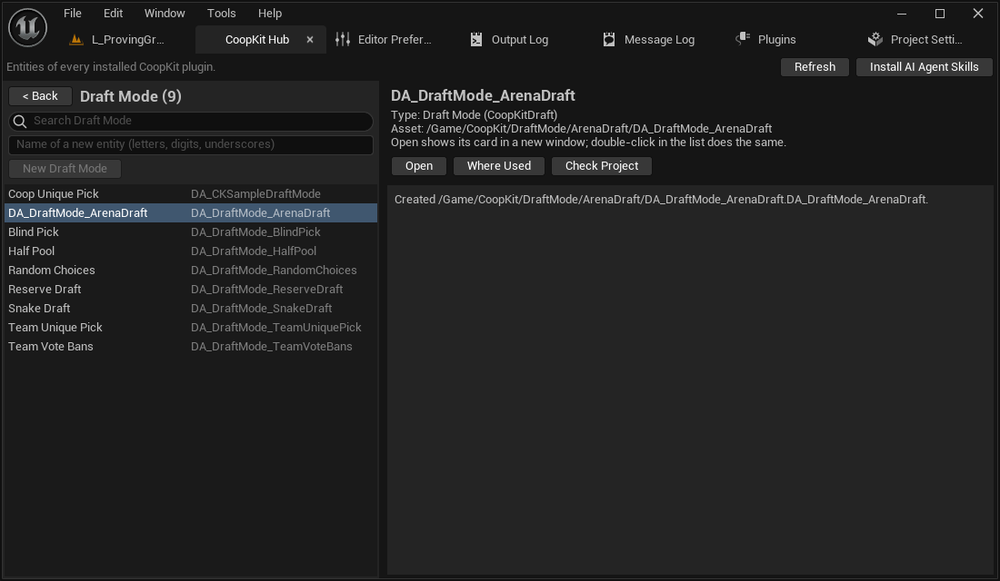

## The draft mode card

The card shows everything about one draft mode. Open it from the hub (**Open**) or double-click the asset in the Content Browser.

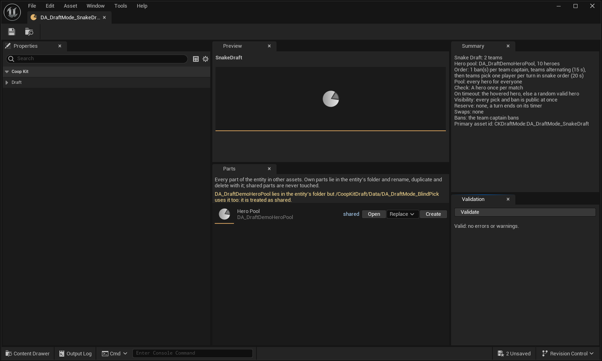

- **Properties**: the data of the mode.

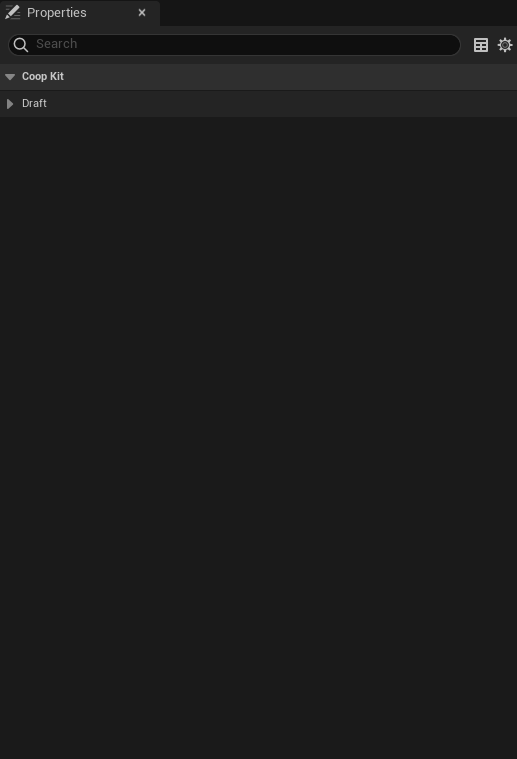

- **Preview**: the name of the mode and the hero pool it uses.

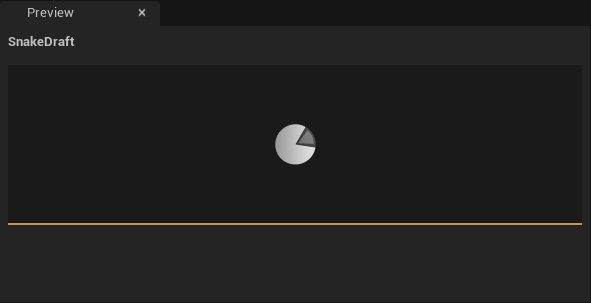

- **Parts**: the **Hero Pool**, the heroes of the draft. An **own** part lies in the mode's folder and is used by nothing else. A **shared** part is used by other assets too and is never moved or deleted. **Open** opens the hero pool in its editor. **Create** makes a new hero pool of the mode's own.

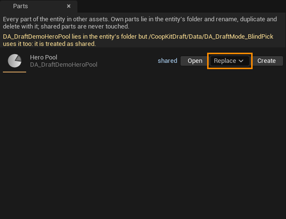

- To use another hero pool, click **Replace** and click the asset in the list.

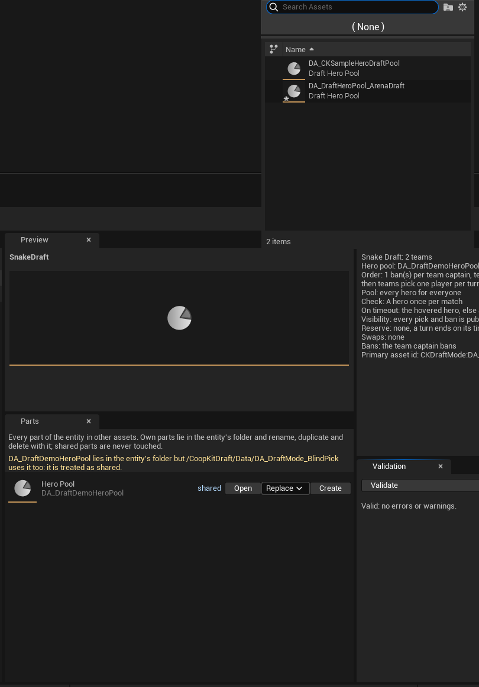

- **Summary**: what a draft with this mode looks like: the order of turns, the pool and the checks.

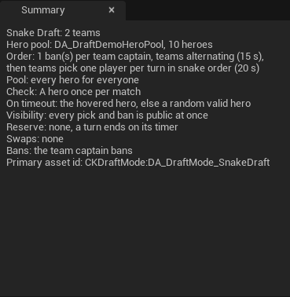

- **Validation**: problems of the data, refreshed on every change. **Validate** checks again.

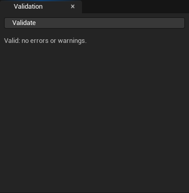

When a value does not work, Validation shows the problem in red right away, for example **Team Count** set to 0.

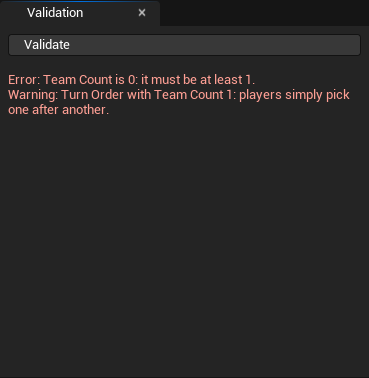

A hero pool opens in the same data editor, with Properties, Summary and Validation.

## Install the AI agent skills

The skills let an AI coding agent extend the plugin with you (see *AI agent skills* in the README).

1. On the main menu, click **Tools**, point to **CoopKit**, then click **Install AI Agent Skills**. The CoopKit Hub has the same button.

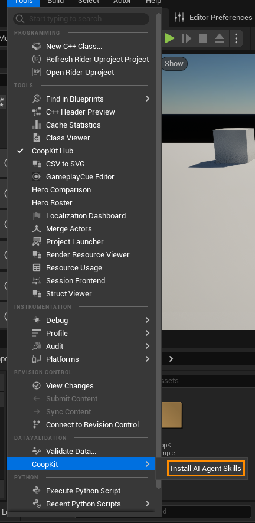

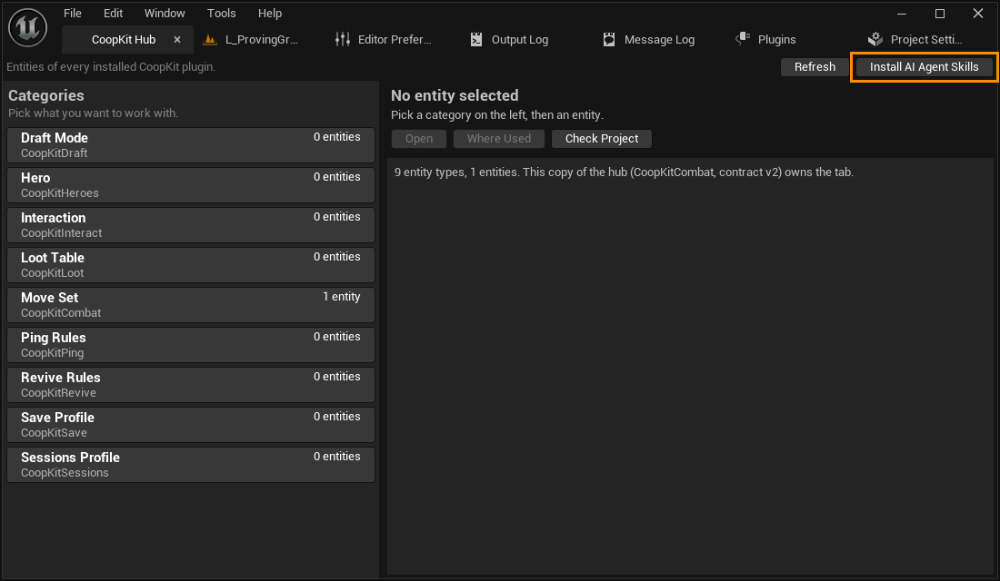

2. A message lists the skill folders that were copied into your project. Click **OK**. If some folders could not be copied, the message shows a warning icon and lists them.

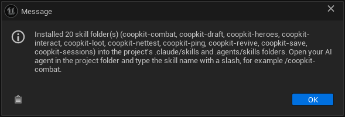

3. If the skills are already in the project, the plugin asks first. **Yes** replaces them and removes any change you made to their files; **No** keeps them.

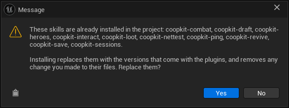

## Play the demo with the mouse

1. Show the plugin's content (see above), double-click `/CoopKitDraft/Maps/L_DraftDemo`, then click **Play** in the toolbar.

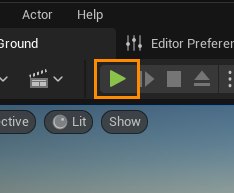

2. The panel in the top left corner has a button for each ready mode. Team modes need a player in each team: click **Play with 2 windows**. Play restarts with two windows. Your Play settings stay as they were.

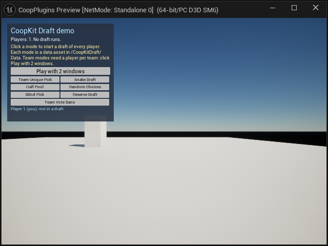

3. In window 1, click **Snake Draft**. Both windows show the turn, the time left and a button for each hero. The player whose turn it is clicks a hero; the other heroes they may not take are grey.

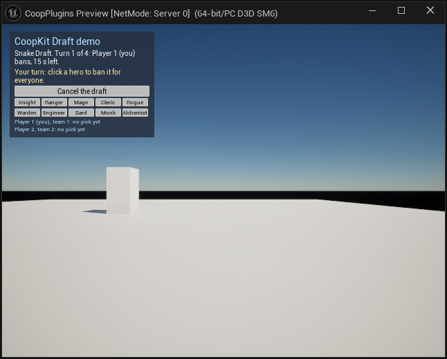

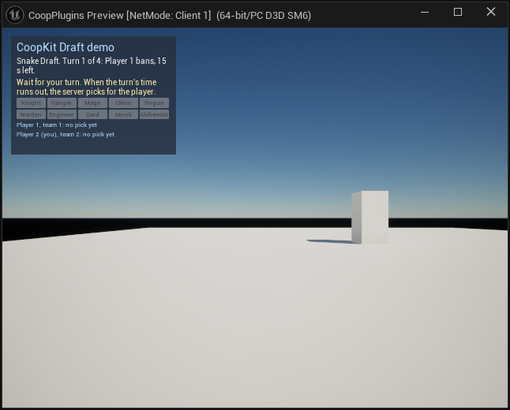

4. Click a hero in the window whose turn it is, until every player has picked. The panel lists the picks.

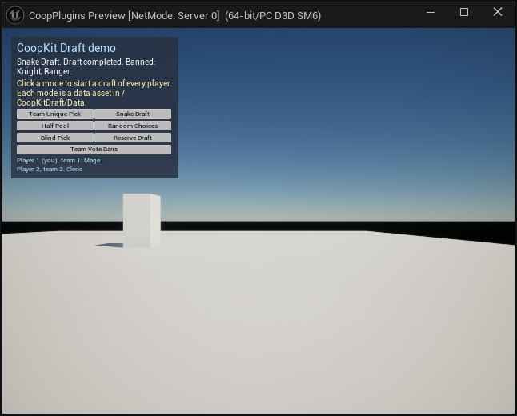
