# CoopKitInteract: editor tools

Step-by-step pictures of the editor tools of CoopKitInteract. You do everything with the mouse; the only typing is a name for a new asset. Your editor may look slightly different from the pictures.

The pictures are in `Docs/Images`.

## Show the plugin's content

The plugin's own assets (examples, demo maps) live in the plugin folder. To see them in the Content Browser, click **Settings** in the Content Browser and turn on **Show Plugin Content**.

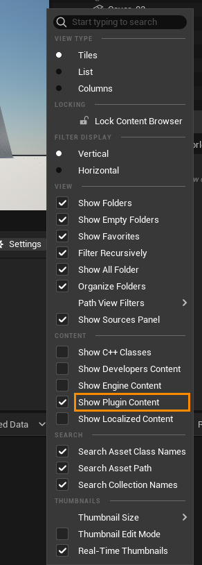

## Create an interaction

1. In the Content Browser, open the folder for the new asset.
2. Click **Add**, point to **CoopKit**, then click **Interaction Type**.
3. Enter a name for the asset.

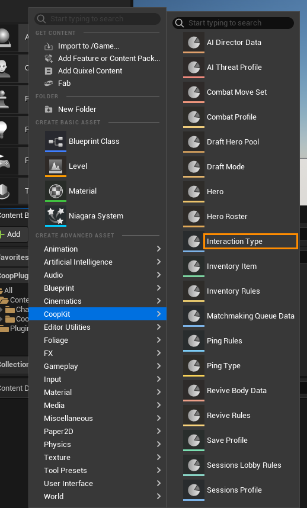

## Open the CoopKit Hub

The hub shows the entities of every CoopKit plugin in your project in one window. CoopKitInteract adds the category **Interaction**.

1. On the main menu, click **Tools**, then click **CoopKit Hub**.

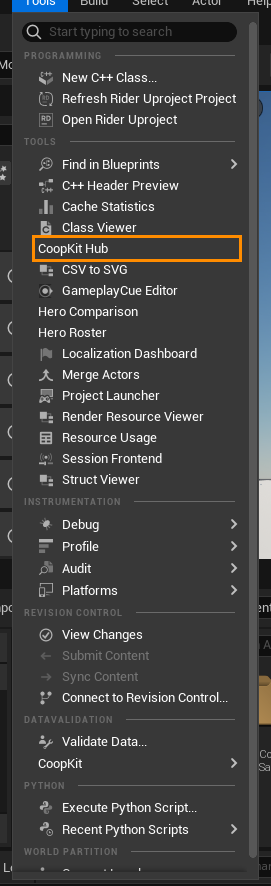

2. The hub opens on the categories. Each entity type has a button that shows the number of its entities and the name of the plugin that adds it.

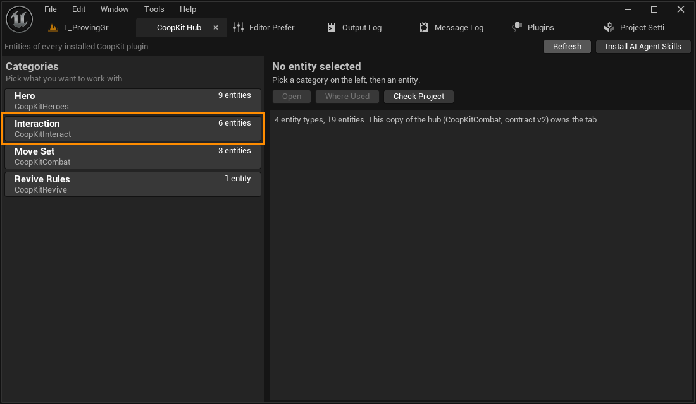

## Find an interaction

1. Click the category **Interaction**. The left side now lists only this category. It also has a search box, the name box and **New Interaction**. Click **< Back** to return to the categories.

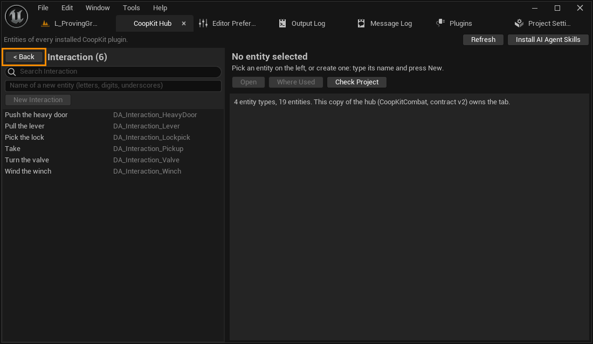

2. Click an interaction in the list. The right side shows its name, type, asset path and id. **Open** opens its card in a separate window (a double click in the list does the same).

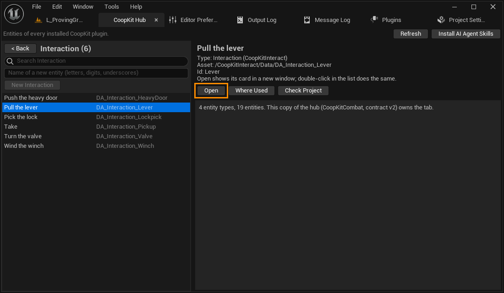

3. **Where Used** shows the assets that use the selected interaction.

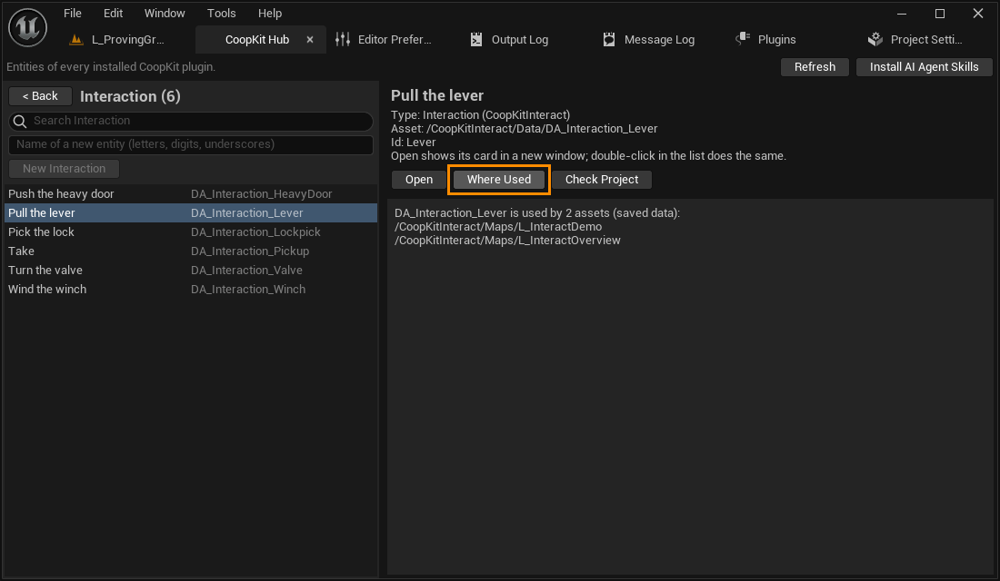

4. **Check Project** checks every entity of every type: data errors and duplicate ids. The result appears in the text box below the buttons.

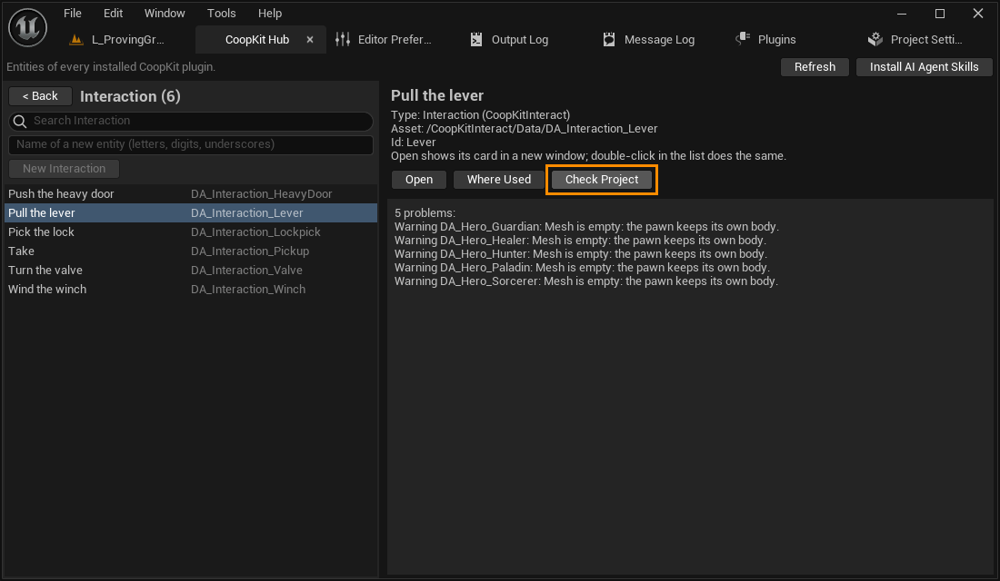

## Make a new interaction with the wizard

1. In the **Interaction** category, click the name box and enter a name (letters, digits, underscores). The button **New Interaction** turns on.

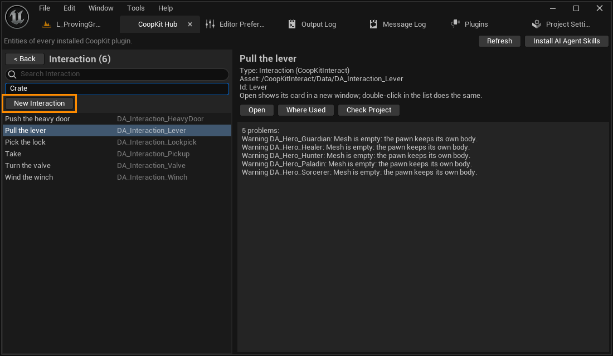

2. Click **New Interaction**. The wizard opens. Pick the prompt verb, the icon, Instant or Hold and the number of players; the wizard creates the interaction with its own progress curve. Click **Create**.

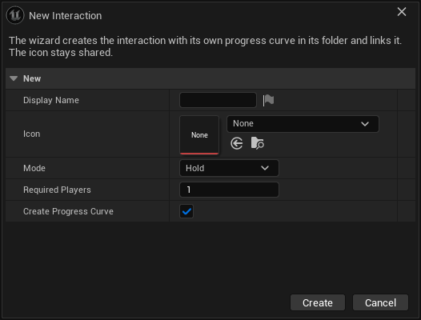

3. The card of the new interaction opens. The new interaction appears in the hub's list and is selected. The text box below the buttons says "Created" and shows the full asset path. The new assets are not saved yet: click **Save All** in the Content Browser to keep them.

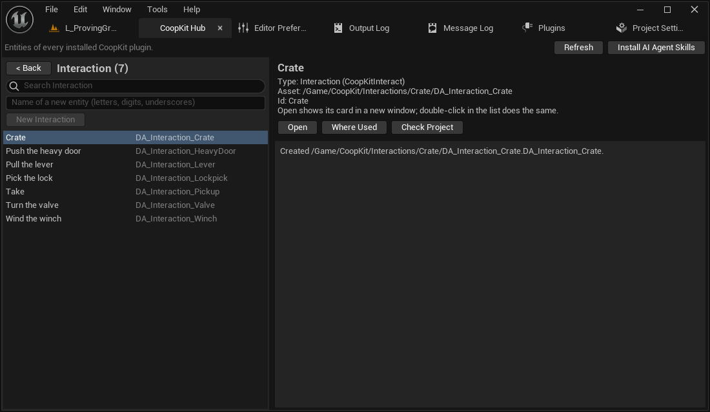

## The interaction card

The card shows everything about one interaction. Open it from the hub (**Open**) or double-click the asset in the Content Browser.

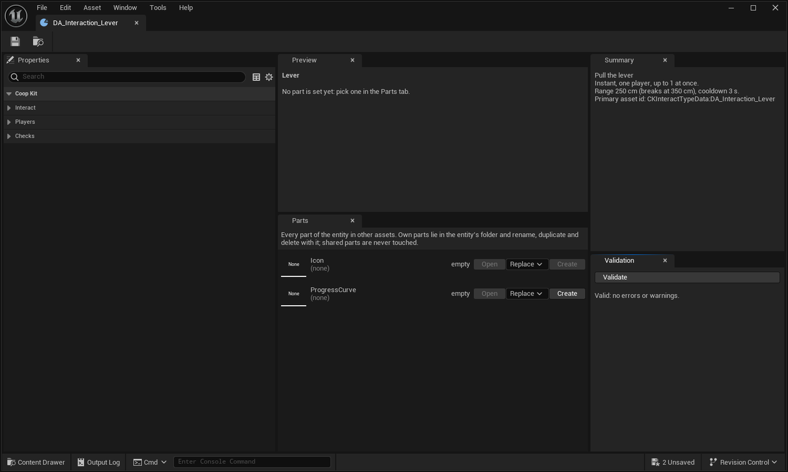

- **Properties**: the data of the interaction.

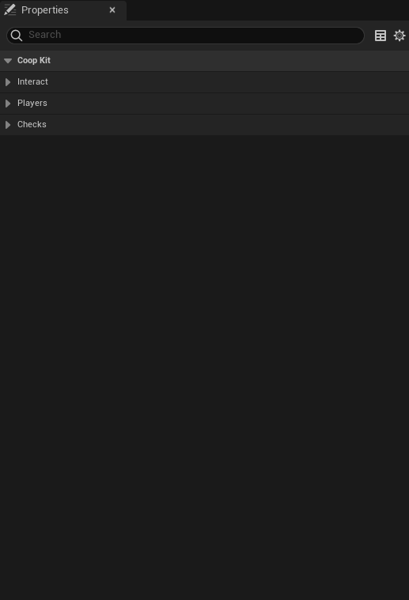

- **Preview**: a picture of the first part that is set (the icon, for example).

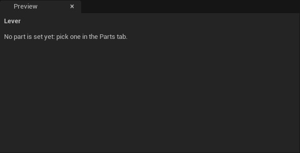

- **Parts**: every asset the interaction uses. **own** parts lie in the interaction's folder and are renamed, duplicated and deleted with it; **shared** parts are used by other assets too and are never touched. **Open** opens a part in its editor, **Create** makes a new own part.

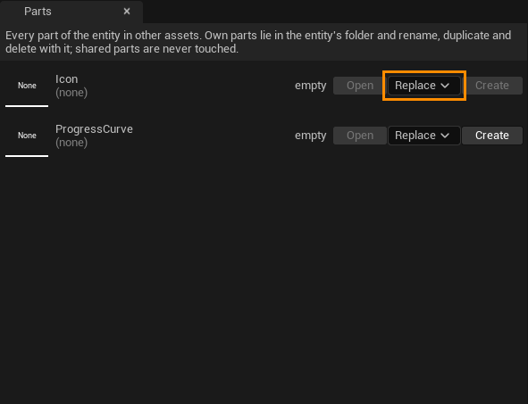

- To use another asset for a part, click **Replace** and click the asset in the list.

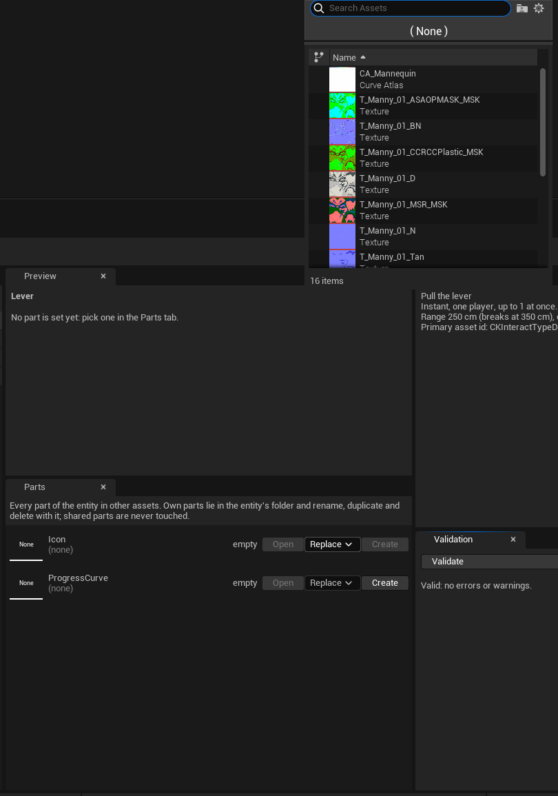

- **Summary**: what the data means in practice.

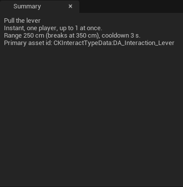

- **Validation**: problems of the data, refreshed on every change. **Validate** checks again.

When a value does not work, Validation shows the problem in red right away, for example **Required Players** set to 0.

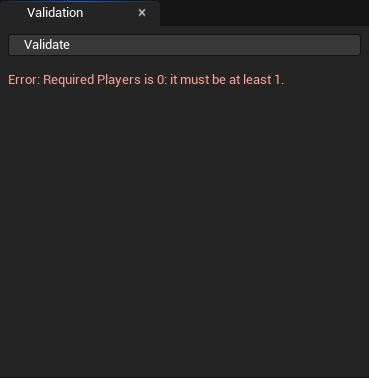

## Play the demo with the mouse

1. Show the plugin's content (see above), double-click `/CoopKitInteract/Maps/L_InteractDemo`, then click **Play** in the toolbar.

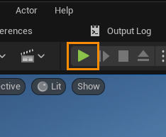

2. The panel in the top left corner has a row for each device: the interaction, the players taking part and the progress, with **Go to** and **Hold** or **Use**. The heavy door needs two players: click **Play with 2 windows**. Play restarts with two windows. Your Play settings stay as they were.

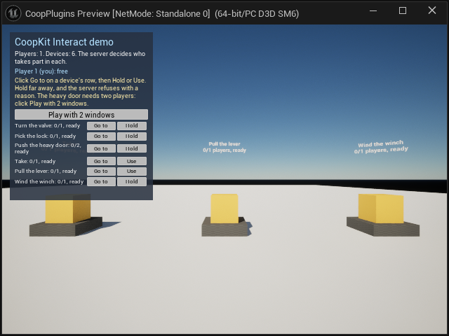

3. Click **Hold** on a device you stand far from. The server refuses, and the panel says why.

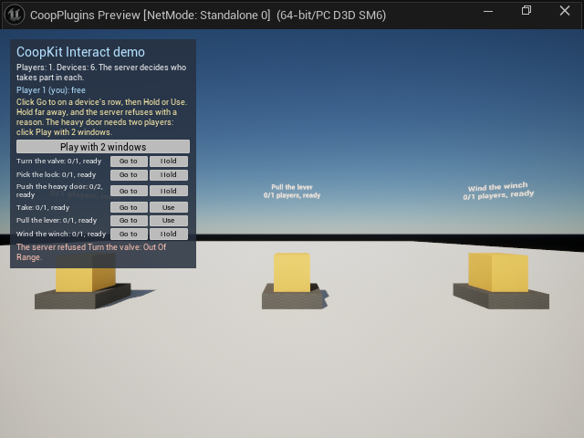

4. In window 1, click **Go to**, then **Hold** on the *Push the heavy door* row. One player is not enough: the row shows 1/2 and no progress.

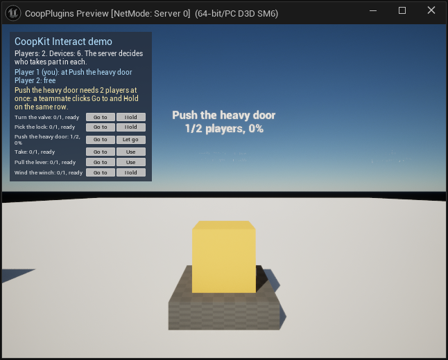

5. In window 2, click **Go to**, then **Hold** on the same row. The door opens for both players.

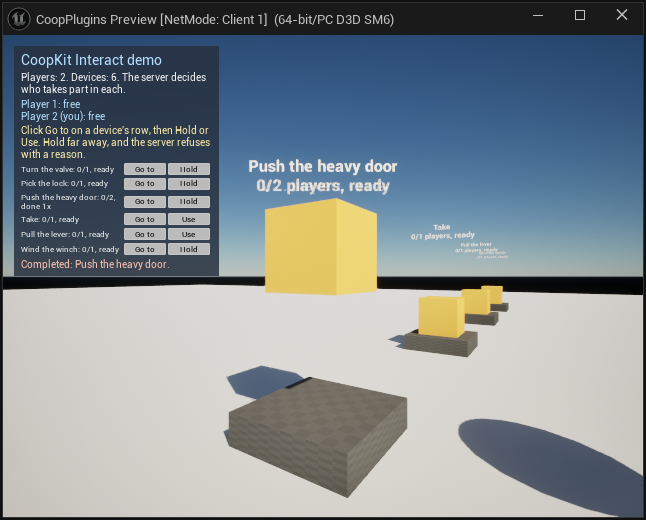

## Install the AI agent skills

The skills let an AI coding agent extend the plugin with you (see *AI agent skills* in the README).

1. On the main menu, click **Tools**, point to **CoopKit**, then click **Install AI Agent Skills**. The CoopKit Hub has the same button.

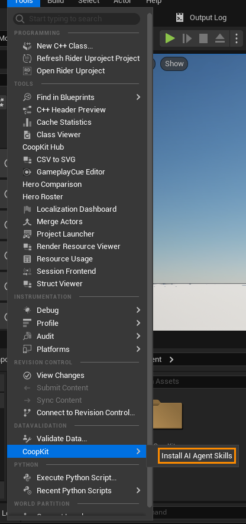

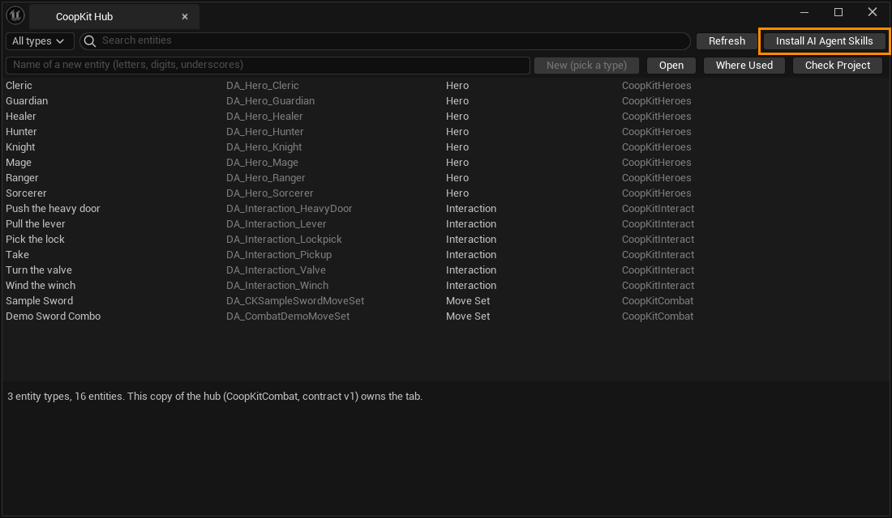

2. A message lists the skill folders that were copied into your project. Click **OK**. If some folders could not be copied, the message shows a warning icon and lists them.

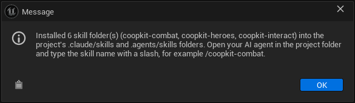

3. If the skills are already in the project, the plugin asks first. **Yes** replaces them and removes any change you made to their files; **No** keeps them.

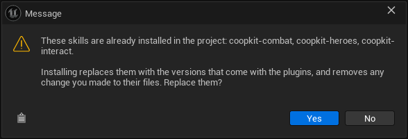
