# CoopKitInventory: editor tools

Step-by-step pictures of the editor tools of CoopKitInventory. You do everything with the mouse; the only typing is a name for a new asset. Your editor may look slightly different from the pictures.

The pictures are in `Docs/Images`.

## Show the plugin's content

The plugin's own assets (examples, demo maps) live in the plugin folder. To see them in the Content Browser, click **Settings** in the Content Browser and turn on **Show Plugin Content**.

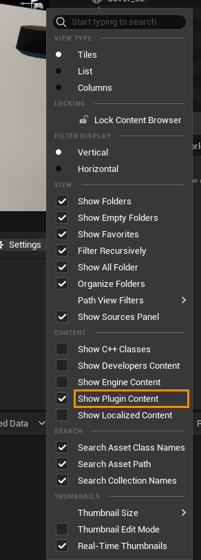

## Create inventory rules or an item

1. In the Content Browser, open the folder for the new asset.
2. Click **Add**, point to **CoopKit**, then click **Inventory Rules**.
3. Enter a name for the asset.

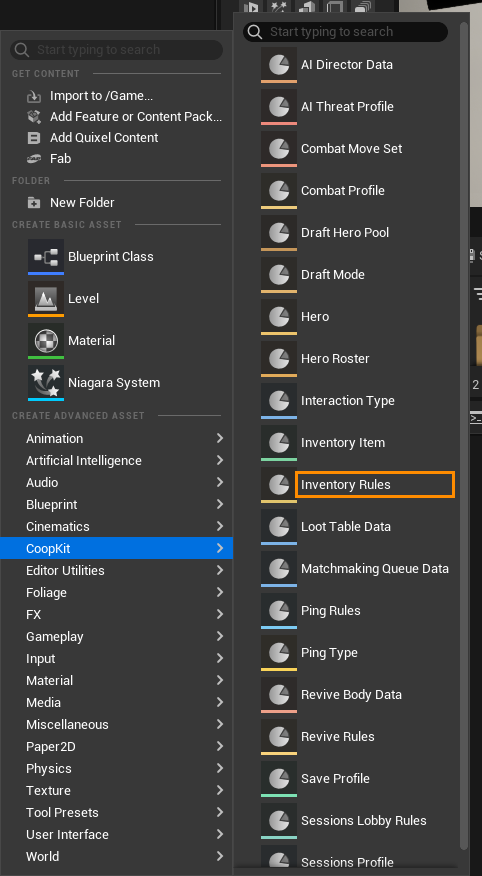

To make an item, click **Add**, point to **CoopKit**, then click **Inventory Item**. The New Inventory Item wizard opens first. It is described in *Make a new item with the wizard* below.

## Edit inventory rules

Double-click the asset in the Content Browser. The data editor opens with three sections.

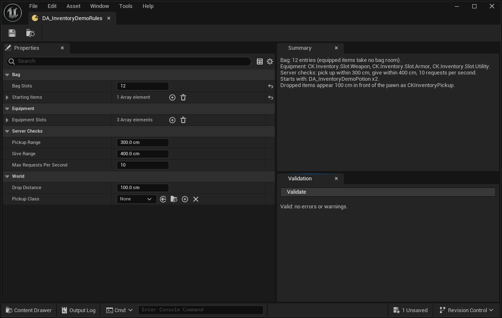

- **Properties** (left): the data of the asset.

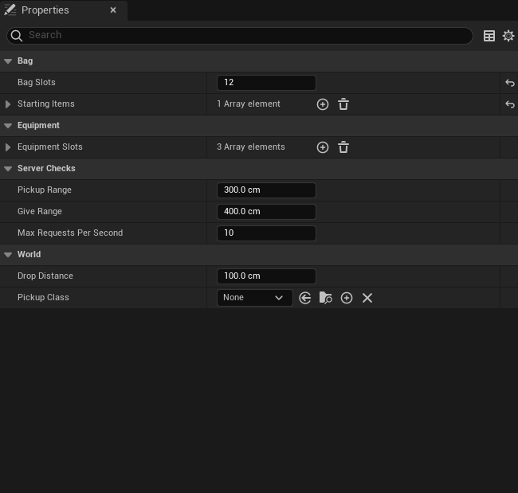

- **Summary** (top right): what the values mean in practice.

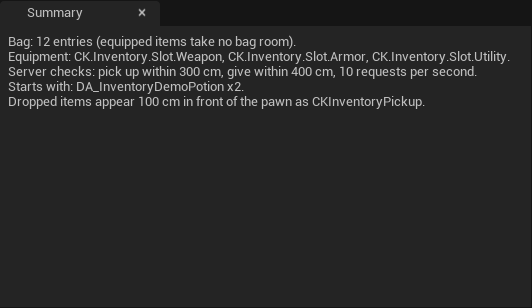

- **Validation** (bottom right): problems of the data, refreshed on every change. **Validate** checks again.

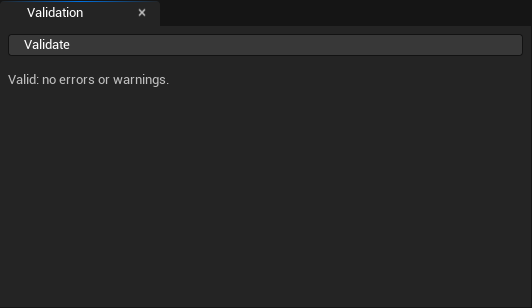

When a value does not work, Validation shows the problem in red right away, for example **Bag Slots** set to 0.

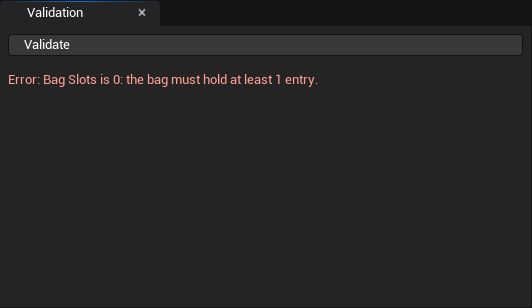

Items open in their own card, described below.

## Open the CoopKit Hub

The hub lists the entity types of every CoopKit plugin in your project in one window: CoopKitInventory adds the category **Inventory Item**.

1. On the main menu, click **Tools**, then click **CoopKit Hub**.

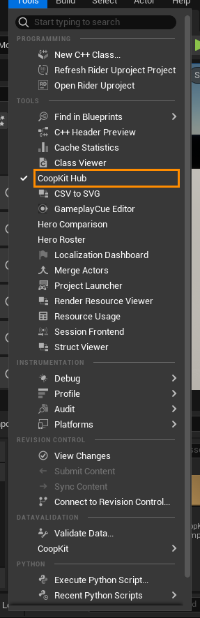

2. The hub opens on the categories. Each entity type has a button that shows the number of its entities and the name of the plugin that adds it.

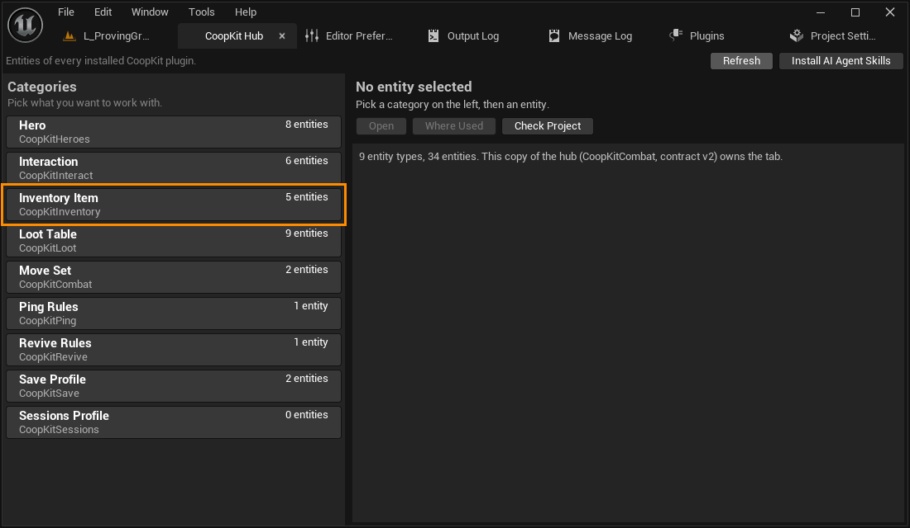

## Find an item

1. Click the category **Inventory Item**. The left side now lists only this category. It also has a search box, the name box and **New Inventory Item**. Click **< Back** to return to the categories.

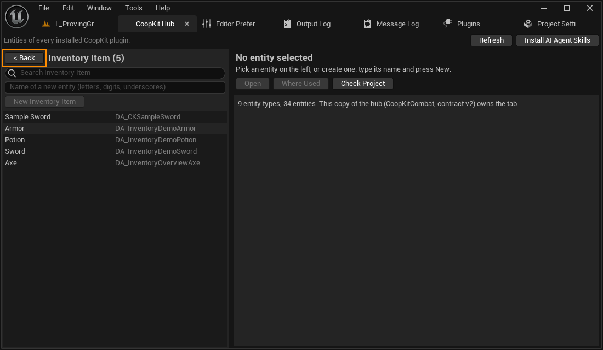

2. Click an item in the list, for example **Sword**. The list shows the item's display name. The right side shows its name, type and asset path. **Open** opens its card in a separate window (a double click in the list does the same).

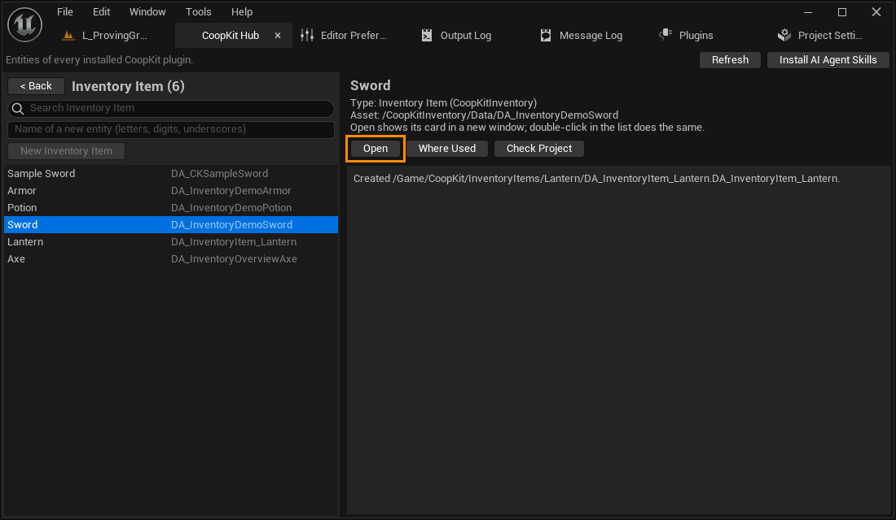

3. **Where Used** shows the assets that use the selected item: for the Sword, the maps with a sword lying on the floor.

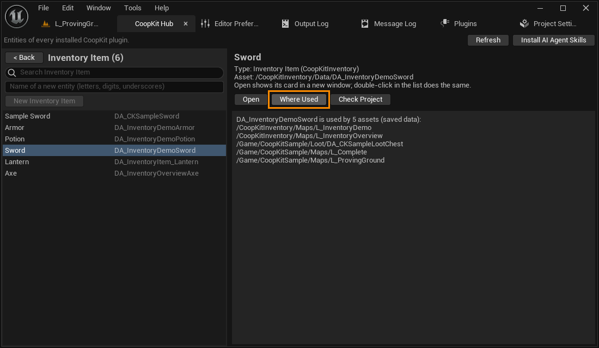

4. **Check Project** checks every entity of every type: data errors and duplicate ids. The result appears in the text box below the buttons.

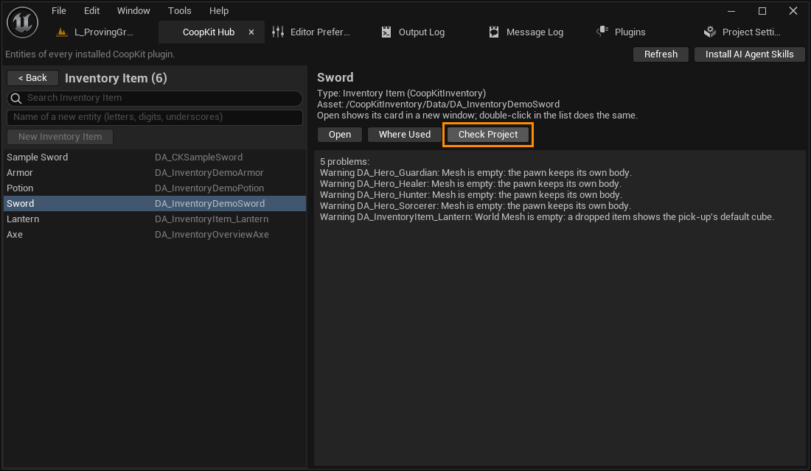

## Make a new item with the wizard

1. In the **Inventory Item** category, click the name box and enter a name (letters, digits, underscores). The button **New Inventory Item** turns on.

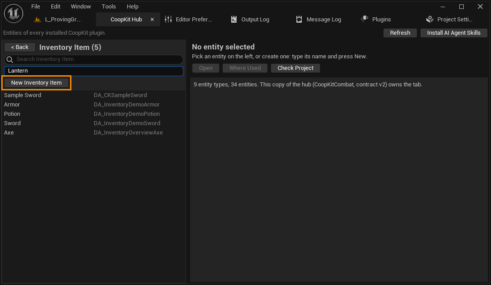

2. Click **New Inventory Item**. The wizard opens. In **Start From**, pick an item to copy, or leave it empty for the defaults. Set the **Display Name**, **Max Stack**, **Equip Slot**, **Icon** and **World Mesh** you want. An empty Equip Slot, Icon or World Mesh keeps the value of the copied item, and so does a Max Stack of 0. An empty Display Name uses the item's name. Turn on **Create Equip Ability** to also get an ability Blueprint that the item grants while equipped (the item needs an Equip Slot). Click **Create**.

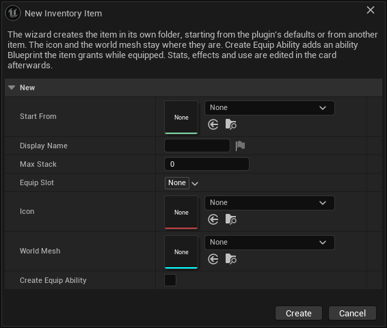

3. The new item appears in the hub's list and is selected, and its card opens. The text box below the buttons says "Created" and shows the asset path. The new asset is not saved yet: click **Save All** to keep it.

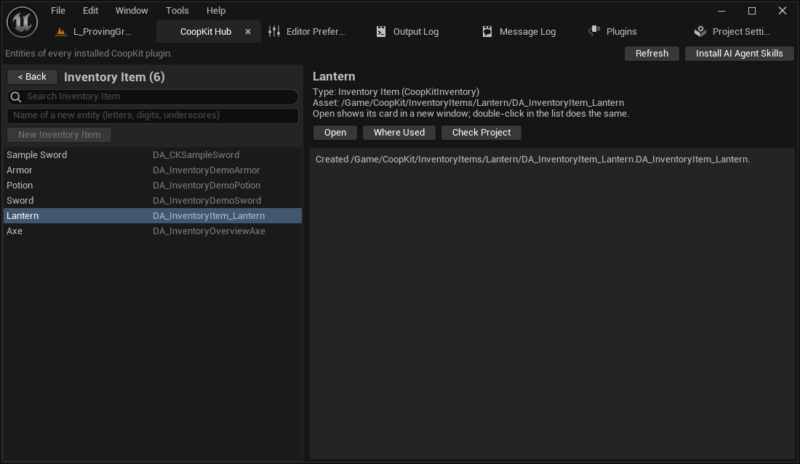

## The item card

The card shows everything about one item. Open it from the hub (**Open**) or double-click the asset in the Content Browser.

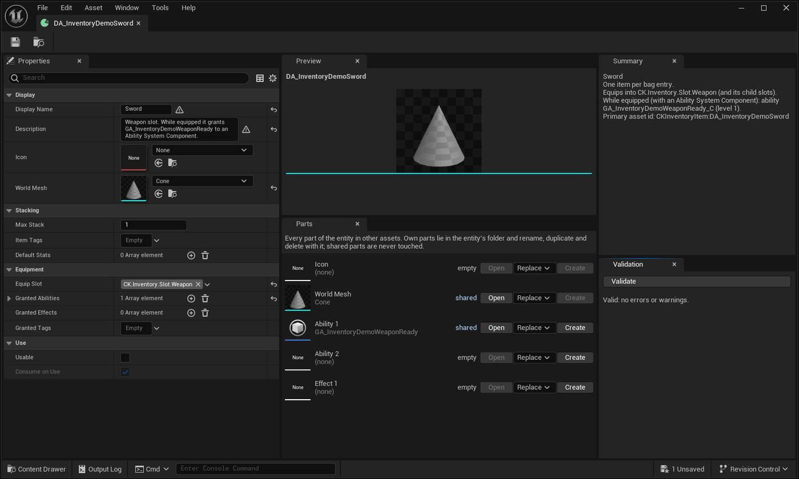

- **Properties**: the data of the item.

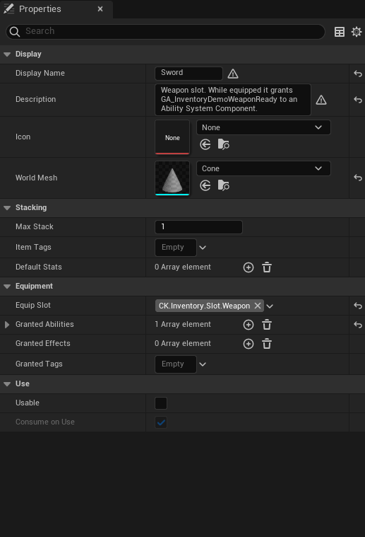

- **Preview**: the item's icon. Without an icon it shows the world mesh, and without that, a granted Blueprint.

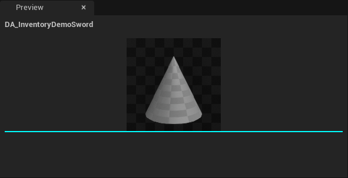

- **Parts**: the other assets the item uses: **Icon**, **World Mesh**, every granted ability and every granted effect. Each part has **Open** and **Replace**. After the last ability and the last effect there is an empty slot that adds one. On an ability or effect slot, **Create** makes a new Blueprint in the item's folder and grants it.

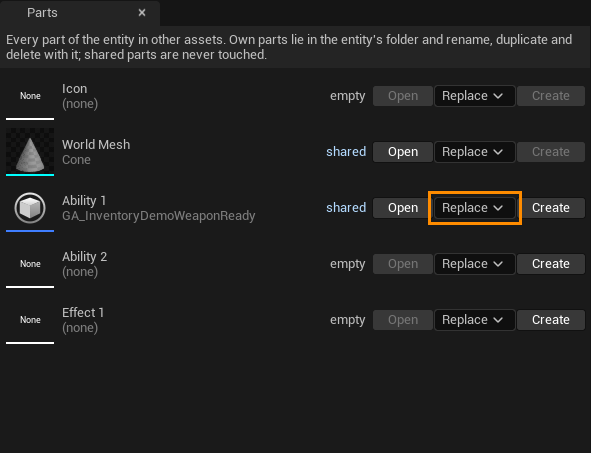

- Click **Replace** to pick another asset. An ability slot lists only Gameplay Ability Blueprints, an effect slot only Gameplay Effect Blueprints. Pick *None* to remove the grant.

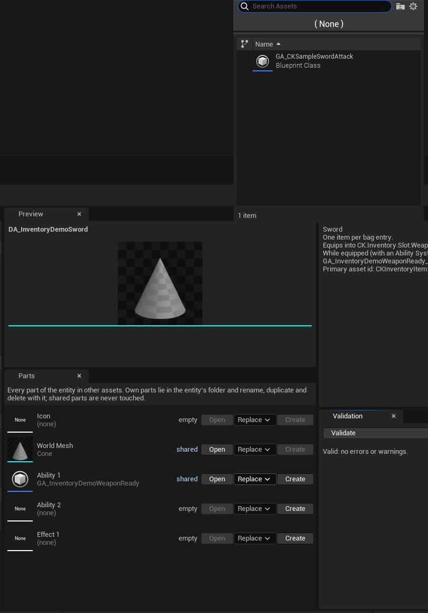

- **Summary**: what the item does in practice: stacking, slot, grants, use.

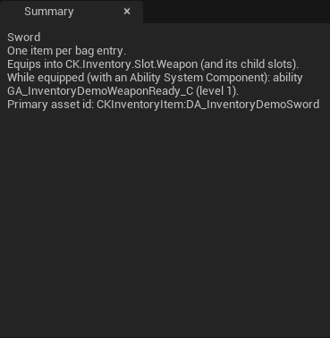

- **Validation**: problems of the data, refreshed on every change. **Validate** checks again.

When a value does not work, Validation shows the problem in red right away, for example **Max Stack** set to 0.

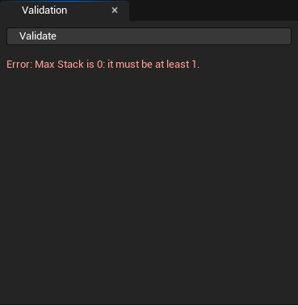

## Install the AI agent skills

The skills let an AI coding agent extend the plugin with you (see *AI agent skills* in the README).

1. On the main menu, click **Tools**, point to **CoopKit**, then click **Install AI Agent Skills**. The CoopKit Hub has the same button.

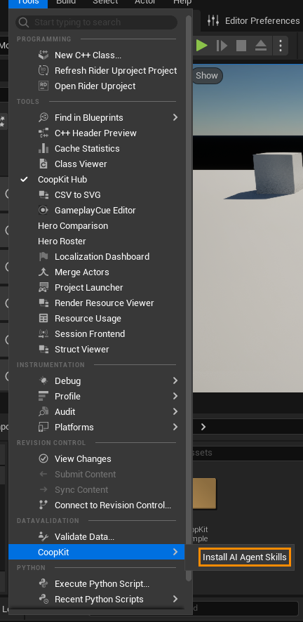

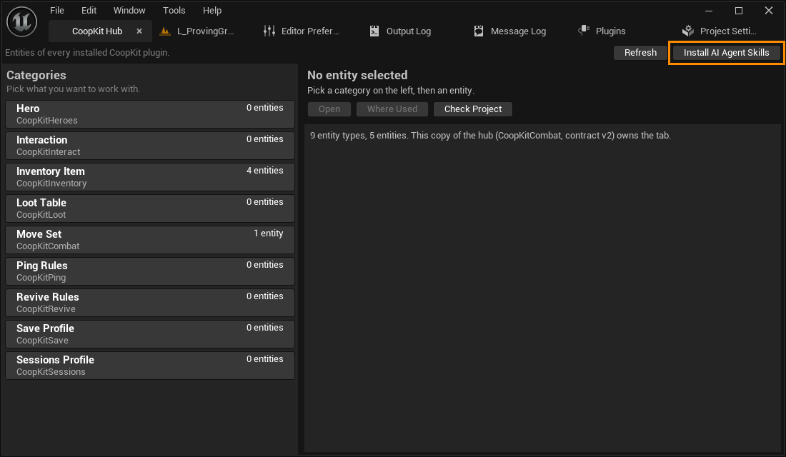

2. A message lists the skill folders that were copied into your project. Click **OK**. If some folders could not be copied, the message shows a warning icon and lists them.

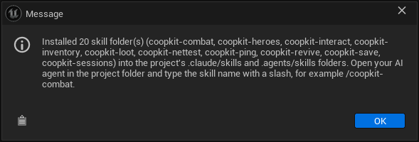

3. If the skills are already in the project, the plugin asks first. **Yes** replaces them and removes any change you made to their files; **No** keeps them.

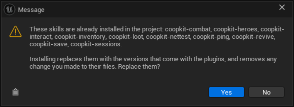

## Play the demo with the mouse

1. Show the plugin's content (see above), double-click `/CoopKitInventory/Maps/L_InventoryDemo`, then click **Play** in the toolbar.

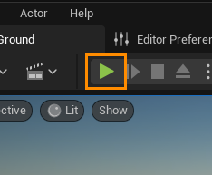

2. The panel in the top left corner shows your bag, the items on the floor and your teammates. To trade, click **Play with 2 windows**: Play restarts with two windows. Your Play settings stay as they were.

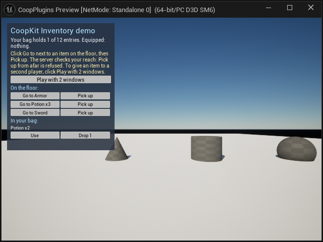

3. In window 1, click **Go to Sword**, then **Pick up** on the same row. The sword is in your bag.

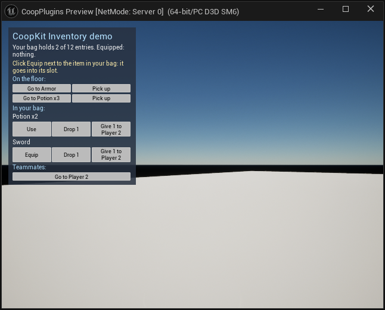

4. Click **Equip** next to the sword. The button changes to **Unequip**.

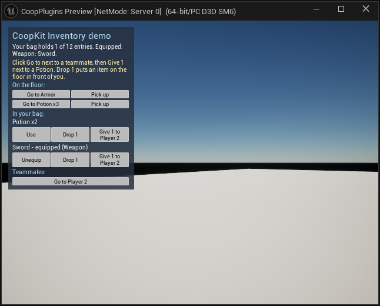

5. In window 2, click **Go to Player 1**, then **Give 1 to Player 1** next to the potions. Window 1 has one more potion.

