# CoopKitMatchmaking: editor tools

Step-by-step pictures of the editor tools of CoopKitMatchmaking. You do everything with the mouse; the only typing is a name for a new asset. Your editor may look slightly different from the pictures.

The pictures are in `Docs/Images`.

## Show the plugin's content

The plugin's own assets (examples, demo maps) live in the plugin folder. To see them in the Content Browser, click **Settings** in the Content Browser and turn on **Show Plugin Content**.

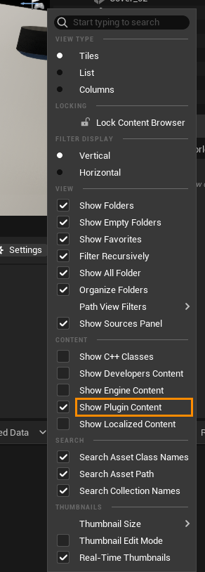

## Create a matchmaking queue

1. In the Content Browser, open the folder for the new asset.
2. Click **Add**, point to **CoopKit**, then click **Matchmaking Queue Data**.
3. Enter a name for the asset. The New Matchmaking Queue wizard opens (see below).

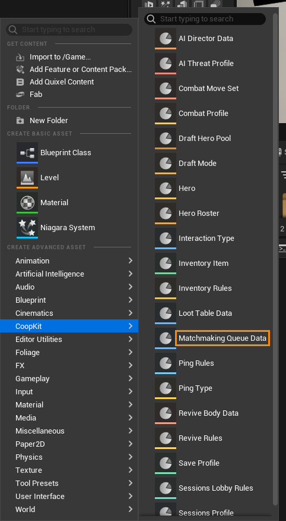

## Open the CoopKit Hub

The hub shows the entities of every CoopKit plugin in your project in one window. CoopKitMatchmaking adds the category **Matchmaking Queue**.

1. On the main menu, click **Tools**, then click **CoopKit Hub**.

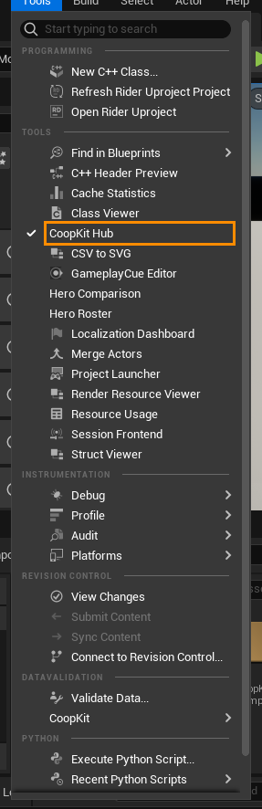

2. The hub opens on the categories. Each entity type has a button that shows the number of its entities and the name of the plugin that adds it.

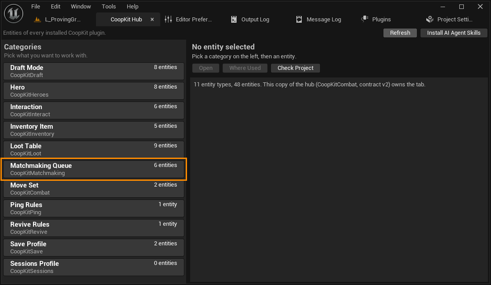

## Find a matchmaking queue

1. Click the category **Matchmaking Queue**. The left side now lists only this category. It also has a search box, the name box and **New Matchmaking Queue**. Click **< Back** to return to the categories.

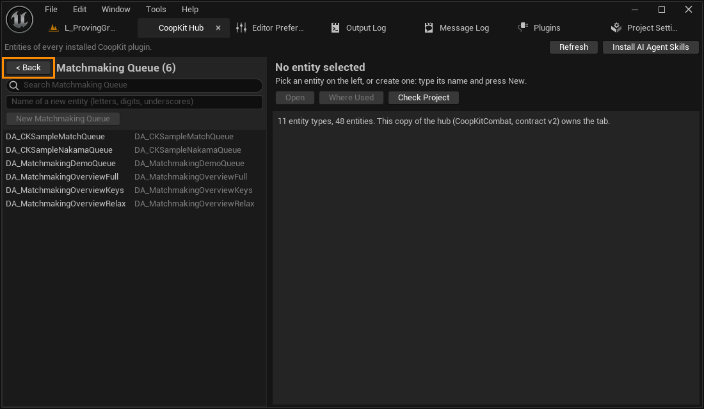

2. Click a queue in the list. A queue has no separate display name, so the list shows the asset's name, for example the demo's `DA_MatchmakingDemoQueue`. The right side shows its name, type and asset path. **Open** opens its card in a separate window (a double click in the list does the same).

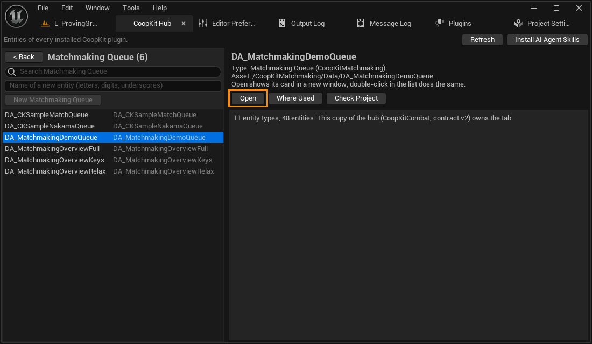

3. **Where Used** shows the assets that use the selected queue.

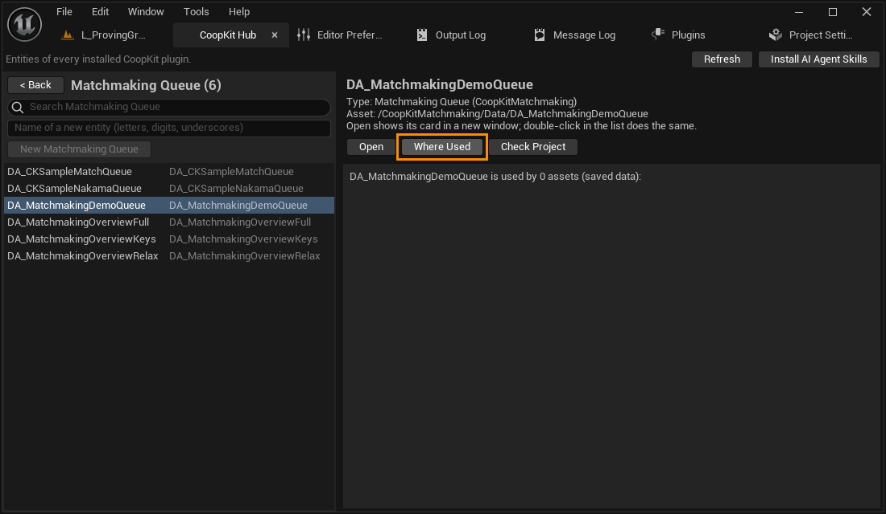

4. **Check Project** checks every entity of every type: data errors and duplicate ids. The result appears in the text box below the buttons.

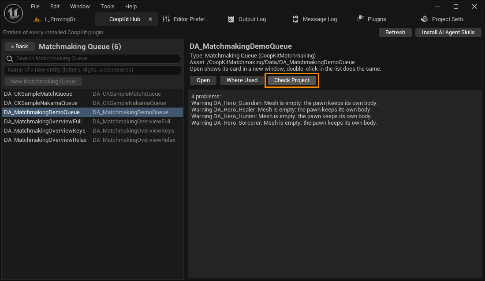

## Make a new matchmaking queue with the wizard

1. In the **Matchmaking Queue** category, click the name box and enter a name (letters, digits, underscores). The button **New Matchmaking Queue** turns on.

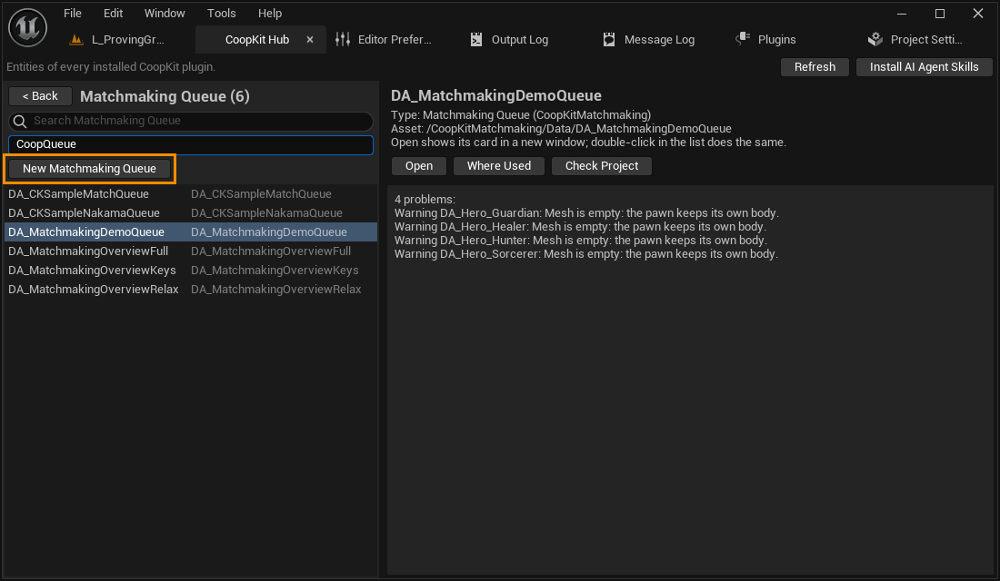

2. Click **New Matchmaking Queue**. The wizard opens. Pick a queue to start from, if you like. **Provider** picks the service that matches the players: **Local** plays in the editor without a server; Nakama, AWS FlexMatch and Azure PlayFab need their own setup (see the README). Leave it empty to keep the provider of the queue you start from. **Queue Name** is the queue's name at the service. Click **Create**.

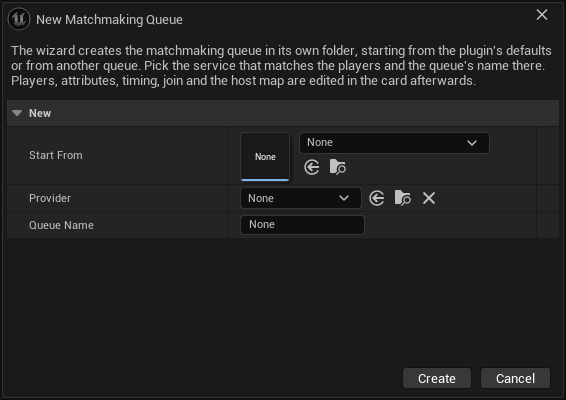

3. The new queue appears in the hub's list and is selected, and its card opens. The text box below the buttons says "Created" and shows the asset path. The new asset is not saved yet: click **Save All** to keep it.

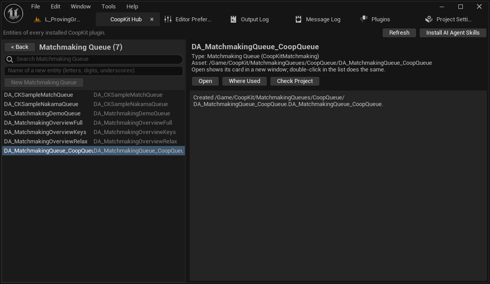

## The matchmaking queue card

The card shows everything about one queue. Open it from the hub (**Open**) or double-click the asset in the Content Browser.

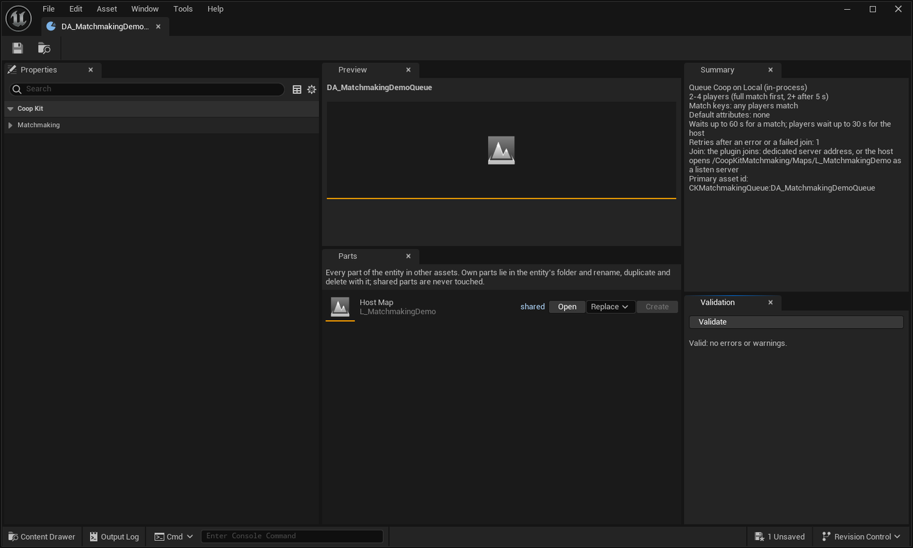

- **Properties**: the data of the queue: the provider and its settings, players per match, match keys and attributes, timing, and how players join.

- **Preview**: the host map of the queue, if it has one.

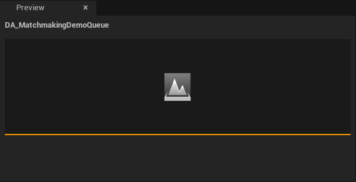

- **Parts**: the other assets the queue uses. A queue uses one: its **Host Map**, the map the host opens for the match. The map is usually shared with other queues, so it stays where it is when a queue is renamed, copied or deleted.

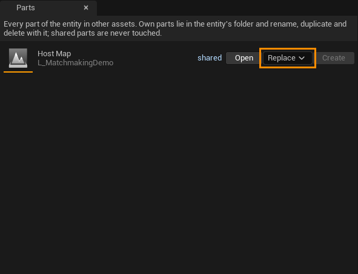

- **Replace** picks another map for the queue.

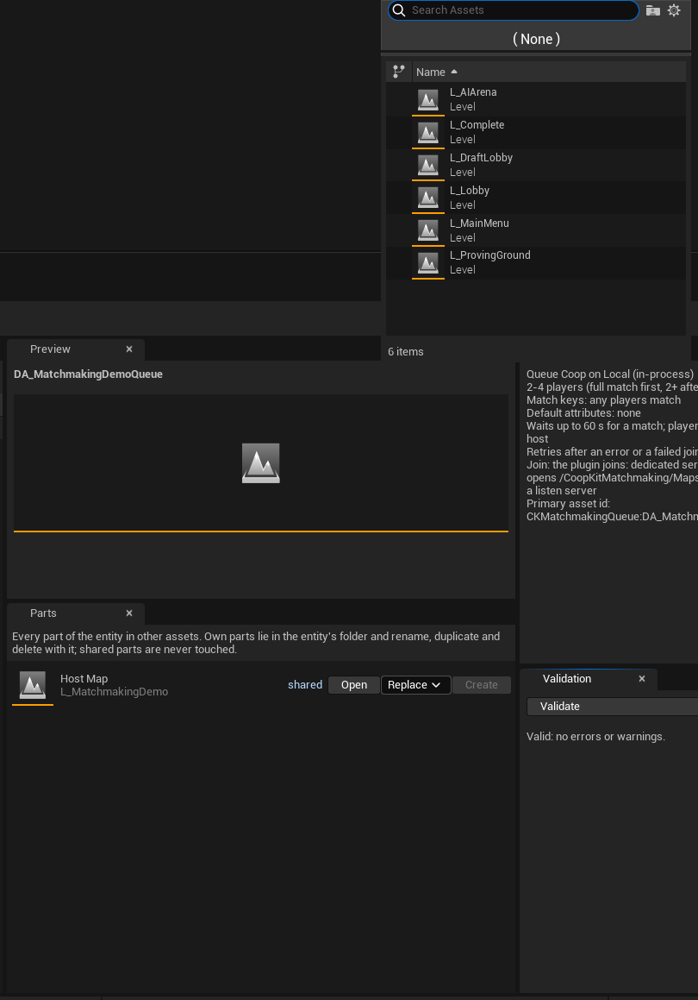

- **Summary**: who is matched, by which service, how long the search waits and who joins the match.

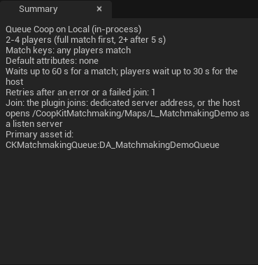

- **Validation**: problems of the data, refreshed on every change. **Validate** checks again.

When a value does not work, Validation shows the problem in red right away, for example an empty **Queue Name**.

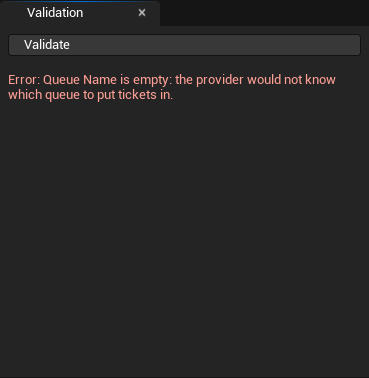

## Install the AI agent skills

The skills let an AI coding agent extend the plugin with you (see *AI agent skills* in the README).

1. On the main menu, click **Tools**, point to **CoopKit**, then click **Install AI Agent Skills**. The CoopKit Hub has the same button.

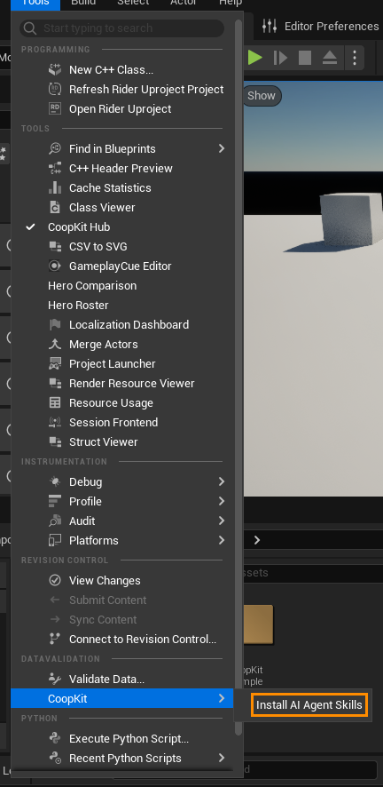

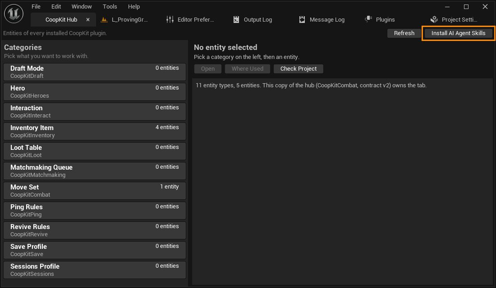

2. A message lists the skill folders that were copied into your project. Click **OK**. If some folders could not be copied, the message shows a warning icon and lists them.

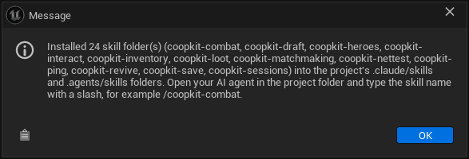

3. If the skills are already in the project, the plugin asks first. **Yes** replaces them and removes any change you made to their files; **No** keeps them.

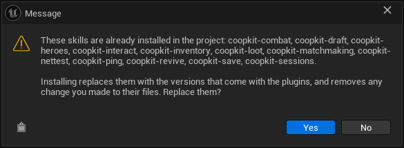

## Play the demo with the mouse

1. Show the plugin's content (see above), double-click `/CoopKitMatchmaking/Maps/L_MatchmakingDemo`, then click **Play** in the toolbar.

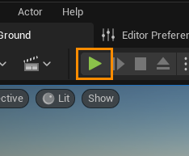

2. The panel in the top left corner shows the demo queue and **Find a match**. A match needs two players: click **Play with 2 windows**. Play restarts with two windows. Your Play settings stay as they were.

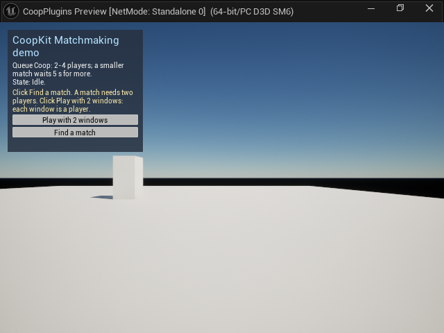

3. Click **Find a match** in both windows. The panel counts the seconds of the search.

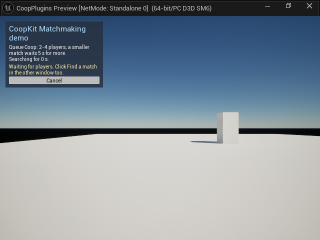

4. After the queue's 5 s wait, one window hosts the match and the other joins it. Both panels list *Player 1* and *Player 2*. Click **Leave the match** to queue again.

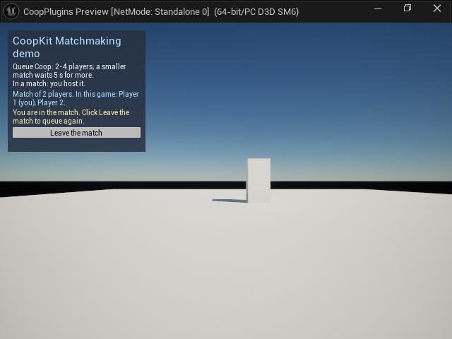

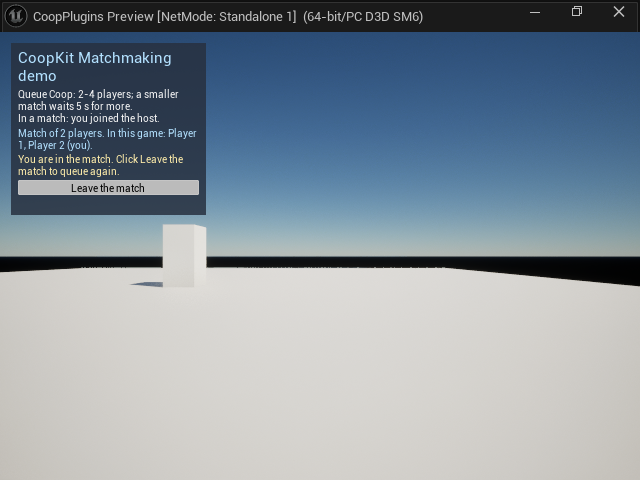
