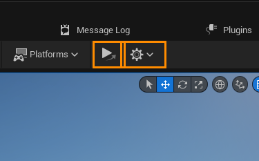
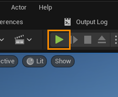
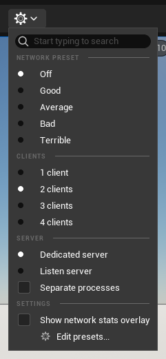
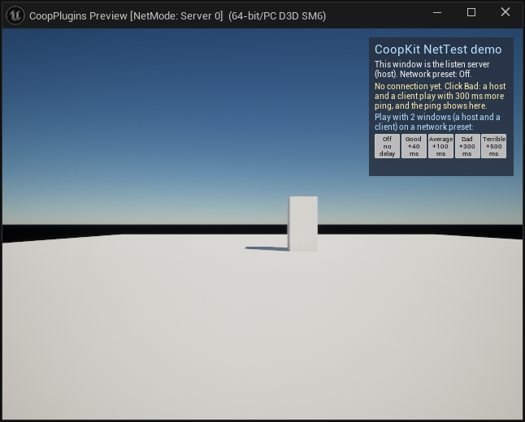
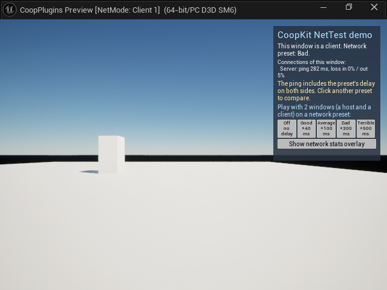

# CoopKitNetTest: editor tools

Step-by-step pictures of the editor tools of CoopKitNetTest. You do everything with the mouse. Your editor may look slightly different from the pictures.

The pictures are in `Docs/Images`.

## Play a network session from the toolbar

The plugin adds two buttons to the Play toolbar, next to **Play**:

- **Net Play** (left, a Play icon with an arrow) starts a session with the choices of the Net menu; its tooltip says what it starts.
- **Net** (right, a gear with a small arrow) opens the menu with the choices. When the toolbar shows labels, its label names the current preset, for example **Net: Off**.

## Choose the network, the clients and the server

Click the **Net** button. The menu has:

- **Network preset**: Off, Good, Average, Bad or Terrible network conditions (lag and packet loss).
- **Clients**: how many clients connect to the server.
- **Server**: a dedicated server or a listen server, and **Separate processes** (every client and the dedicated server in its own process instead of the editor process).
- **Settings**: **Show network stats overlay** draws ping, packet loss and traffic on each Play window; **Edit presets...** opens *Project Settings > Plugins > CoopKit NetTest*.

Click a choice: it is saved for the next sessions. Then click **Net Play**.

## Play the demo level with the mouse

1. Show the plugin's content (see above), double-click `/CoopKitNetTest/Maps/L_NetTestDemo`, then click **Play** in the toolbar.

2. The panel in the top right corner has one button per network preset. With one window there is no connection yet.

3. Click **Bad** (*+300 ms* under the name). Play restarts as a listen server and a client under the Bad preset. Your Play settings and the toolbar's choice stay as they were. Each panel names the preset and shows the ping of its connection, about 300 ms more than without the preset.

4. Click **Show network stats overlay** to see ping, packet loss and traffic on the left of every window.
