# CoopKitRevive: editor tools

Step-by-step pictures of the editor tools of CoopKitRevive. You do everything with the mouse; the only typing is a name for a new asset. Your editor may look slightly different from the pictures.

The pictures are in `Docs/Images`.

## Show the plugin's content

The plugin's own assets (examples, demo maps) live in the plugin folder. To see them in the Content Browser, click **Settings** in the Content Browser and turn on **Show Plugin Content**.

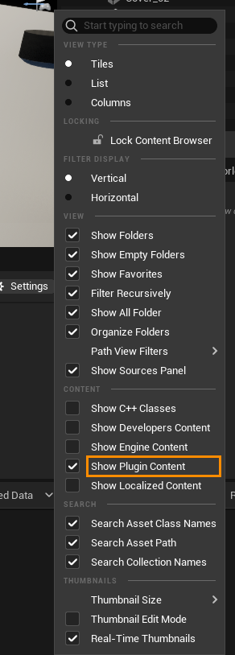

## Create revive rules

1. In the Content Browser, open the folder for the new asset.
2. Click **Add**, point to **CoopKit**, then click **Revive Rules**. **Revive Body Data** in the same menu creates body data alone.
3. Enter a name for the asset. The New Revive Rules wizard opens (see below).

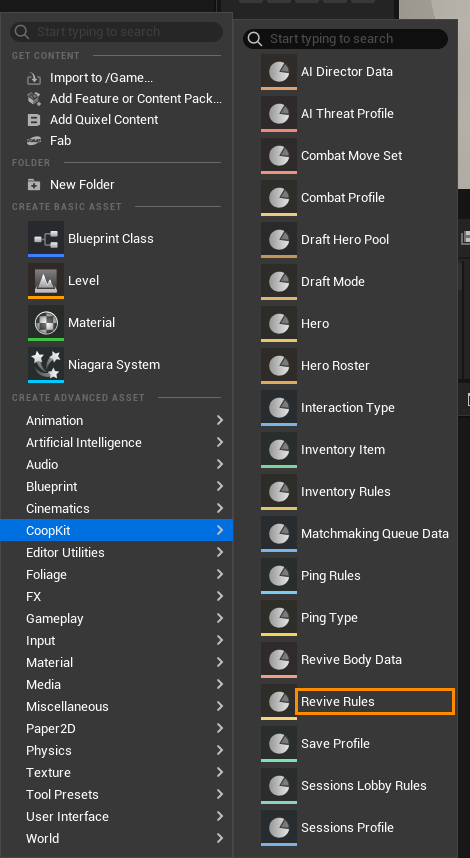

## Open the CoopKit Hub

The hub shows the entities of every CoopKit plugin in your project in one window. CoopKitRevive adds the category **Revive Rules**.

1. On the main menu, click **Tools**, then click **CoopKit Hub**.

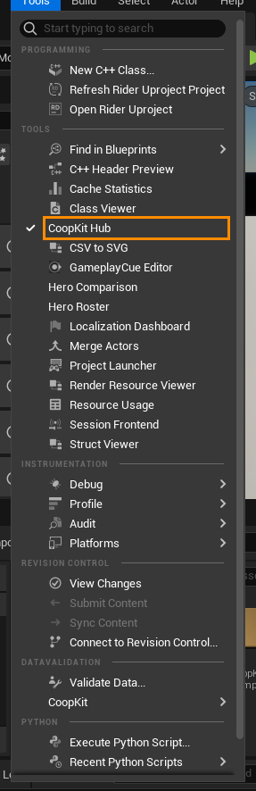

2. The hub opens on the categories. Each entity type has a button that shows the number of its entities and the name of the plugin that adds it.

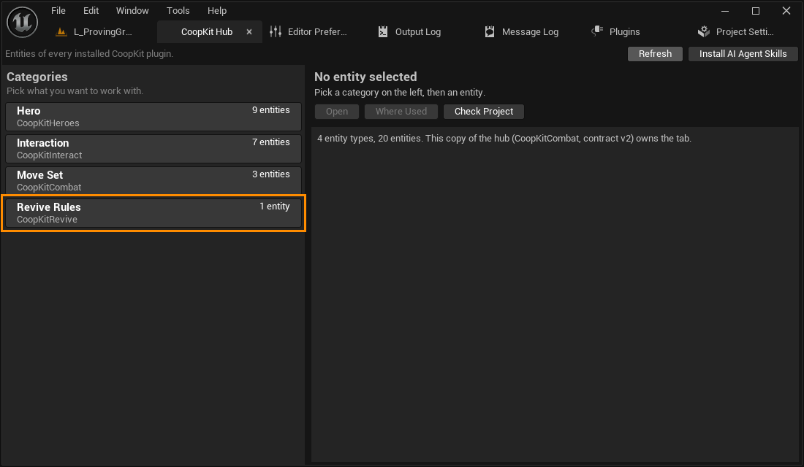

## Find revive rules

1. Click the category **Revive Rules**. The left side now lists only this category. It also has a search box, the name box and **New Revive Rules**. Click **< Back** to return to the categories.

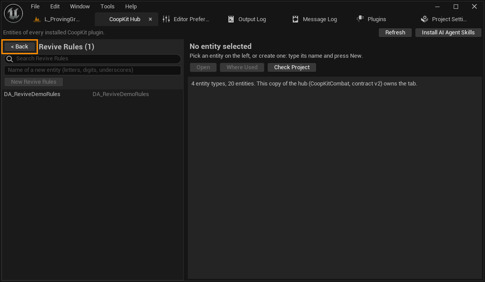

2. Click revive rules in the list. Revive rules have no separate display name, so the list shows the asset's name. The right side shows their name, type and asset path. **Open** opens their card in a separate window (a double click in the list does the same).

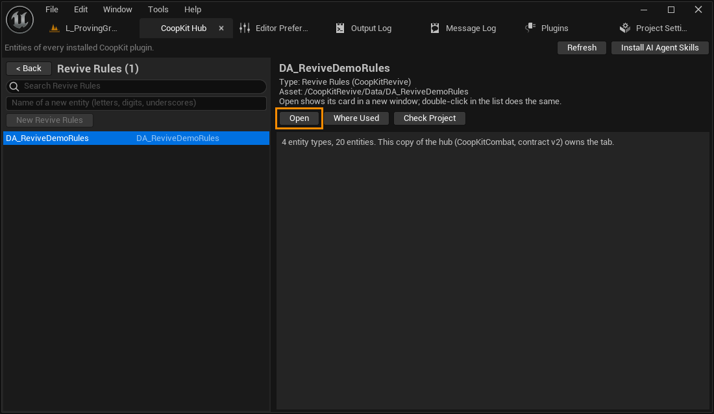

3. **Where Used** shows the assets that use the selected rules, for example the demo's game state.

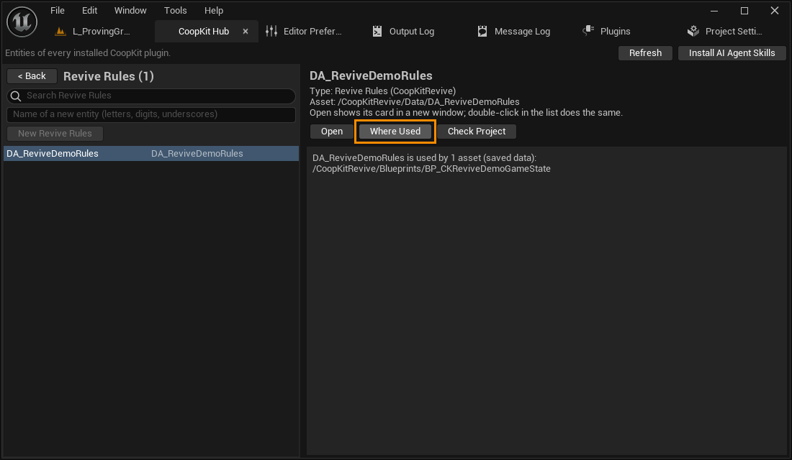

4. **Check Project** checks every entity of every type: data errors and duplicate ids. The result appears in the text box below the buttons.

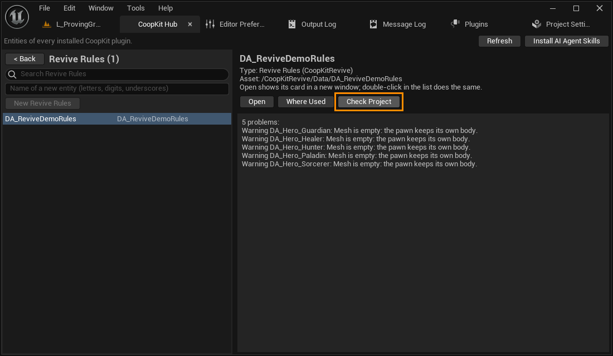

## Make new revive rules with the wizard

1. In the **Revive Rules** category, click the name box and enter a name (letters, digits, underscores). The button **New Revive Rules** turns on.

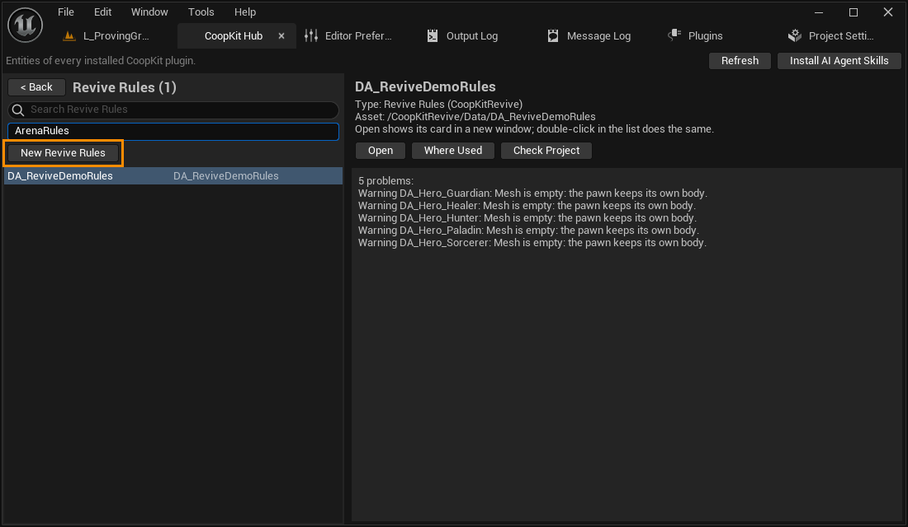

2. Click **New Revive Rules**. The wizard opens. Pick rules to start from, if you like. Leave **Create Body Data** on to get body data of the rules' own, and pick a **Body Data** whose values it copies. Click **Create**.

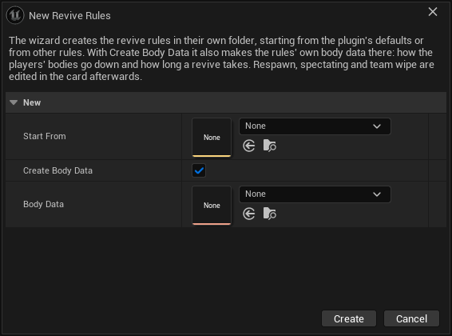

3. The new rules appear in the hub's list and are selected, and their card opens. The text box below the buttons says "Created" and shows the asset path. The new assets are not saved yet: click **Save All** to keep them.

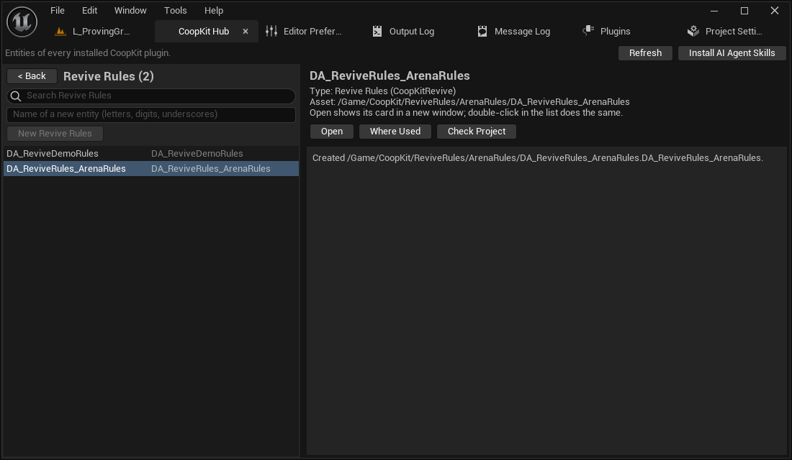

## The revive rules card

The card shows everything about one set of revive rules. Open it from the hub (**Open**) or double-click the asset in the Content Browser.

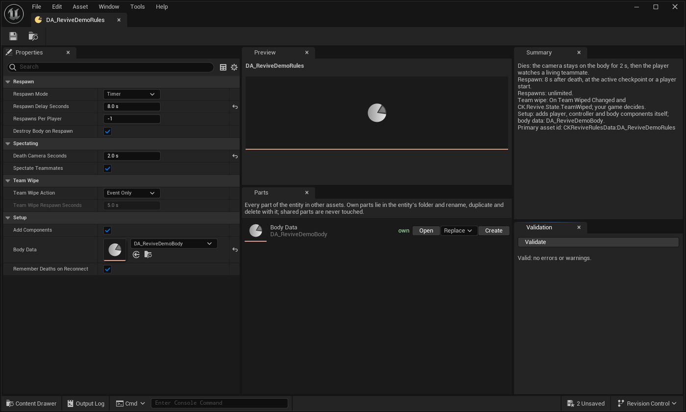

- **Properties**: the data of the rules.

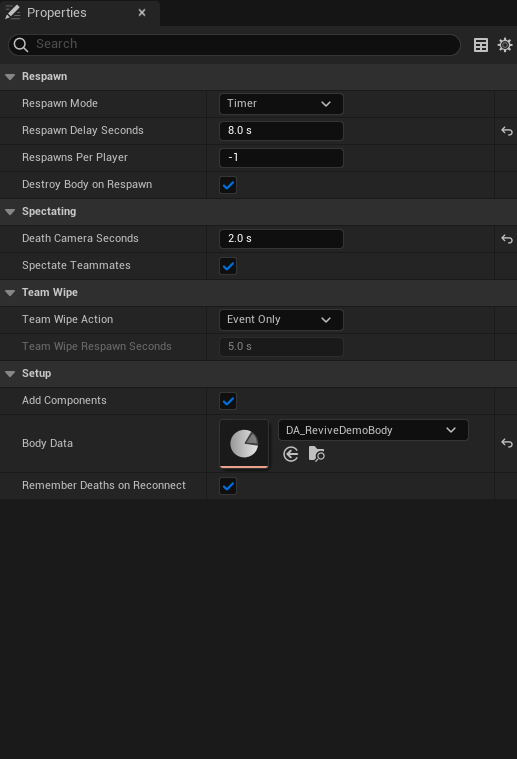

- **Preview**: the name of the rules and a picture of the body data they use.

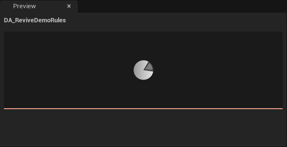

- **Parts**: the **Body Data** that the rules give to the bodies the match adds. An **own** part lies in the rules' folder and is used by nothing else. A **shared** part is used by other assets too and is never moved or deleted. **Open** opens the body data in its editor. **Create** makes new body data of the rules' own.

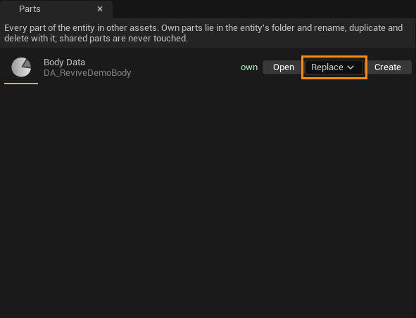

- To use other body data, click **Replace** and click the asset in the list.

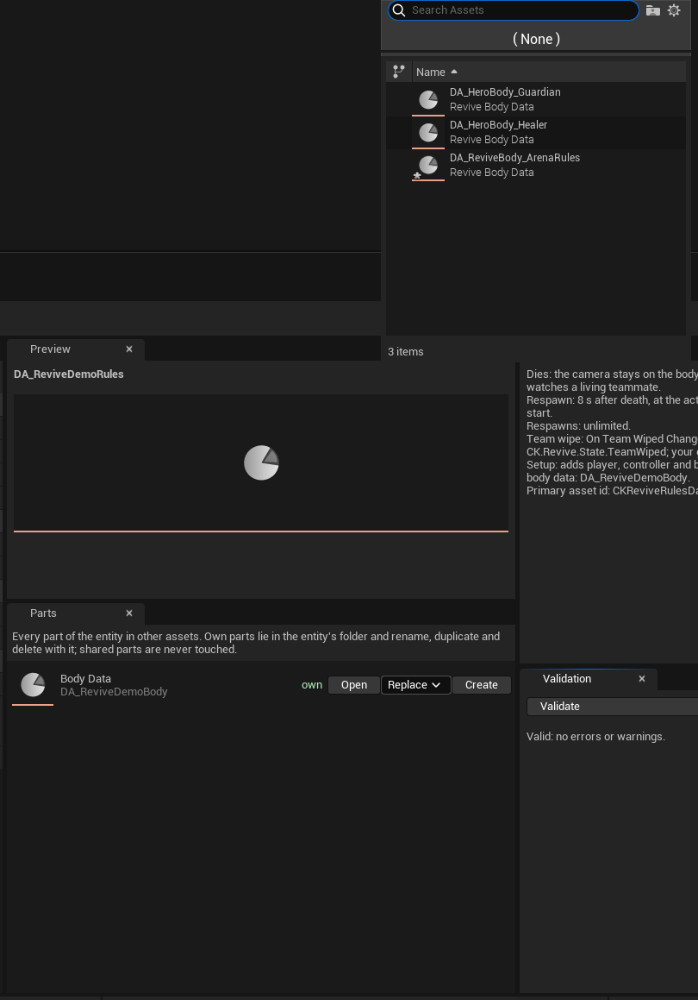

- **Summary**: what a dead player goes through with these rules.

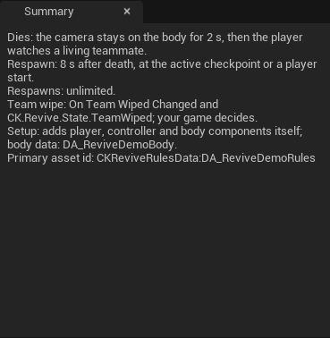

- **Validation**: problems of the data, refreshed on every change. **Validate** checks again.

When a value does not work, Validation shows the problem in red right away, for example **Respawns Per Player** set below -1.

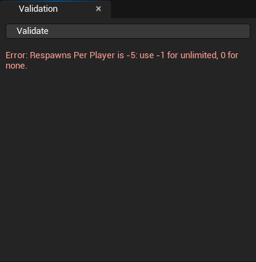

Body data opens in the same data editor, with Properties, Summary and Validation.

## Install the AI agent skills

The skills let an AI coding agent extend the plugin with you (see *AI agent skills* in the README).

1. On the main menu, click **Tools**, point to **CoopKit**, then click **Install AI Agent Skills**. The CoopKit Hub has the same button.

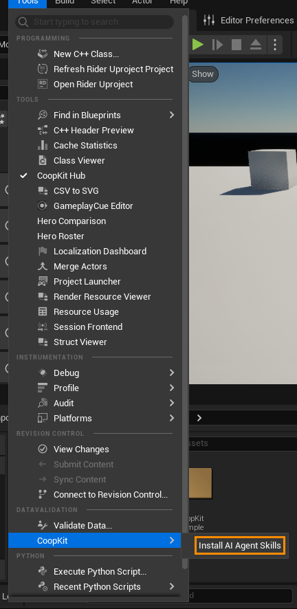

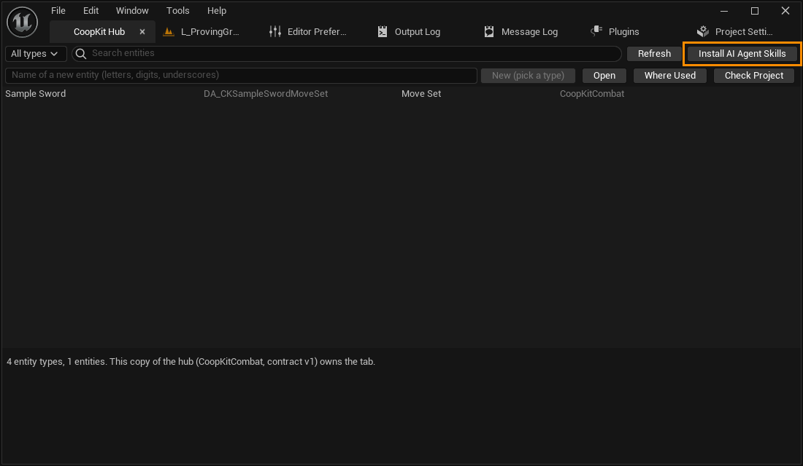

2. A message lists the skill folders that were copied into your project. Click **OK**. If some folders could not be copied, the message shows a warning icon and lists them.

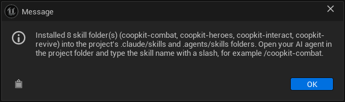

3. If the skills are already in the project, the plugin asks first. **Yes** replaces them and removes any change you made to their files; **No** keeps them.

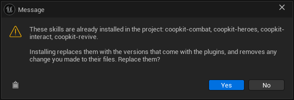

## Play the demo with the mouse

1. Show the plugin's content (see above), double-click `/CoopKitRevive/Maps/L_ReviveDemo`, then click **Play** in the toolbar.

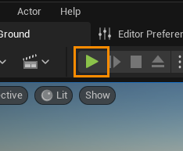

2. The panel in the top left corner lists the players, *Player 1 (you)* first, with the state of each body and the buttons for that player. A revive needs a teammate: click **Play with 2 windows**. Play restarts with two windows. Your Play settings stay as they were.

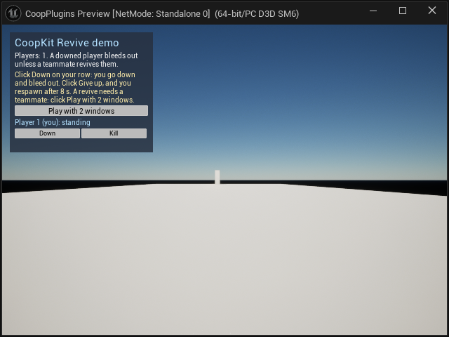

3. In window 1, click **Down** on the *Player 2* row. Player 2 goes down. Window 2 says *You are down*.

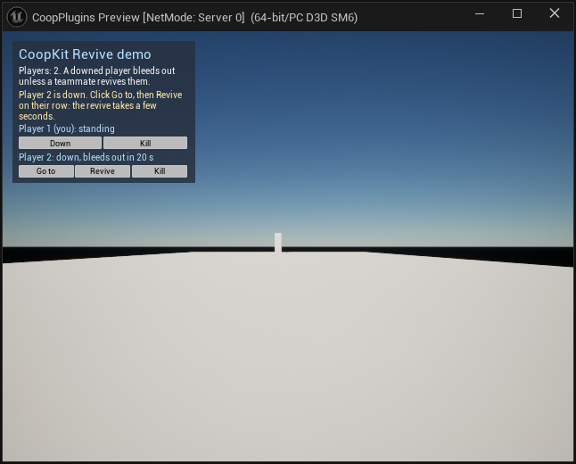

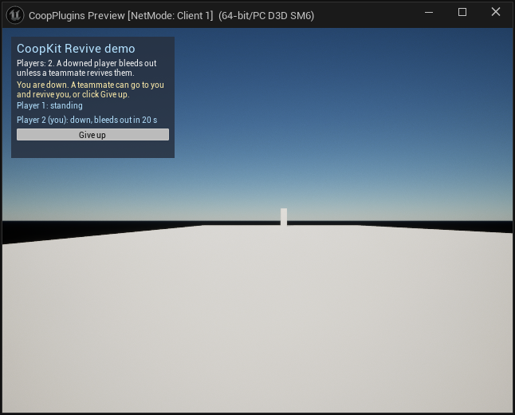

4. In window 1, click **Go to**, then **Revive** on the *Player 2* row. After 3 seconds Player 2 stands again.

5. In window 1, click **Kill** on the *Player 2* row. Player 2 respawns after 8 seconds, or at once when you click **Respawn**.

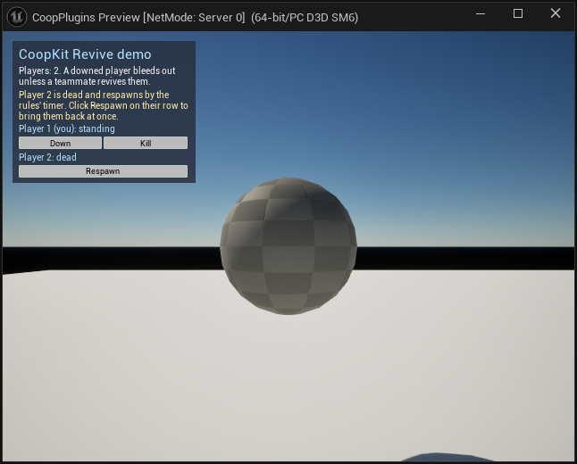
