# CoopKitSave: editor tools

Step-by-step pictures of the editor tools of CoopKitSave. You do everything with the mouse; the only typing is a name for a new asset. Your editor may look slightly different from the pictures.

The pictures are in `Docs/Images`.

## Show the plugin's content

The plugin's own assets (examples, demo maps) live in the plugin folder. To see them in the Content Browser, click **Settings** in the Content Browser and turn on **Show Plugin Content**.

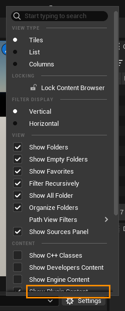

## Create a save profile

1. In the Content Browser, open the folder for the new asset.
2. Click **Add**, point to **CoopKit**, then click **Save Profile**.
3. Enter a name for the asset. The New Save Profile wizard opens (see below).

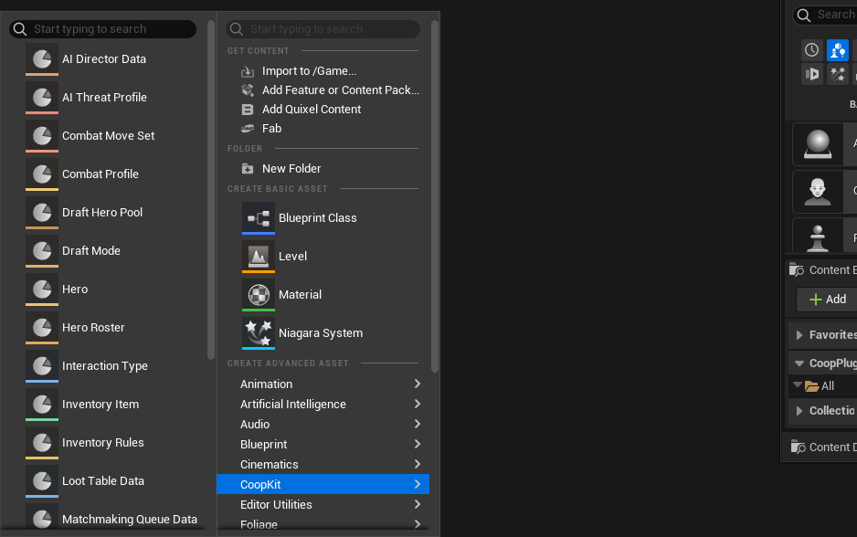

## Open the CoopKit Hub

The hub shows the entities of every CoopKit plugin in your project in one window. CoopKitSave adds the category **Save Profile**.

1. On the main menu, click **Tools**, then click **CoopKit Hub**.

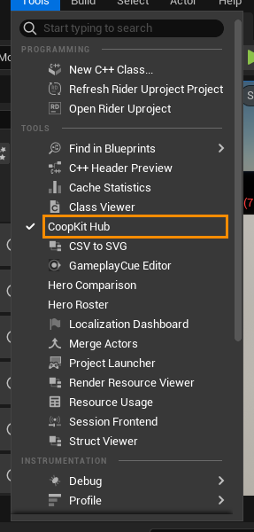

2. The hub opens on the categories. Each entity type has a button that shows the number of its entities and the name of the plugin that adds it.

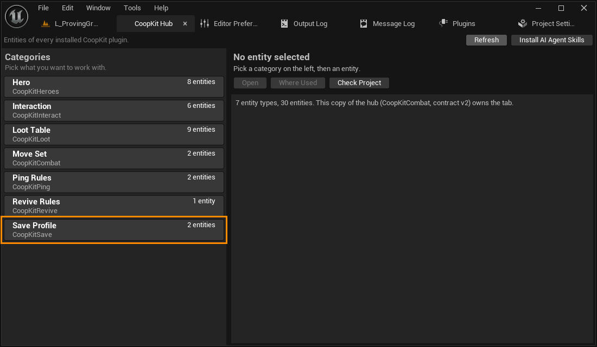

## Find a save profile

1. Click the category **Save Profile**. The left side now lists only this category. It also has a search box, the name box and **New Save Profile**. Click **< Back** to return to the categories.

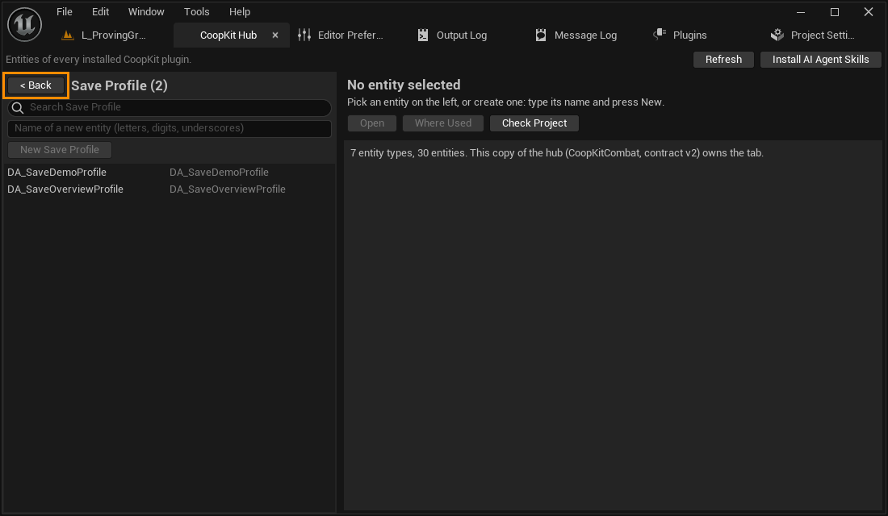

2. Click a save profile in the list. A save profile has no separate display name, so the list shows the asset's name. The right side shows its name, type and asset path. **Open** opens its card in a separate window (a double click in the list does the same).

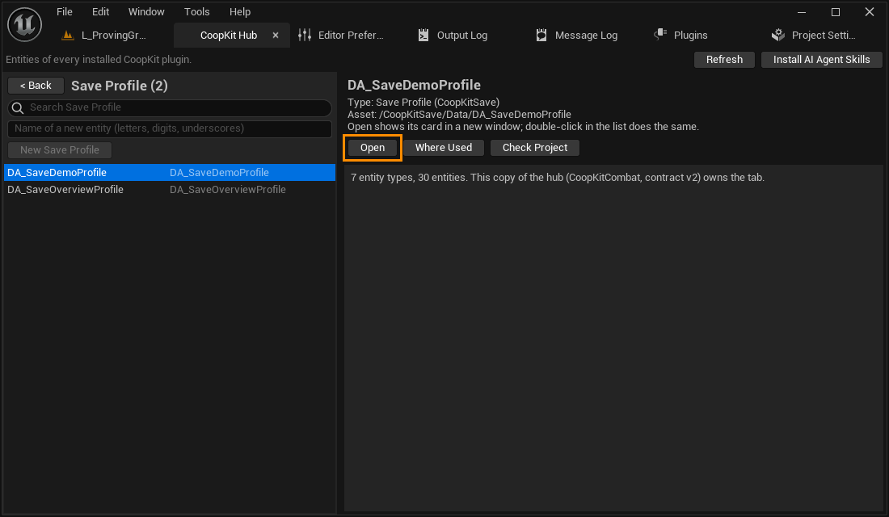

3. **Where Used** shows the assets that use the selected profile, for example the demo's game mode.

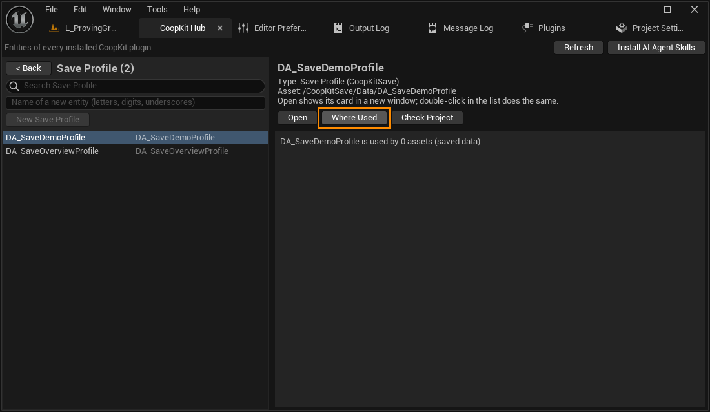

4. **Check Project** checks every entity of every type: data errors and duplicate ids. The result appears in the text box below the buttons.

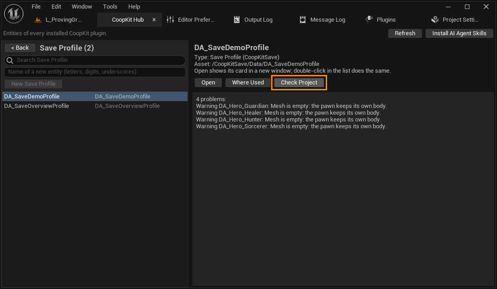

## Make a new save profile with the wizard

1. In the **Save Profile** category, click the name box and enter a name (letters, digits, underscores). The button **New Save Profile** turns on.

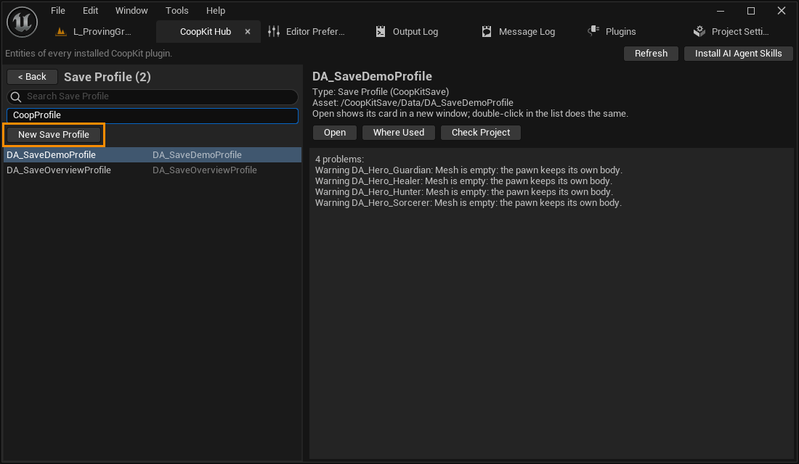

2. Click **New Save Profile**. The wizard opens. Pick a profile to start from, if you like, and type a **Slot Prefix** for your game's saves. Click **Create**.

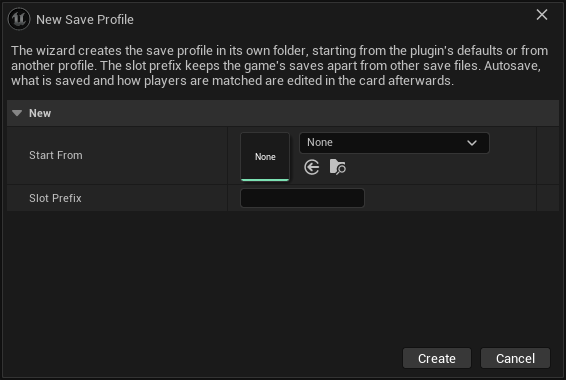

3. The new profile appears in the hub's list and is selected, and its card opens. The text box below the buttons says "Created" and shows the asset path. The new asset is not saved yet: click **Save All** to keep it.

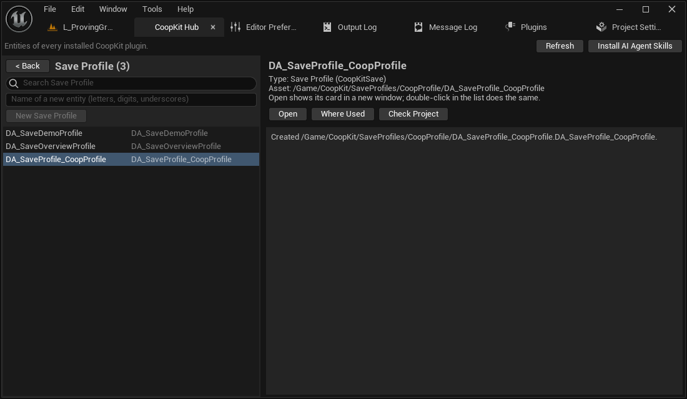

## The save profile card

The card shows everything about one save profile. Open it from the hub (**Open**) or double-click the asset in the Content Browser.

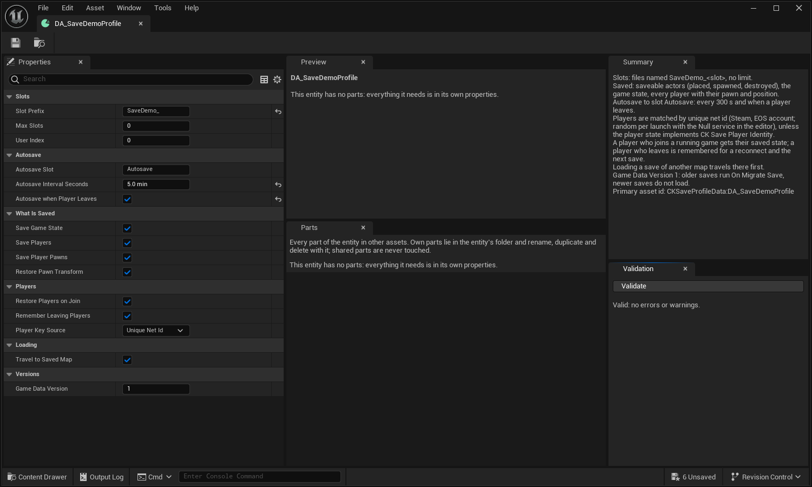

- **Properties**: the data of the profile.

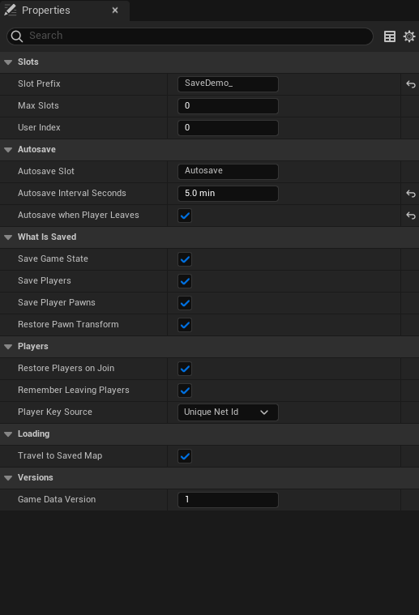

- **Preview**: the name of the profile. A save profile has no picture to show.

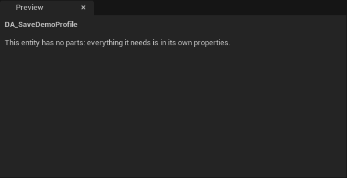

- **Parts**: the other assets the profile uses. A save profile uses none, so the list is empty.

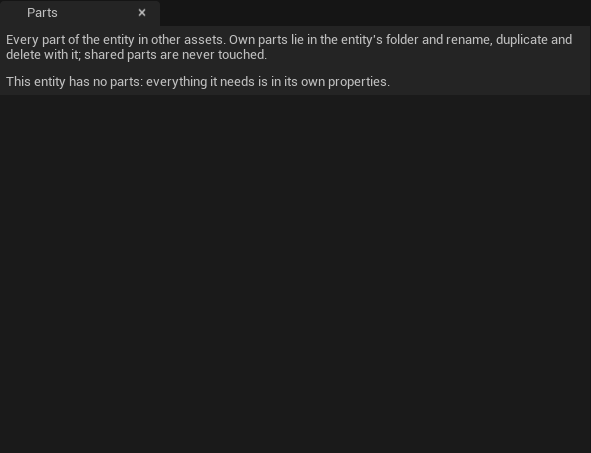

- **Summary**: what is saved, when, and how players are matched.

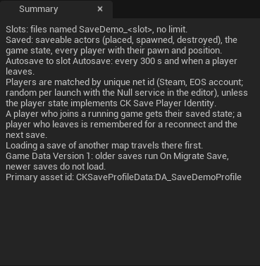

- **Validation**: problems of the data, refreshed on every change. **Validate** checks again.

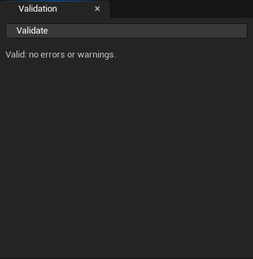

When a value does not work, Validation shows the problem in red right away, for example **Max Slots** set to -1.

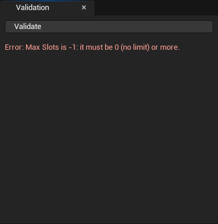

## Install the AI agent skills

The skills let an AI coding agent extend the plugin with you (see *AI agent skills* in the README).

1. On the main menu, click **Tools**, point to **CoopKit**, then click **Install AI Agent Skills**. The CoopKit Hub has the same button.

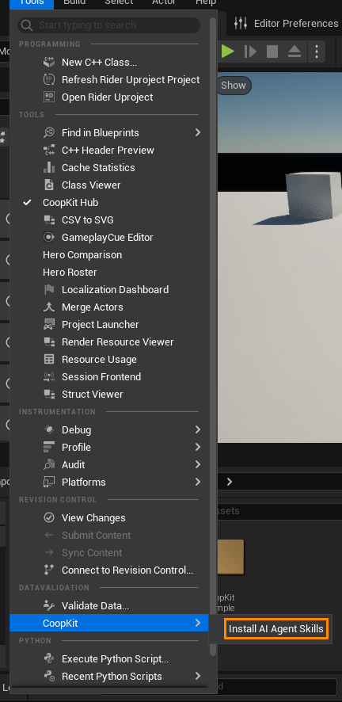

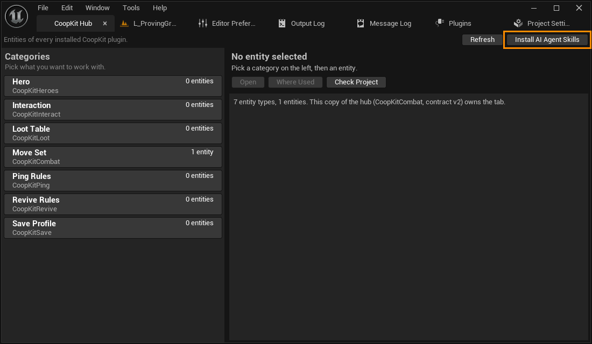

2. A message lists the skill folders that were copied into your project. Click **OK**. If some folders could not be copied, the message shows a warning icon and lists them.

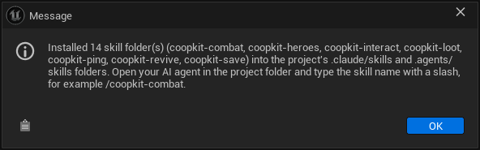

3. If the skills are already in the project, the plugin asks first. **Yes** replaces them and removes any change you made to their files; **No** keeps them.

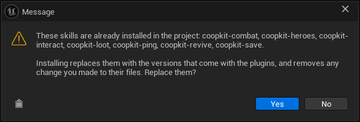

## Play the demo with the mouse

1. Show the plugin's content (see above), double-click `/CoopKitSave/Maps/L_SaveDemo`, then click **Play** in the toolbar.

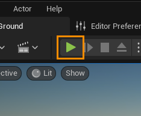

2. The panel in the top left corner of the window saves and loads the game. To see a second player come back too, click **Play with 2 windows**: Play restarts with two windows. Your Play settings stay as they were.

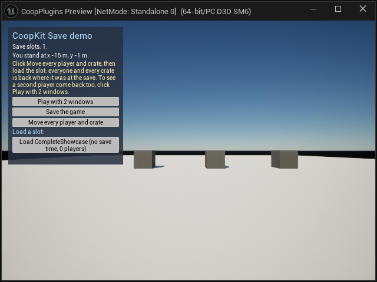

3. In window 1, click **Save the game**. A **Load Quick save** button appears.

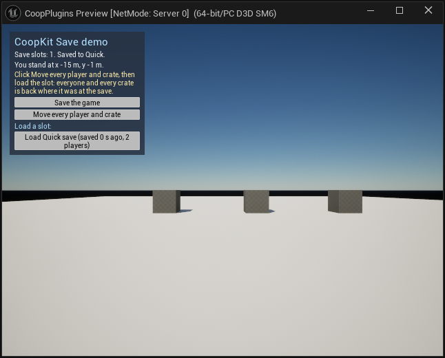

4. Click **Move every player and crate**. The players and the crates move to new spots.

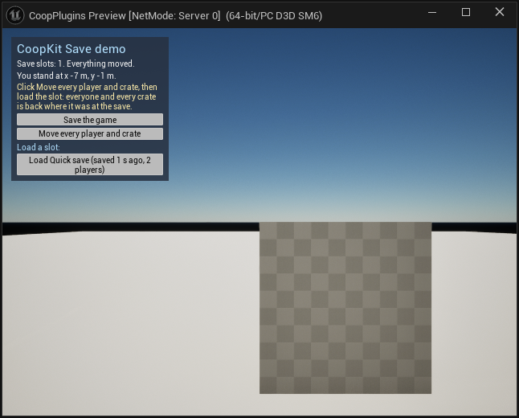

5. Click **Load Quick save**. Every player and every crate is back where it was at the save, in window 2 too. The line *You stand at* shows the saved position in each window.

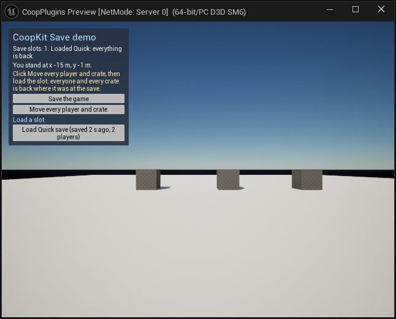

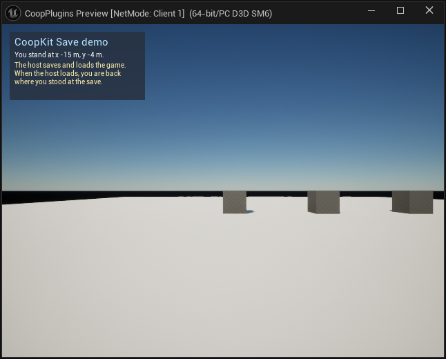
