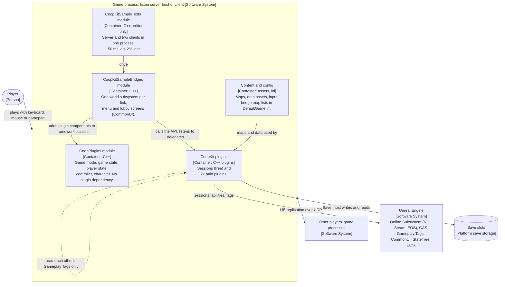
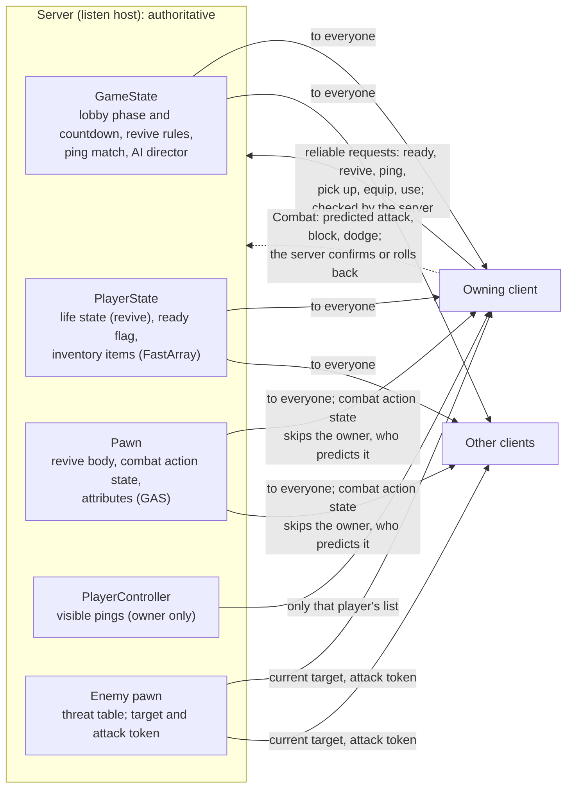

# CoopKit Sample

A co-op sandbox for Unreal Engine built from 22 CoopKit plugins: sessions, lobby, party and matchmaking, a hero draft, revive, host-side save and host migration, pings, enemy AI, inventory and loot, melee combat and support abilities, crafting, quests, carrying, parkour, doors and locks for several players, proximity voice, a roguelite run and network testing in the editor. It is also my portfolio as a multiplayer engineer.

## What I can do in your project

- **Multiplayer health check.** I run your project under 150 ms lag and 2% packet loss (the settings my own tests use), review authority, RPCs and replicated state, and write a report: what breaks in co-op and what a conversion would take, step by step.
- **Fix a replication or desync bug.** Fixed price per bug. Send a log or a video first, and I will tell you whether I can fix it before you pay.
- **Sessions and lobby.** Host, find and join, a lobby with ready checks, travel and reconnection on a listen server, built on the open-source CoopKit Sessions in this repository. Steam and EOS are configuration only; the automated tests run on LAN.
- **Co-op conversion, after the health check.** Milestone contract with a playable build at every milestone.
- **Engine upgrade and plugin port.** Move a project or C++ plugins to a newer UE 5.x, with a compatibility layer so one code base builds for several engine versions.

I do not take on MMOs and server meshing, anti-cheat, server orchestration or fleet hosting. Code written for you is yours. CoopKit plugins are licensed separately, under the Fab license.

**Supported:** Unreal Engine 5.6, 5.7 and 5.8 | listen server, and dedicated server (tested in the editor; the Server target is built and join-tested on UE 5.8 built from source, so compile it yourself on other versions) | every network test runs at 150 ms lag and 2% packet loss | Steam and EOS by configuration (not covered by automated tests) | C++, with Blueprint APIs.

**Hire me:** [Upwork](https://www.upwork.com/freelancers/~01cb01e68c8e69f34e) | [LinkedIn](https://www.linkedin.com/in/reasp/) | [the form on my website](http://reasp.pro/#contact)

## What this repository is

The complete sample project: framework code, the bridges that connect it to the plugins, automation tests, maps, data and config. The project file is still called `CoopPlugins.uproject`, after the framework module's name.

**It builds and runs only with the CoopKit plugins installed.** The free plugin, CoopKit Sessions, is already in `Plugins/`. The other 21 are paid plugins; some are still on their way to Fab (see the table). The bridges module links all of them, and the maps use their assets. Without them you can still read the code, the architecture and the plugin documentation in `Docs/`.

## The CoopKit plugins

Each plugin works on its own: none depends on another CoopKit plugin.

| Plugin | What it does | Price | Docs | Fab |
|---|---|---|---|---|
| CoopKit Sessions | Host, find and join; lobby with ready checks; join in progress; reconnection; kick and ban; Steam invites. Null, Steam or EOS by configuration. | Free, MIT | `Plugins/CoopKitSessions/Docs/README.md` | [Fab](https://www.fab.com/listings/9e96749d-d852-4495-a5ca-1c78574ea9d4) |
| CoopKit Matchmaking | Queue with one node, a match of 2-4 players, the same host picked on every machine. Local, Nakama, AWS FlexMatch and PlayFab providers. | Paid | `Docs/CoopKitMatchmaking/README.md` | [Fab](https://www.fab.com/listings/76b55f28-1422-4bbd-a797-59010748d2b9) |
| CoopKit Party | A group that stays together from the menu to the match and queues together. | Paid | `Docs/CoopKitParty/README.md` | Not on Fab yet |
| CoopKit Draft | Server-checked hero selection: draft modes with bans, blind picks, reserve time, swaps and ban votes. | Paid | `Docs/CoopKitDraft/README.md` | [Fab](https://www.fab.com/listings/76114e8e-f62d-4a97-91d0-ec8e43ac314f) |
| CoopKit Heroes | Heroes as data assets: look, skins, abilities and modules; a hero choice the server checks and applies. | Paid | `Docs/CoopKitHeroes/README.md` | [Fab](https://www.fab.com/listings/1e4e7e95-8ea1-4d9c-b102-8945e0321079) |
| CoopKit Host Migration | A new host takes over when the host leaves or crashes; the world and the players come back from a snapshot. | Paid | `Docs/CoopKitHostMigration/README.md` | Not on Fab yet |
| CoopKit Revive | Down, not dead; revive by a teammate; spectating, respawn, checkpoints, team wipe. | Paid | `Docs/CoopKitRevive/README.md` | [Fab](https://www.fab.com/listings/45fbf481-5b2e-4eb3-9ee3-74edb43b0de9) |
| CoopKit Save | Host-side save of the world and every player, also players who join later; slots and versions. | Paid | `Docs/CoopKitSave/README.md` | [Fab](https://www.fab.com/listings/98a32527-347b-497f-8fc5-3d8f0b7f1904) |
| CoopKit Ping | Ping what you look at; command wheel; HUD markers. With teams set up, pings reach only your team. | Paid | `Docs/CoopKitPing/README.md` | [Fab](https://www.fab.com/listings/339bb415-148a-435a-9cfe-b2b564ce8b44) |
| CoopKit AI | Threat table per enemy, attack tokens, difficulty by player count; StateTree and EQS. | Paid | `Docs/CoopKitAI/README.md` | [Fab](https://www.fab.com/listings/99cb09a7-adaa-48df-baaa-93bc959a5a40) |
| CoopKit Inventory | Bag and equipment in one replicated list; the server checks every request. | Paid | `Docs/CoopKitInventory/README.md` | [Fab](https://www.fab.com/listings/58abc058-f4b0-4a7b-9569-e2fb6f17e99b) |
| CoopKit Loot | Server-decided loot: personal, free for all, round robin and Need or Greed; loot tables as data assets. | Paid | `Docs/CoopKitLoot/README.md` | [Fab](https://www.fab.com/listings/f4635b80-454a-4245-87de-7516d0b26fd1) |
| CoopKit Combat | Melee on the Gameplay Ability System: combo, block, parry, dodge; client prediction, server-judged hits. | Paid | `Docs/CoopKitCombat/README.md` | [Fab](https://www.fab.com/listings/7b23bbe4-99a5-432b-ab2f-19ab116e2792) |
| CoopKit Support | Heals, shields, buffs and auras for allies on GAS, synergies between players, one team ultimate. | Paid | `Docs/CoopKitSupport/README.md` | Not on Fab yet |
| CoopKit Craft | Crafting stations and buildings checked by the server: one shared queue, items brought together, refunds on cancel. | Paid | `Docs/CoopKitCraft/README.md` | Not on Fab yet |
| CoopKit Objectives | Co-op quests: shared, every-player and any-player objectives, branches, time limits, start votes, rewards for contributors. | Paid | `Docs/CoopKitObjectives/README.md` | Not on Fab yet |
| CoopKit Carry | Pick up, carry and throw; carry a heavy chest together; tow a downed teammate. No lag in the hands. | Paid | `Docs/CoopKitCarry/README.md` | In review on Fab |
| CoopKit Traversal | Predicted vaults, mantles and climbs, plus two-player boosts, pull-ups and launches. | Paid | `Docs/CoopKitTraversal/README.md` | In review on Fab |
| CoopKit Voice | Proximity voice where the server decides who hears whom: walls, a team radio, rules by Gameplay Tags. | Paid | `Docs/CoopKitVoice/README.md` | In review on Fab |
| CoopKit Run | A co-op roguelite run: one seed builds the same rooms everywhere, hidden upgrade picks, door votes, meta progress. | Paid | `Docs/CoopKitRun/README.md` | In review on Fab |
| CoopKit Interact | Doors, levers and valves several players reach for at once: the server decides, one player at a time where it must be, hold progress on the server clock, doors that need two. | Paid | `Docs/CoopKitInteract/README.md` | [Fab](https://www.fab.com/listings/a00f1f98-7eeb-410f-9de2-b6b9782d5b8d) |
| CoopKit NetTest | Network presets for Play In Editor, one-click sessions with a listen or dedicated server, a stats overlay. | Paid | `Docs/CoopKitNetTest/README.md` | [Fab](https://www.fab.com/listings/3fdcbfe0-c1aa-443a-9049-4db4f811b9af) |

## Build and run

1. Install Unreal Engine 5.6, 5.7 or 5.8 and Visual Studio 2022 with the C++ game development workload.
2. Get the paid plugins on Fab and install them to your engine. Until every plugin of the table is on Fab, the project does not build with plugins from Fab alone.
3. Right-click `CoopPlugins.uproject` > *Generate Visual Studio project files*, then build the *Development Editor* configuration and open the project. The project is saved in an older engine version: when the editor offers to convert it, choose *Open a Copy*, so the original stays unchanged.
4. Play: *Play > Number of Players* 2, *Net Mode* *Play Standalone*, *Run Under One Process* on; open `L_MainMenu` and press Play. Click **Host** in one window and **Find sessions** in the other, then press **Ready** in both.
5. Or open `L_ProvingGround` and click **Net Play** in the toolbar (CoopKit NetTest): a listen server and one client start under 150 ms lag and 2% loss, the network of the sample's tests. In the **Net** menu next to it, **Show network stats overlay** shows the ping and the loss in each window.
6. Tests: *Tools > Session Frontend > Automation*, filter `CoopKit.Sample`, or the console command `Automation RunTests CoopKit.Sample`.

**Character art.** The sample does not include Epic's mannequins. Characters use the engine's tutorial mannequin, or a plain cylinder if it is missing. To get Manny, copy `Mannequins` from the Third Person template in your UE install (`Templates/TemplateResources/High/Characters/Content/Mannequins`) into `Content/Characters/Mannequins` of this project. Keep that path, then restart the editor. The folder is git-ignored. Check the Unreal Engine EULA before you share a project that contains it.

## Maps and bridges

| Map | What happens there |
|---|---|
| `L_MainMenu` | The game's default map: **Host** opens the lobby as a listen server, **Find sessions** lists games to join. |
| `L_Lobby` | Lobby with ready flags and a countdown, then seamless travel to the match. |
| `L_DraftLobby` | The same lobby with a hero draft of CoopKit Draft from the CoopKit Heroes assets. |
| `L_ProvingGround` | The match: revive, save (host: F5/F9), pings, inventory, loot, melee combat, heroes, support abilities, crafting, carrying, parkour and interactions. A sword, armor and potions lie in front of the spawn points. At the right edge stand five devices: a valve, a lock pick for one player at a time, a heavy door for two players, a chest, and a hatch that opens only with the chest's key. Press V in front of one; hold it for the valve, the lock pick, the door and the hatch. |
| `L_AIArena` | Three enemies of CoopKit AI on a navigation mesh, with combat, revive and pings. |
| `L_Complete` | Six plugins in one match, played by two bots in a loop. A ping draws the enemies, the bots fight with a sword combo, one goes down and is revived, then the host saves. |

The framework module `CoopPlugins` (game mode, game state, player state, player controller, character) depends on no plugin. A style check in the tooling keeps it that way. All plugin code goes through the module `CoopKitSampleBridges`: one world subsystem per link, enabled per map in `Config/DefaultGame.ini`.

| Bridge | Links |
|---|---|
| Revive, Save, Ping, AI, Inventory, Combat, Heroes, Carry, Interact, Sessions UI, Party menu | the sample and one plugin each |
| Matchmaking -> Sessions; Party -> Sessions; Party <-> Matchmaking | a match or a party lands in one session |
| Draft <-> Sessions lobby; Heroes <-> Draft | the lobby runs the draft; the draft picks from the hero assets |
| Heroes -> Combat, Inventory, Revive | hero modules give abilities, starting items and revive settings |
| Host Migration -> Save, Sessions; plugin state -> Save | a new host restores the world, the players and the plugins' state |
| Ping -> AI | a ping makes nearby enemies angry with the player who pinged |
| Combat -> Revive | health 0 downs the player; reviving restores health |
| Combat -> AI | an enemy turns on the player who hits it |
| Loot -> Inventory; Craft <-> Inventory, Save | loot and crafted items go to the bag; stations are saved |
| Objectives <-> Save; Objectives -> Ping | the quest log is saved; a new step pings its target |
| Run <-> Save; Revive -> Run | the run is saved; a team wipe ends the run |
| Carry <-> Revive; Traversal <- Revive | a downed player can be towed; downed players do not climb |
| Interact <-> Inventory; Interact <- Revive | a chest gives the key that opens a hatch; downed players cannot interact |
| Support -> Combat, Revive | support abilities heal and shield Combat attributes; downed players are refused |
| Voice <- Revive, Inventory | downed players whisper, the dead talk to the dead, a radio item opens the team channel |
| Inventory -> Combat | content only: the sample sword grants a combat attack |

Keys, configuration and the matching Blueprint nodes for each bridge: `Source/CoopKitSampleBridges/README.md`.

## Architecture

Container view (C4) of one game process: a listen server host or a client.

### What replicates and who is authoritative

The server owns every gameplay decision. Clients send requests and, in Combat and Traversal, predict their own actions.

The table covers seven plugins; the README of every other plugin in `Docs/` describes its own replication.

| Plugin | Where its state lives | What replicates | Who decides |
|---|---|---|---|
| Sessions | Game instance subsystem; lobby component on the game state; ready flag on the player state | Lobby phase, countdown end time and ready flags, to everyone | The server counts down and travels; *Ready* is a reliable request to the server |
| Revive | Body on the pawn, life on the player state, rules on the game state | Body and player status, to everyone | The client asks to revive, give up or spectate; the server checks and decides |
| Save | Game instance and world subsystems | Nothing of its own: restored state comes through normal replication | Only the server saves and loads |
| Ping | Match component on the game state; visible pings on each player controller | Each player's own ping list (owner only): the server decides who sees which ping | The client aims; the server checks type, distance, block tags and the rate limit |
| AI | Director on the game state (server only); threat on the enemy pawn | Each enemy's current target and attack token, to everyone | Server only |
| Inventory | Player state | Items as a FastArray (only changed entries travel), to everyone | The server checks every request and answers with a reason code; no client prediction |
| Combat | Pawn; Ability System Component on the pawn or the player state | Action state to everyone but the owner; attributes; hit cues as one unreliable multicast | The owner predicts attack, block, dodge and their costs; the server checks every combo step and every reported hit; damage only on the server; no position rewind |

## Engineering decisions

- **Independent plugins, glue in the project.** Fab does not allow a plugin to depend on another seller plugin. So every plugin depends only on engine plugins and talks to the others through Gameplay Tags, interfaces and GAS; the glue lives here as bridges. Example: CoopKit AI stops targeting downed players by reading CoopKit Revive's tags by name, with no link between the two.
- **A framework that knows no plugin.** Removing a plugin removes its bridges and nothing else. A style check enforces it.
- **One code base for every listed engine version.** Development and every asset stay on one older engine version, because an asset saved in a newer editor does not open in an older one. Engine API differences live in one compatibility header per plugin. Every plugin is built for each listed version.
- **Sessions on Online Subsystem v1.** Its API is the same in every listed engine version and supports Steam directly. Online Services v2 changes between versions and reaches Steam only through an adapter. The service is chosen in config, with Null (LAN) by default.
- **State where its lifetime is.** The revive body is on the pawn, a player's life on the player state, match rules on the game state. Inventory stays on the player state, so it survives death, respawn and reconnect.
- **Combat predicted, hits judged by the server.** Attacks, blocks and dodges start at once on the owning client, with rollback when the server refuses. The attacker reports the hits it saw; the server checks reach, arc, timing and target state. There is no position rewind, so the tolerances suit co-op against AI, not competitive player-versus-player.
- **Dedicated server.** Behavior is tested in the editor: a server world and two clients in one process. The project also has a Server target, `CoopPluginsServer`. Launcher engines cannot build it, so it needs Unreal Engine built from source. It is built on UE 5.8 from source, and two packaged game clients join the packaged server in a smoke test. On UE 5.6 and 5.7 it is not compiled.
- **Tests under bad network conditions.** Every network test runs a server and two clients with 150 ms lag and 2% packet loss on every connection, for both listen and dedicated servers where both apply.

## Tests

`Source/CoopKitSampleTests`, all named `CoopKit.Sample.*`, at least one per bridge:

- Lobby, Ping, Revive, Replication, Draft: `DedicatedServer` and `ListenServer`
- Menu, Save, Inventory, Loot, AI, Combat, Heroes, Craft, Objectives, Support, Carry, Traversal, Voice, Run, Complete: `ListenServer`; also `Combat.AIArena` and `Menu.ListenServerUmg`
- Host Migration: `Graceful`, `Crash`, `TwoHosts`, `PluginState`, `Buttons`
- Party and Matchmaking: `Party.Sessions`, `Party.SessionsUmg`, `Party.Matchmaking`, `Party.MatchmakingPlayFab`, `Matchmaking.SessionBridge`, `Matchmaking.Nakama`
- Content checks: `Content.Input`, `Heroes.Data`, `Map.ProvingGroundLoads`

## License

This repository (sample code, bridges, content and CoopKit Sessions) is under the MIT License, see `LICENSE`. The paid CoopKit plugins are not part of it: they are licensed on Fab.
